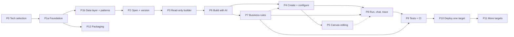

# Open Agent Kernel Studio (OAK Studio), Phase 1

OAK Studio is a desktop app (Electron) that builds, tests and deploys an Open Agent Kernel (OAK) project from
one folder on the user's computer, with a visual canvas and a coding agent on top of the real project files.
This folder holds its whole Phase 1 plan: what to build and why, how and when it is built, and the design
briefs for each screen. The Agent Kernel team and the implementation work from this one folder.

**Tracked in:** [issue #950](https://github.com/yaalalabs/agent-kernel/issues/950). The
[PRD](PHASE-1-PRD.md), revised 25 November 2026, is the source of scope and supersedes the issue where they
differ.

## Document map

Read in this order.

1. [PHASE-1-PRD.md](PHASE-1-PRD.md): what Phase 1 delivers and why. The source of scope.
2. [PHASE-1-PLAN.md](PHASE-1-PLAN.md): the product plan: journey, files written, principles, toolchain,
   screens, risks, and the PRD milestones mapped to the implementation phases.
3. [implementation/](implementation/): how and when it is built: phases P0 to P12, the architecture, the
   ground rules and Studio skills, the design gate. Its files are listed below.
4. Briefs [00](00-project-brief.md) to [09](09-app-settings.md): the design input for each screen. See
   [Design briefs and canvas](#design-briefs-and-canvas).
5. [later-phases/](later-phases/README.md): the team's parked briefs for screens after Phase 1. Not planned.
6. [research/](research/): competitive research ([reports/](research/reports/),
   [research_notes/](research/research_notes/)) and the technology research and spikes behind P0
   ([technology/](research/technology/)).

**Implementation files**

| File | Holds |
|---|---|
| [README.md](README.md) | This entry point and the tracker |
| [implementation/design-process.md](implementation/design-process.md) | The design gate every screen passes |
| [implementation/architecture.md](implementation/architecture.md) | The data and feature layer |
| [implementation/conventions-and-skills.md](implementation/conventions-and-skills.md) | Ground rules, UX patterns, development techniques, Studio skills |
| [implementation/P0-technology-selection.md](implementation/P0-technology-selection.md) | Stack decisions and spikes |
| [implementation/P0-plan.md](implementation/P0-plan.md) | Task-by-task execution plan for the P0 spikes |
| [implementation/P1a-plan.md](implementation/P1a-plan.md) | Task-by-task execution plan for P1a, with its pre-flight rulings |
| [research/technology/p1a-design-gate-options.md](research/technology/p1a-design-gate-options.md) | P1a design gate: palette, fonts, density and theme options, with measured contrast |
| [research/technology/p1b-design-gate-options.md](research/technology/p1b-design-gate-options.md) | P1b design gate: options and recommendations for the eight shared patterns and the command palette |
| [research/technology/p2-design-gate-options.md](research/technology/p2-design-gate-options.md) | P2 design gate: Welcome, the status bar and Commands panel, and the version states, with the artboard review |
| [implementation/P1a-app-foundation.md](implementation/P1a-app-foundation.md) | Workspace, Electron shell, bridge transport, design system |
| [implementation/P1b-data-layer-and-patterns.md](implementation/P1b-data-layer-and-patterns.md) | Contract shapes, jobs and sessions, shared patterns, generators, enforcement, first skills |
| [implementation/P2-project-and-kernel-version.md](implementation/P2-project-and-kernel-version.md) | Welcome, toolchain, command runner, versions and the capability catalog |
| [implementation/P3-read-only-builder.md](implementation/P3-read-only-builder.md) | Introspection, read-only Canvas, Code and Config |
| [implementation/P4-P12.md](implementation/P4-P12.md) | Outlines of P4 to P12 in the PRD order (P6 and P7 first), and what comes after Release 1 |
| [research/technology/tech-stack-evaluation.md](research/technology/tech-stack-evaluation.md) | Evidence for P0; the spike notes S1 to S5 sit beside it |

This plan uses its own layout instead of the repository's `design.md`, `spec.md`, `plan.md` set, because it
plans a multi-phase product, not one change to `ak-py`. Work that changes `ak-py` (for example
`ak rules check` in P7) follows the repository's normal spec process.

## Status

### Phases and names

The team's view: the product is built in phases. **Only Phase 1 is planned and briefed here.**

| Phase | Theme | State |
|-------|-------|-------|
| **1** | A local desktop app: build, test and deploy an OAK project from one folder on one computer | Planned in [PHASE-1-PLAN.md](PHASE-1-PLAN.md); briefs 00 to 09 |
| Later | Deep configuration pages; operating a deployed system; a hosted Studio (cloud SaaS) with teams and sign-in; coding agents other than Claude Code | Not planned. Earlier briefs are parked in [later-phases/](later-phases/). Phase 1 is shaped for them: see "Built for the next phases" in [PHASE-1-PLAN.md](PHASE-1-PLAN.md). |

Phase 1 in one paragraph: an Electron app opens a working directory, generates the project files in it (the
agents, the Python project and the Terraform files), runs and tests the project locally, and deploys from the
same computer with Terraform. Sign-in, dashboards and everything after deployment are deferred.

**Naming the work.** The PRD calls the whole local app "Phase 1" and splits it into six milestones. This plan
calls that **Release 1** and splits it into implementation phases **P0 to P12**, each covering one business
aspect.

**Name.** "OAK Studio" is a working name, from the PRD and the brand's
[name rule](../../../branding/README.md#name): the full name on first mention, "OAK" after that. Identifiers
keep their form: `ak-studio/`, `.akstudio/`, the `agentkernel` package, the `ak` CLI. The final name and app
identifier are [open decision 3](#open-decisions), settled by P12.

### Progress

Status values: Not started, Design, In progress, In review, Done. Rows are in build order, which follows the
PRD's milestones.

| Phase | Business aspect | PRD milestone | Status | Design signed off | Doc |
|---|---|---|---|---|---|
| P0 | Technology selection | Before 1 | In review (spikes ran on Linux; record drafted; Windows and macOS deferred by the owner; spike S5 added; no turn has run on a subscription yet) | n/a | [P0](implementation/P0-technology-selection.md) |
| P1a | App foundation: workspace, shell, bridge, design system | Before 1 | Started 24 Nov 2026: Tasks 1–10 done on Linux; shell layout and component set await sign-off. The 25 Nov branding changes are decided and built (`c3085c7c`) | Palette, fonts, density, theme only | [P1a](implementation/P1a-app-foundation.md), [plan](implementation/P1a-plan.md) |
| P1b | Data and feature layer, shared patterns, Studio skills | Before 1 | Started 26 Nov 2026: approval gate passed; plan written | Patterns: yes (26 Nov 2026) | [P1b](implementation/P1b-data-layer-and-patterns.md) |
| P2 | Open a project and know its OAK version | 1 | Not started | No | [P2](implementation/P2-project-and-kernel-version.md) |
| P3 | See the project: read-only Canvas, Code, Config | 1 | Not started | No | [P3](implementation/P3-read-only-builder.md) |
| P6 | Build with AI | 2 | Not started | No | [outline](implementation/P4-P12.md#p6--build-with-ai) |
| P7 | Business rules and `ak rules check` | 2 | Not started | No | [outline](implementation/P4-P12.md#p7--business-rules) |
| P4 | Create and configure a project | 3 | Not started | No | [outline](implementation/P4-P12.md#p4--create-and-configure-a-project) |
| P5 | Build on the canvas | 3 | Not started | No | [outline](implementation/P4-P12.md#p5--build-on-the-canvas) |
| P8 | Run, chat and trace | 4 | Not started | No | [outline](implementation/P4-P12.md#p8--run-chat-and-trace) |
| P9 | Tests, scenarios and CI | 4 | Not started | No | [outline](implementation/P4-P12.md#p9--tests-scenarios-and-ci) |
| P10 | Deploy to one target | 5 | Not started | No | [outline](implementation/P4-P12.md#p10--deploy-to-one-target) |
| P11 | The remaining targets | 6 | Not started | n/a | [outline](implementation/P4-P12.md#p11--the-remaining-targets) |
| P12 | Packaging and release | None (installers are a PRD deliverable) | Not started | No | [outline](implementation/P4-P12.md#p12--packaging-and-release) |

**Next action:** the owner signs off the P1a shell layout and base component set. The 25 Nov branding changes
have landed in `ak-studio/` (rectangular controls at the 8 px radius, Archivo on primary call-to-action
labels, the logo mark, Tabler outline icons; last commit `c3085c7c`). Owner review of the [P0 decision record](implementation/P0-technology-selection.md#decision-record)
is still open. The owner answers the [open decisions](#open-decisions) marked for 25 Nov. Anthropic's
confirmation of the coding-agent design is needed before P6. Windows and macOS are deferred until the
re-entry point under [Order and dependencies](#order-and-dependencies).

P0 to P3 (including P1a and P1b) are detailed and can be picked up as written. P4 to P12 are outlines; each is
detailed when the phase before it is close to done. After P3 comes P6, not P4.

### Design status

From the team's brief pack, 25 November 2026: the Phase 1 screens are designed on a Claude Design canvas
(https://claude.ai/artifact/VSewdGFtfYAQe4zGFVt3po). The briefs, the design system and the canvas were all
moved to the Open Agent Kernel identity on 25 November 2026 and are in step. The re-skinned canvas has not
been looked at yet: see "Not verified" under [Design canvas](#design-canvas). Nothing is built as an app yet.

> **Note.** "Nothing is built as an app yet" is out of date: the P1a app shell is built in `ak-studio/` (see
> [Progress](#progress)). The canvas is input to the [design gate](implementation/design-process.md), not the
> build contract ([decision log](#decision-log), 25 Nov 2026).

**Our working design: the Claude Design "OAK Studio Phases"** (<https://claude.ai/artifact/HxwXUwENoUhpnjKdQb1k8j>). It is a copy of the team's
canvas at its version of 25 November 2026 (`1795602368-842b`, design system version `1795602250-3750`): the same
50 artboards on the same four pages, with the same file names, notes and design-system files. Each phase's
design gate starts from it and draws its options and changes there, so the design improves phase by phase.
Each phase doc names its artboards in a **Claude Design** row of its header table. The copy is private to its
owner until it is shared from its Share menu. How it relates to the team's canvas, the PRD deliverable, is
[open decision 11](#open-decisions).

### How a phase runs

1. **Detail it.** If the phase is still an outline, write its doc in the layout of P2 and P3.
2. **Design gate.** Every screen in the phase is finalised through [design-process.md](implementation/design-process.md)
   before its UI is built. The briefs and design canvas are input: use them as a starting sketch, and
   do not reopen the requirements in the PRD. A signed-off story supersedes its artboard.
3. **Build.** Work through the phase's work packages. Tick them in the phase doc.
4. **Verify.** Run the phase's verification list on all three operating systems (Windows and macOS deferred by
   the owner; Linux only until the re-entry point under [Order and dependencies](#order-and-dependencies)).
5. **Close.** Set the status here to Done, add decisions to the log below, and detail the next phase.

### Standing principles

The principles every phase keeps are in [PHASE-1-PLAN.md](PHASE-1-PLAN.md#principles): the PRD's five
requirements that apply everywhere (section 4) and the team's "Nothing depends on the app", with the
implementation's additions marked there.

### Order and dependencies

A solid arrow means "needs"; a dotted arrow means "comes after, in the PRD order" only.

- **The PRD order** (decided 25 Nov 2026): open and read (P2, P3); coding agent and business rules (P6, P7);
  create and edit (P4, P5); run and test (P8, P9); deploy to one target (P10); the remaining four targets
  (P11). It replaces the issue's order, which put create and edit first. P6 needs only P3, so no built work
  changes.
- **What the order costs.** P6 installs the OAK skills itself and owns the "Coding agents" section of
  Settings. P7 runs the test file itself (`uv run pytest`) for its "Untested" state and generated tests,
  before P9 exists. P4's "Describe it with AI" entries work from the start. P10 takes P7's rule check and P9's
  test results as prerequisites. Detail: [P4-P12.md](implementation/P4-P12.md#order).
- **Windows and macOS.** Still deferred by the owner. Re-entry point: the three-system CI (`studio.yml`,
  written in P1a) runs green before the first build leaves the team, and before P6 starts at the latest. P6 is
  the first phase that depends on per-platform process trees and on finding the user's `claude`.
- After P3 the Studio already shows any OAK project visually. That is the first point worth showing to
  people.

### Cross-cutting: architecture and ground rules

| Document | Fixes | Built in |
|---|---|---|
| [architecture.md](implementation/architecture.md) | The data and feature layer: layers, who owns each kind of data, the contract's four shapes (query, command, job, session), safe file writes, jobs, errors, capability gating, feature folders and manifests, what the Studio writes into a project, and the kernel commands it should use instead of hacks | P1, followed by every phase |
| [conventions-and-skills.md](implementation/conventions-and-skills.md) | Ground rules for UI semantics, the UX pattern catalogue, development techniques, and the `ak-studio-*` skills that teach all of it to coding agents | P1, extended by every phase |

Both were approved on 26 November 2026, at the start of [P1b](implementation/P1b-data-layer-and-patterns.md). Both were revised
after a review on 23 November 2026 (sessions, safe writes, domain-event invalidation, working copies, secret
handling, fewer skills written later, skills scoped to `ak-studio/`).

### Cross-cutting: OAK versions

Features are driven by the OAK version of the open project, because versions add features and make
breaking changes.

| Piece | What it does | Built in |
|---|---|---|
| Version detection | Reads the project's version from its environment, `uv.lock` or `pyproject.toml` | P2 |
| Capability catalog | One list of features with the version that adds each and the version that removes it. The whole app asks it "is F available here?" | P2 |
| Installed-version schema | Config forms are generated from the schema of the installed `agentkernel`, so fields, defaults and descriptions are always right for that version | P3 |
| Version-unavailable pattern | One UI pattern for "needs OAK ≥ X" | P2 design gate |
| Supported floor | The oldest version opened with full support; older projects open read-only | P2 |
| Version choice at creation | The new project wizard picks the version; templates follow it | P4 |
| Drift test | Fails when in-tree `ak-py` gains a feature the catalog does not list | P2 |

Detail: [P2](implementation/P2-project-and-kernel-version.md).

## Decisions

### Decision log

| Date | Decision | Where |
|---|---|---|
| 23 Nov 2026 | Plan lives in its own folder under `docs/specs/`, separate from the unmerged brief pack. (Superseded 25 Nov 2026: the folders are merged; see below) | This file |
| 23 Nov 2026 | App source lives in this repository under `ak-studio/` | [P1a](implementation/P1a-app-foundation.md) |
| 23 Nov 2026 | Implementation phases are named P0 to P12 and mapped to the issue's milestones (remapped to the PRD's milestones on 25 Nov 2026; see below) | This file |
| 23 Nov 2026 | Phase order follows the issue (create and edit before coding agent). (Superseded 25 Nov 2026 by the PRD order; see below) | [P4-P12.md](implementation/P4-P12.md) |
| 23 Nov 2026 | Bundler: Vite, through electron-vite. Rspack is dropped. | [P0](implementation/P0-technology-selection.md) D3 |
| 23 Nov 2026 | Component library: shadcn/ui, styled with Tailwind CSS. React Spectrum is not used as a library. | [P0](implementation/P0-technology-selection.md) D1, D2 |
| 23 Nov 2026 | Style reference: the components' basic style resembles React Spectrum (Spectrum 2) in size, density, shape and states, with OAK's colours and fonts. (Shape amended 25 Nov 2026 for buttons, inputs and tags; see below) | [P0](implementation/P0-technology-selection.md) D1, [P1a](implementation/P1a-app-foundation.md) design gate |
| 23 Nov 2026 | Bridge: the in-house zod contract with the `Transport` interface, not oRPC. Same renderer code over IPC and WebSocket; sender checked on every IPC message, which oRPC's Electron path does not do. Approved by Dhananjaya Rajasinghe | [P0](implementation/P0-technology-selection.md) D5, [S3](research/technology/spike-s3-bridge.md) |
| 23 Nov 2026 | Form validation is strict: Ajv `coerceTypes` off, so `"30"` for an integer `ttl` is rejected. Validators stay precompiled (CSP blocks runtime compile). Approved by Dhananjaya Rajasinghe | [P0](implementation/P0-technology-selection.md) D12, [S1](research/technology/spike-s1-components.md) |
| 23 Nov 2026 | Floating layers are solid, as in Spectrum 2, not glass. Decided in P0. Approved by Dhananjaya Rajasinghe | [P0](implementation/P0-technology-selection.md) D1a, [conventions-and-skills.md](implementation/conventions-and-skills.md) |
| 23 Nov 2026 | Changed from provisional: shadcn/ui primitive base is React Aria, confirmed on Linux by S1 (two other libraries: splitter, toasts). Pending owner review | [P0](implementation/P0-technology-selection.md) D1, [S1](research/technology/spike-s1-components.md) |
| 23 Nov 2026 | Changed from provisional: the architecture check is dependency-cruiser with the swc parser and a CI self-test, because without `@swc/core` it passes silently under TypeScript 7. Pending owner review | [P0](implementation/P0-technology-selection.md) D13, [S2](research/technology/spike-s2-build.md) |
| 23 Nov 2026 | Changed from provisional: ESLint is dropped, Biome lints, because typescript-eslint cannot load under TypeScript 7.0. Pending owner review | [P0](implementation/P0-technology-selection.md) D10, [S2](research/technology/spike-s2-build.md) |
| 23 Nov 2026 | Windows and macOS are deferred; Phase 0 evidence is from Linux. Decided by Dhananjaya Rajasinghe | [P0](implementation/P0-technology-selection.md#exit-criteria) |
| 23 Nov 2026 | New requirement: the Studio takes a key from the user and drives Claude with it to build agents. Spike S5 and decision D14 added to P0; the Claude Agent SDK runs in the main process and holds the key there. Replaces "the app never stores credentials". (Superseded 24 Nov 2026; see the next row) | [architecture](implementation/architecture.md#the-coding-agent-and-the-users-claude-code), [P6](implementation/P4-P12.md#p6--build-with-ai) |
| 24 Nov 2026 | The coding agent uses the user's own Claude Code, already installed and signed in with a subscription. Decided by Dhananjaya Rajasinghe. Replaces the pasted-key design of 23 Nov. That the Studio itself never takes or stores the subscription token is our reading of Anthropic's rules, awaiting the owner's confirmation; under it, "the app never stores credentials" stands again. Mechanics ran on 24 Nov; no turn has run on a subscription; needs Anthropic's confirmation before P6 | [architecture](implementation/architecture.md#the-coding-agent-and-the-users-claude-code), [P0](implementation/P0-technology-selection.md) D14 |
| 24 Nov 2026 | P1a started at the owner's request. The P0 record is still in review (the choices of Vite and shadcn/ui were the owner's from the start; D1a, D5 and D12 were approved after the spikes; everything else is pending); P1a builds on the drafted rows and is Linux only, with the three-system CI written but not executed | [P1a-plan.md](implementation/P1a-plan.md) |
| 25 Nov 2026 | P1a design gate, palette, tokens, density and theme: Option A palette: OAK's current brand. Orange `#FF5E32` primary (dark text on fills), ice `#B1CDFF` / dusk `#3F598A` for the coding agent, navy ground; every role gets per-surface text variants tuned to 4.5:1. Fonts: Inter for UI, Archivo for headings, JetBrains Mono for code (Archivo also on primary call-to-action labels from 25 Nov 2026; see below). Density: one, Spectrum 2 medium (32 px controls, 40 px rows, 14 px text, 48 px top bar). Default theme: follow the system setting, dark when unknown. Approved by Dhananjaya Rajasinghe. Shell layout and the base component set are signed off after their stories (gate steps 4 to 6) | [P1a](implementation/P1a-app-foundation.md#design-gate), [options](research/technology/p1a-design-gate-options.md) |
| 25 Nov 2026 | The P0 spike code (local branch `spike/950-studio-p0` and the `ak-studio-spikes/` working copy) is deleted at the owner's request; it was never pushed. The findings stay in `research/`. S5's live turn moves to P6 | [P0](implementation/P0-technology-selection.md#exit-criteria) |
| 25 Nov 2026 | Source of scope: the team's [PRD](PHASE-1-PRD.md) (revised 25 Nov 2026) supersedes issue #950 where they differ. The plan linked to the team's folder as input (merged into one folder later the same day; see the last row). The team is asked to update the issue so the two agree. Ruled at the owner's request to align with the team branch | [Inputs](#inputs-and-what-was-checked), [design-process.md](implementation/design-process.md) |
| 25 Nov 2026 | Phase order follows the PRD's milestones: P2, P3; then P6, P7; then P4, P5; then P8, P9; P10; P11. Phase IDs are kept. P6 installs the OAK skills itself; P7 runs the test file itself before P9; P10 takes P7 and P9 as prerequisites. Replaces the 23 Nov order | [Order](#order-and-dependencies), [P4-P12.md](implementation/P4-P12.md#order) |
| 25 Nov 2026 | Working name "OAK Studio" ("Open Agent Kernel Studio" on first mention, per the brand's name rule). Identifiers `ak-studio/` and `.akstudio/` unchanged. The final name stays open decision 3, settled by P12 | This file, [branding](../../../branding/README.md#name) |
| 25 Nov 2026 | **Branding change.** Where the brand ([branding/README.md](../../../branding/README.md); the "Logo Extension V3, November 2026" PDF matches it) is explicit, it wins: Tabler outline icons replace lucide; buttons, inputs and tags are rectangular at the 8 px control radius, replacing the Spectrum 2 pill shape for those; Archivo for primary call-to-action labels, Inter for UI text; the logo mark is the app icon and sits in the top bar. Palette A stays: it is the brand. Spectrum 2 still sets size, density and states. Kept, owner-approved: 32 px controls, dark when the system gives no answer, solid floating layers. Ruled at the owner's request; the code change lands separately in `ak-studio/` | [P1a](implementation/P1a-app-foundation.md#design-gate), [conventions](implementation/conventions-and-skills.md#visual-rules), [P0](implementation/P0-technology-selection.md) C1, D1 |
| 25 Nov 2026 | Design input for every phase: the Claude Design "OAK Studio Phases" (<https://claude.ai/artifact/HxwXUwENoUhpnjKdQb1k8j>), copied from the team's canvas at version `1795602368-842b`. Each phase's design gate starts from its artboards (named in the phase doc's **Claude Design** row) and draws its options and changes on it; signed-off stories still supersede artboards. Ruled at the owner's request. Which canvas is the PRD deliverable stays open decision 11 | [Design status](#design-status), [design-process.md](implementation/design-process.md#ground-rules) |
| 25 Nov 2026 | Open decision 2 closed: the Studio's primary is orange `#FF5E32`. The P1a gate chose it, and the team moved its briefs and canvas to the OAK identity the same day | [P1a](implementation/P1a-app-foundation.md#design-gate) |
| 25 Nov 2026 | The coding-agent feature stays "Claude Agent" in our copy (Anthropic's naming rule for products built on its SDK); D14 stands. The team is asked to change its briefs' "Claude Code" labels | [conventions](implementation/conventions-and-skills.md#copy-rules), [P0](implementation/P0-technology-selection.md) D14 |
| 25 Nov 2026 | Our design gate stays. A signed-off story supersedes its artboard; artboard and component names stay code names where they fit; the team gets the differences after each gate. The PRD's redrawn canvas is a team deliverable (who owns it: open decision 11) | [design-process.md](implementation/design-process.md#ground-rules) |
| 25 Nov 2026 | Terraform state: remote by default, created through a confirm-by-name job (`deploy.backend.create`); local state only by choice, with a warning that state holds secrets | [P10](implementation/P4-P12.md#p10--deploy-to-one-target), [architecture](implementation/architecture.md#jobs) |
| 25 Nov 2026 | Business-rule checks have one implementation, in Python (`ak rules check`), which the Studio calls. A helper shipped with the Studio runs the same module only on OAK versions without the command | [P7](implementation/P4-P12.md#p7--business-rules), [architecture](implementation/architecture.md#get-data-from-the-kernel-not-around-it) |
| 25 Nov 2026 | Secrets are modelled as a key name plus the OAK secret provider; `.env` is the `env` provider's local store | [architecture](implementation/architecture.md#where-each-kind-of-data-lives) |
| 25 Nov 2026 | `.akstudio/` is committed with the project, except `.akstudio/runs/`, which git ignores (the team's rule). Closes P3's open question | [P3](implementation/P3-read-only-builder.md) |
| 25 Nov 2026 | Windows and macOS stay deferred, with a re-entry point: the three-system CI runs green before the first build leaves the team, and before P6 at the latest | [Order](#order-and-dependencies) |
| 25 Nov 2026 | The licence is decided before any build leaves the team, not at P12 (open decision 9) | [Open decisions](#open-decisions) |
| 25 Nov 2026 | **One folder.** The implementation plan moves into the team's folder, `docs/specs/950-agent-kernel-studio-phase-1/`: the implementation docs into `implementation/` (`later-phases.md` renamed `P4-P12.md`, so it does not clash with the team's `later-phases/`), the technology research into `research/technology/`, and the two READMEs into this one. `PHASE-1-PLAN.md` maps the PRD milestones to the implementation phases. Ruled at the owner's request, so the team and the implementation refer to one plan | This file, [PHASE-1-PLAN.md](PHASE-1-PLAN.md) |
| 26 Nov 2026 | P1b approval gate passed. The architecture and the ground rules are approved as written. D12 still holds: config forms use React Hook Form with strict, precompiled Ajv; the bridge keeps zod (D5). Approved by Dhananjaya Rajasinghe. Closes open decision 6a | [architecture](implementation/architecture.md), [conventions](implementation/conventions-and-skills.md), [P1b](implementation/P1b-data-layer-and-patterns.md#approval-gate) |
| 26 Nov 2026 | P1b design gate: all five sign-off rows approved as recommended in the options note (job progress, approval and background notice; session control, streaming list and the command palette; changed on disk and the unsaved guard; version gate and the empty, cannot-read and error family; nothing drawn first). The changed-on-disk banner uses the info tone when there is no working copy, which departs from the canvas and brief 00. Approved by Dhananjaya Rajasinghe | [P1b](implementation/P1b-data-layer-and-patterns.md#design-gate), [options](research/technology/p1b-design-gate-options.md) |
| 26 Nov 2026 | P2 decisions, ahead of the phase: the supported floor is OAK 0.10 (older projects open read-only with a banner); a project newer than the Studio knows is treated as the newest known version, with a "Studio update available" notice; Windows and macOS stay deferred to the re-entry point; P2's design-gate options are written now, while P1b is built. Decided by Dhananjaya Rajasinghe. Closes open decision 4 | [P2](implementation/P2-project-and-kernel-version.md#open-decisions) |

### Open decisions

Our numbers are kept, because code and docs cite them. The team's eleven "decisions waiting on you" (from the
brief pack, 25 Nov 2026) are merged in as T1 to T11: beside the matching row where there is one, as their own
rows where there is not. The team's wording is quoted; **Settled** marks what is decided. "Settled by the
PRD" means settled for the implementation: the PRD is the source of scope by the 25 Nov 2026 ruling, although
it is still a draft for review, and its section 7 still lists one deploy target per project as an assumption.
The team's list opened: "The Phase 1 direction settles three earlier questions: the coding agent runs locally, the app is
Electron, and the code is real files in the working directory."

| # | Decision | Needed by | Notes |
|---|---|---|---|
| 1 | Owner review of the rest of the P0 decision record. D8 (state, data, routing) was not exercised by any spike; D11 (Electron policy) was not tested. Windows and macOS are deferred by the owner, until the re-entry point under [Order and dependencies](#order-and-dependencies) | End of P0 | [P0 decision record](implementation/P0-technology-selection.md#decision-record) |
| 1e | Coding agent (D14): the Studio uses the user's own signed-in Claude Code (decided 24 Nov 2026) and, on our reading of Anthropic's rules, holds no credential. Open: the owner's confirmation of that reading; Anthropic's confirmation that a third-party app may do this; a live turn on a working sign-in, moved to P6 (the spike machine's had expired; the mechanics ran; the spike code is deleted); what a user with only the Claude desktop app is told: the spike machine is one, and it reported "not installed" and "not signed in", so such a user may have to install and sign in to Claude Code separately. **Questions for Anthropic, from third-party reports that are not confirmed on an Anthropic page** ([research note 04](research/research_notes/AK%20Studio%20competitive%20landscape/04_ai_assisted_and_rules_driven_building.md)): that in May 2026 programmatic use, "whether via Anthropic's own Agent SDK, headless mode, or a third-party tool", moved into a separate usage pool; and that Anthropic advised businesses to use API keys for Agent SDK work. Whether an API-key route ships beside the subscription route is decided in P6 | Before P6 starts | [S5](research/technology/spike-s5-coding-agent.md), [architecture](implementation/architecture.md#the-coding-agent-and-the-users-claude-code) |
| 1c | Canvas keyboard model: Tab reaches the first node only after all edges; `edgesFocusable={false}` fixes it but loses edge keyboard access | P3 design gate | [S4](research/technology/spike-s4-canvas-code.md) |
| 1d | CodeMirror cold open missed 200 ms (360 to 382 ms); try preload on idle. Also needs a person: side-by-side look against Spectrum 2, screen-reader pass, canvas smoothness on a real GPU (nodes are solid by default; compare glass only if reconsidered) | P1a design gate | [P0 exit criteria](implementation/P0-technology-selection.md#exit-criteria) |
| 2 (T7) | Studio primary colour. **Closed 25 Nov 2026:** orange `#FF5E32`, chosen at the P1a gate; the team's briefs moved to the OAK identity the same day | Closed | [Decision log](#decision-log). **Team item 7, the look:** "Decided on 25 November 2026: the app takes the Open Agent Kernel identity (orange accent on Prussian Blue, flat surfaces, rectangular controls, a light and a dark mode), with the adaptations in brief 00." **Settled**, the same as ours. The team's two remaining points are under 10 |
| 3 (T8) | Product name and app identifier | P12 | Working name "OAK Studio" since 25 Nov 2026 (the PRD's working name). Identifiers `ak-studio/` and `.akstudio/` unchanged. The built app uses the full name in titles and "OAK Studio" in the compact interface. **Team item 8:** "Decided on 25 November 2026: the runtime is Open Agent Kernel (OAK) and the company is not named. 'OAK Studio' (in full, Open Agent Kernel Studio) and `.akstudio/` are still working names. I chose 'OAK Studio' by the brand's naming rule; say if the Studio should be called something else." |
| 4 | Supported floor version. **Closed 26 Nov 2026:** 0.10 | Closed | |
| 5 | Introspection by import or by static parsing | P3 | |
| 6 | Kernel-side commands (`ak inspect`, `ak config schema`, `ak config resolve`, `ak features`) in `ak-py` | Design in P3 | Proposed in [architecture.md](implementation/architecture.md); each goes through the repo's spec process |
| 6a | Approve the architecture and the ground rules. **Closed 26 Nov 2026:** approved as written | Closed | [architecture.md](implementation/architecture.md), [conventions-and-skills.md](implementation/conventions-and-skills.md) |
| 6b | Mark secret fields in `AKConfig` (they are plain `str` today), so resolved config can be masked without a hand-kept list | Design in P3 | [architecture.md](implementation/architecture.md) |
| 6c | Move the project templates into `ak-py` as files that both the `ak-init` skill and the Studio read | Before P4 | Until then, reviewed reference projects |
| 7 (T10) | Anthropic's rules for the coding agent: no collecting or storing of Claude.ai credentials, no login screen of our own, the Claude Code executable unmodified, no routing of requests through plan credentials "on behalf of their users". Running Claude Code in a product "requires agreeing to our Commercial Terms of Service": an owner action. Running the user's own signed-in Claude Code is our reading of the rules, not a stated permission: confirm with Anthropic. The Studio's feature is "Claude Agent"; the Studio never calls itself "Claude Code": Anthropic's Agent SDK branding rule permits "Claude Agent" or "Powered by Claude" and not "Claude Code" (a primary source). Put in the same conversation with Anthropic: the two unconfirmed reports in 1e, and the model for the later hosted Studio (API keys or commercial terms), as the PRD asks | Before P6 | Checked against the documentation on 24 Nov 2026; see [architecture](implementation/architecture.md#the-coding-agent-and-the-users-claude-code). **Team item 10, Claude Code terms:** "Confirm with Anthropic that the app may launch the user's own signed-in Claude Code, and settle the hosted-Studio model (API keys or commercial terms) in the same conversation." Open, the same question |
| 8 | First deploy target | P10 | |
| 9 (T9) | Studio licence | Before any build leaves the team | The PRD recommends free to use locally, ideally open source. The source sits in this repository, which is Apache 2.0 (`LICENSE`), so that licence would apply on merge unless the owner decides otherwise. **Team item 9, licence and price:** "Recommended: free to use locally, ideally open source, since every local agent dev tool it competes with is free. Charging belongs to the hosted Studio." |
| 10 (T7) | The team's assumptions that differ from approved choices. Brief 00 assumes 40 px controls (ours: 32 px, approved 25 Nov), Archivo for all UI text (ours: Inter for UI text, Archivo for headings and primary call-to-action labels) and light when the system gives no answer (ours: dark). Owner: keep ours and ask the team to update brief 00 and the canvas, or adopt theirs. **Team item 7, two points left as the team's defaults:** (a) "The coding agent's colour. The brand palette reserves no colour for AI, so the briefs use the system's blue with the sparkle icon. Say if the coding agent should get a colour of its own outside the five brand colours." **Settled:** the system's blue is Baby Blue Ice (dark) and Dusk Blue (light), the same ice `#B1CDFF` / dusk `#3F598A` the P1a gate approved. (b) "The colour mode. Artboards are drawn in the light mode, the brand default, and the app follows the operating system. Say if the app should be drawn dark first." **Open**, as above: both follow the operating system; they differ only when it gives no answer (team: light; ours: dark) | Before the P1a shell sign-off | [P1a](implementation/P1a-app-foundation.md#design-gate); team [brief 00](00-project-brief.md) |
| 11 | Who owns the PRD deliverable "the design canvas of 45 artboards, redrawn in the OAK identity", and who keeps it in step with signed-off stories. Our gate treats the canvas as input; the team lists it as a deliverable. **Proposed (25 Nov 2026):** the gates draw on our copy, the Claude Design "OAK Studio Phases" (<https://claude.ai/artifact/HxwXUwENoUhpnjKdQb1k8j>), and the team's canvas takes the differences after each gate; or the team adopts the copy as the deliverable. Both canvases hold 50 artboards (47 screens and 3 shell components), not the PRD's 45 | Before the P1a shell sign-off | [design-process.md](implementation/design-process.md#ground-rules) |
| 12 (T6) | The PRD's items "to be agreed before issue": timeline, fees and team (owner items, outside this technical plan); where the app source lives (decided here on 23 Nov 2026 and built under `ak-studio/`; the PRD still lists it as open, so the owner tells the team, or reopens it before P1b) | Before the PRD is issued | [PRD](PHASE-1-PRD.md) section 7. **Team item 6, platform and stack:** "Windows, Linux and macOS from the first release (decided). A React and TypeScript renderer, and where the app's source lives, are still open." On our side both are decided: React and TypeScript in [P0](implementation/P0-technology-selection.md) (D1 to D10; the record's owner review is decision 1), and the source under `ak-studio/` (23 Nov 2026). Windows and macOS are in the PRD; the implementation defers them to a re-entry point ([Order and dependencies](#order-and-dependencies)) |
| 13 (T11) | Rule severity. **Team item 11:** "The briefs rank Untested above Drafted, because an untested rule looks finished but has no evidence. Say if Drafted should rank higher." | P7 design gate | Open. New from the team's list; no counterpart before the merge. [P7](implementation/P4-P12.md#p7--business-rules) |
| T1 | Configuration pages. **Team item 1:** "I parked the full pages for agents, tools, knowledge, channels, guardrails and memory. Phase 1 reaches those settings through the canvas inspector, the Config tab, the Code tab and the coding agent. Say if any of them should come back into Phase 1." | Settled | **Settled** by the [PRD](PHASE-1-PRD.md) section 3 (revised 25 Nov 2026): dedicated configuration pages are out of scope. They are a later phase ([P4-P12.md](implementation/P4-P12.md#after-release-1)) |
| T2 | How canvas edits become Python. **Team item 2:** "The plan writes config deterministically and writes Python only through scaffold templates and the coding agent. This is the main technical risk of Phase 1." | Settled (approach) | **Settled** as the approach by the PRD section 7 and [P5](implementation/P4-P12.md#p5--build-on-the-canvas). The risk stays; its open parts are 5 and 6c |
| T3 | Deploy scope. **Team item 3:** "One Terraform target per project; the five supported Terraform modules (Azure Functions is retired, issue #957); no Kubernetes with Helm." | Settled | **Settled** by the PRD sections 2, 3 and 7. Which target comes first is still 8 |
| T4 | Coding agents. **Team item 4:** "Claude Code only in Phase 1, as the only adapter of an agent-neutral (ACP-shaped) coding-agent interface; the others appear as 'Not set up' and arrive later as adapters." | Settled | **Settled** by the PRD sections 2 and 3, P0 D14 and [architecture](implementation/architecture.md#the-coding-agent-and-the-users-claude-code). The terms are 1e and 7 |
| T5 | The app's own folder. **Team item 5:** "Canvas layout, business rules, test scenarios and deploy history live in `.akstudio/` inside the working directory and can be committed." | Settled | **Settled** 25 Nov 2026 ([decision log](#decision-log)): committed, except `.akstudio/runs/`, which git ignores. The folder's final name follows 3 |

## Design briefs and canvas

This section is the team's Claude Design brief pack: design briefs for OAK Studio, written for Claude Design,
the design canvas in Claude. It is kept as the team wrote it. A short **Note** marks each statement that
differs from a settled decision, with a link to it.

### Design canvas

Every Phase 1 screen is designed on one canvas, **OAK Studio**: <https://claude.ai/artifact/VSewdGFtfYAQe4zGFVt3po>. It uses the OAK Design System (<https://claude.ai/artifact/KZnMQKq86EJG2FGnxGRp35>), installs its token stylesheets and mounts its real Button and Tag. The system's bundle global keeps its earlier identifier, `AgentKernelDesignSystem_a95705`, so the artboards did not have to be rewired. The canvas is shared with the organization; the design system is private to its owner.

> **Note.** Our working copy of this canvas is the Claude Design "OAK Studio Phases" (<https://claude.ai/artifact/HxwXUwENoUhpnjKdQb1k8j>), copied
> on 25 November 2026 from version `1795602368-842b`. It has the same pages, artboards and notes. The phase
> gates draw on it ([Design status](#design-status)). The artboard map below holds for both, checked against
> the canvas index (`project/canvas.json`): 50 artboards. Neither canvas has been looked at rendered for this
> plan.

The canvas links back to these files: each row of artboards carries a note naming its brief. These files link forward the same way: each brief's header table has a **Design** row with the canvas page and the artboards built.

The canvas has four pages, matching the artboard names in the briefs.

| Page | Contents |
|------|----------|
| Start | Welcome and the new project wizard (briefs 02 and 03) |
| Builder | Canvas, Code, Config, Build with AI, agentic development, Test & Trace, Deploy (briefs 04 to 08) |
| Settings | The five settings sections (brief 09) |
| System | The shared shell components (brief 01) |

**Artboard map.** Counts are artboards drawn on the canvas against artboards listed in the brief.

| Brief | File | Canvas page | Built | Not drawn yet |
|-------|------|-------------|-------|---------------|
| 01 | [01-app-components.md](01-app-components.md) | System | 3 shell components | specimen artboards, other shared components |
| 02 | [02-welcome.md](02-welcome.md) | Start | 4 of 4 | none |
| 03 | [03-new-project.md](03-new-project.md) | Start | 5 of 5 | none |
| 04 | [04-agent-canvas.md](04-agent-canvas.md) | Builder | 6 of 8 | `Builder-Canvas-Dragging`, `Builder-Canvas-ContextMenu` |
| 05 | [05-build-with-ai.md](05-build-with-ai.md) | Builder | 6 of 9 | `Builder-AIDrawer-AgentMenu`, `Builder-AIDrawer-Bottom`, `Builder-AIDrawer-Review` |
| 06 | [06-agentic-development.md](06-agentic-development.md) | Builder | 4 of 5 | `AgenticDev-Diff` |
| 07 | [07-builder-test-and-trace.md](07-builder-test-and-trace.md) | Builder | 8 of 9 | `Builder-TestTrace-Compare` |
| 08 | [08-builder-deploy.md](08-builder-deploy.md) | Builder | 9 of 11 | `Builder-Deploy-Redeploy`, `Builder-Deploy-ChangeTarget` |
| 09 | [09-app-settings.md](09-app-settings.md) | Settings | 5 of 5 | none |

**Canvas synced with the briefs (25 November 2026).** The earlier sync, on 16 November, added the Untested
rule state, rule tests and the three-way "Fix with AI", rule chips on spans, judge reasons, run history, the
simulated user, the CI workflow, the remote state backend, the Claude sign-in lines and the usage-data
setting. This one followed the develop merge (the Open Agent Kernel rebrand, the retirement of Azure
Functions, the agent registry and authorization). The second-pass artboards in the "Not drawn yet" column are
still to do.

| Where on the canvas | What changed on 25 November | Brief |
|---------------------|-----------------------------|-------|
| Design system | Brought to the OAK identity and renamed OAK Design System: the palette in a light and a dark mode, Archivo and JetBrains Mono, the two radii, flat surfaces, three button kinds, the OAK logo set. `GradientHeading` and the old website kit are archived inside it. (Note: the app uses Inter for UI text and Archivo for headings and primary call-to-action labels; [open decision 10](#open-decisions).) | 00, 01 |
| Every artboard | The OAK look, through the system's tokens and the app stylesheet: orange accent, flat surfaces, 8px controls and 16px cards, no glass or glow. Drawn in the light mode. (Note: the app follows the system theme and is dark when the system gives no answer; [open decision 10](#open-decisions).) | 00 |
| Every artboard | The coding agent's colour is the system's blue with the sparkle icon, in place of magenta | 00 |
| The ten page components | A `theme` tweak, light or dark. The state artboards beside them stay light. | 00 |
| Canvas title, logos | Title "OAK Studio"; the Primary lockup on Welcome, the OAK Horizontal lockup in the new project bar, the mark in the top bar | 00, 02, 03 |
| UI copy | "No OAK project in this folder", "Install OAK skills for Claude Code", "Reserved by OAK", "OAK runs them side by side in one runtime." | 02, 03, 04 |
| `Start-NewProject-Framework` | The Claude Agent SDK card shows Streaming | 03 |
| `Builder-Config` | The dimmed section list gains registry, identity and authorization | 04 |
| `AgenticDev-*` | BR-013, an Access rule in the drafted state with an "Implement" button; an Access filter chip; the count line reads 13 rules with 1 drafted | 06 |
| `Builder-TestTrace` | "Covers 9 of 13 business rules" | 07 |
| `Builder-Deploy-NoTarget`, the Change target modal, the prerequisites | Five target cards with the Azure serverless (Functions) card removed; the business-rules check adds "1 rule is drafted" | 08 |
| `Settings-General` | "Theme" is a choice of System, Light and Dark | 09 |

Left as it was (note: the app does use Inter, for UI text; [open decision 10](#open-decisions)): the font link in each artboard still requests Inter, which nothing uses now; a few inline
labels still use weight 500; the earlier logo uploads are still in the canvas's asset store, unused.

**Playing the prototypes.** Artboards marked interactive have a Play button on the canvas. Press it on the main artboard of each brief and follow the links between artboards. The pieces that really work are listed under Behaviour in each brief and were built as follows:

- Welcome: the toolchain and first-launch states are one component with a view switch, so they stay consistent.
- New project: the four steps and the creating screen are one component. Back, Continue and card selection work.
- Builder canvas: node selection, inspector tabs (Properties, Tools, Hooks, Run options, Output schema), renaming, adding an agent by drag or click.
- Build with AI: Approve and Deny on the approval card, Accept all and Revert on the pending changes, the Chat, Code and Rules views.
- Agentic development: rule selection, category filters, the rule detail panel, Fix with AI on BR-009 with a
  choice of code, rule or tests, and Generate tests on BR-005, BR-010 or BR-012 with Accept and Revert.
- Test & Trace: span selection, approve and deny a paused refund, Run tests filling the result squares, the
  "Last run" chip opening the run history, the simulated-user scenario, and Add CI workflow.
- Deploy: the whole flow from choosing a target, through the state backend choice, plan, confirmation and apply
  to done, then destroy with a typed confirmation.

**What the design settled that the briefs left open**

1. Brand mark and logos are real files: the OAK lockups and mark from `branding/`, uploaded with their fills written as attributes because the canvas strips a style block from an uploaded SVG; partner marks from `docs/static/img/integrations/`. Where no logo file exists (AWS, Azure, Google Cloud, Microsoft, Claude and a few providers) a two or three letter mark stands in.
2. App-layer styles (quiet buttons, status chips, canvas nodes, code lines, tables) live in one stylesheet beside the design system's tokens and use only its variables.
3. Facts the briefs mark as unknown are shown as bracketed placeholders: `[VERSION]`, `[ACCOUNT]`, `[PATH]`, `[N]`, `[VPC ID]`, `[resource type]`, `[agent_invoke_url]`.
4. The deploy flow's `ChangeTarget` is a modal inside the Deploy component, reached from Change target in Play, not a separate artboard.

**Not verified.** The canvas was written without rendering it, and the move to the OAK look on 25 November was made the same way: the component scripts were checked for syntax and every token the artboards use was checked to exist, and nothing more. Open each artboard, check the layout at 1440 and 1100 wide, switch the `theme` tweak to dark on the page components, and report anything clipped, unreadable or off. Contrast and keyboard order were designed for but not measured. Two things to look at first: the coding agent's blue against the grey-blue borders in the light mode, and orange text on the tinted raised surfaces, which is about 4.2:1.

### Phase 1 files

| # | File | Screen | Canvas page | Fidelity |
|---|------|--------|-------------|----------|
| | [PHASE-1-PLAN.md](PHASE-1-PLAN.md) | The plan: scope, journey, files written, architecture sketch, risks, assumptions (the architecture is now a summary that links to [implementation/architecture.md](implementation/architecture.md)) | | |
| | [PHASE-1-PRD.md](PHASE-1-PRD.md) | One-page product requirements and scope of work, for conversion to PDF | | |
| 00 | [00-project-brief.md](00-project-brief.md) | Standing context: product, design system, adaptations, desktop shell, fixture data, conventions | | |
| 01 | [01-app-components.md](01-app-components.md) | Desktop shell and app components (build first) | System | Static specimens |
| 02 | [02-welcome.md](02-welcome.md) | Welcome: open a folder, recent projects, toolchain check | Start | Static |
| 03 | [03-new-project.md](03-new-project.md) | New project wizard | Start | Working prototype |
| 04 | [04-agent-canvas.md](04-agent-canvas.md) | Builder: Canvas, Code and Config tabs | Builder | Working prototype |
| 05 | [05-build-with-ai.md](05-build-with-ai.md) | Build with AI drawer: Chat, Code, Rules | Builder | Working prototype |
| 06 | [06-agentic-development.md](06-agentic-development.md) | Agentic development workspace: chat, code, business rules | Builder | Working prototype |
| 07 | [07-builder-test-and-trace.md](07-builder-test-and-trace.md) | Builder: Test & Trace tab, against the local run | Builder | Working prototype |
| 08 | [08-builder-deploy.md](08-builder-deploy.md) | Builder: Deploy tab, Terraform from this computer | Builder | Working prototype |
| 09 | [09-app-settings.md](09-app-settings.md) | App settings: toolchain, coding agents, cloud, secrets | Settings | Static |

### How to use the briefs

Claude Design runs in any Claude conversation and in Claude Code. Running it in Claude Code inside the OAK
repository is the better fit, because it can read the repository for real names, config keys, Terraform
variables, brand tokens and logo files. The standalone site at claude.ai/design closes on 14 December 2026; these briefs
target Claude Design in Claude.

1. Confirm the assumptions in [PHASE-1-PLAN.md](PHASE-1-PLAN.md) and the adaptations in brief 00. (Note: most
   assumptions are now settled; each says so in the plan. The open ones are under [Open decisions](#open-decisions).)
2. Work through the build plan below, one step per request. Give Claude the project brief plus the screen
   brief for that step.
3. Review on the canvas. Comment on an element for a small change; ask in the conversation for a new state or
   an alternative.
4. Hand the canvas to Claude Code when a group of screens is approved. (Note: for the app, each screen then
   passes the [design gate](implementation/design-process.md): final designs are built in Storybook from the
   Studio's components, and a signed-off story supersedes its artboard; [decision log](#decision-log),
   25 Nov 2026.)

Every request must name the **OAK Design System**. The organization default is a presentation system for
slides, and Claude Design uses the default unless told otherwise.

### How a brief is laid out

| Section | Holds |
|---------|-------|
| Header table | Artboard names, canvas page, kind, fidelity, story moment, what to read first |
| Job | Why the screen exists and what it must make clear |
| Layout | The regions of the screen, without pixel values |
| Content | The exact labels, rows and fixture values |
| Behaviour | Prototype links, and for working prototypes what must work |
| States and variants | Each further artboard, marked first pass or second pass |
| Tweaks | Levers Claude Design should expose on the artboard |
| Handoff notes | The OAK concepts, files and commands behind the screen |
| Open details | What is undecided for that screen |

### Build plan and starter prompts

| Step | Briefs | Starter prompt |
|------|--------|----------------|
| 0. Identity (done 25 November 2026) | 00 | Done, and kept as a record: the account's design system was brought to the Open Agent Kernel identity from `branding/README.md` and `docs/src/css/custom.css` and renamed OAK Design System, and the existing canvas was re-skinned with it and renamed OAK Studio, with no layout change. To repeat it after a later brand change: "Read `branding/README.md`, `docs/src/css/custom.css` and brief 00. Update the OAK Design System to match, then reinstall it on the OAK Studio canvas and re-skin the artboards. Change no layout." |
| 1. Foundation | 00, 01 | "Read `docs/specs/950-agent-kernel-studio-phase-1/00-project-brief.md` and `01-app-components.md`. Create a design canvas named OAK Studio using the OAK Design System. Build only the System page: the desktop shell and the app components, each group on its own artboard. Do not design any screens yet." |
| 2. Explore the builder | 04, 05, 06 | "Read briefs 04, 05 and 06. Before building them, show three layout options for the builder, each on its own artboard, differing in where the inspector, the bottom panel and the Build with AI drawer live. Static is enough." |
| 3. Builder core | 04, 05, 06 | "Build the first-pass artboards of briefs 04, 05 and 06 on the Builder page. Make them working prototypes: everything listed under Behaviour (must work) works." |
| 4. Test and deploy | 07, 08 | "Build the first-pass artboards of briefs 07 and 08 as working prototypes." |
| 5. Start and settings | 02, 03, 09 | "Build the first-pass artboards of briefs 02, 03 and 09. The new project steps click through." |
| 6. Second pass | all | "Add the second-pass artboards from the briefs, each beside its main artboard." |
| 7. Handoff check | all | "Check the canvas for handoff: artboard and component names match the briefs, decisions are written as notes, unused components are removed." |

For any screen, a generic state request also works: "Show how this page handles the empty state, the error
state and a loading state. Put each on its own artboard next to the current one."

## Sources

### Claude Design

- Using Claude Design for prototypes and UX: <https://academy.claude.com/tutorials/using-claude-design-for-prototypes-and-ux>
- Introducing Claude Design: <https://www.anthropic.com/news/claude-design-anthropic-labs>
- Claude Design product page and FAQ: <https://claude.com/design>

### Inputs and what was checked

| Input | Where | State |
|---|---|---|
| Requirements | The team's [Phase 1 PRD](PHASE-1-PRD.md), revised 25 Nov 2026 | The source of scope. Supersedes issue #950 where they differ |
| Original request | [Issue #950](https://github.com/yaalalabs/agent-kernel/issues/950), last edited 13 Nov 2026 | Older than the PRD and lacks some of its items (simulated users, run history, the OTLP receiver, the CI workflow, remote state, adversarial rule tests, five targets). The team is asked to update it |
| Team plan and briefs: [plan](PHASE-1-PLAN.md), the brief pack (now [Design briefs and canvas](#design-briefs-and-canvas)), briefs 00 to 09, parked later-phase briefs, competitive research | This folder. They came from the team branch `feature/950-agent-kernel-studio-phase-1` at `013765ad` (25 Nov 2026) | Input to the design gates, not a contract. For the 25 Nov alignment, read in full: the PRD, the plan, the README, briefs 00 to 09, the parked briefs' README and the research report. Read in part: the six research notes (takeaways, inferences and gaps) and each parked brief's header and notes. The comparison is in the alignment report of 25 Nov 2026 (working notes, not in the repository) |
| Design canvas (45 artboards) | <https://claude.ai/artifact/VSewdGFtfYAQe4zGFVt3po> | A team deliverable in the PRD, redrawn in the OAK identity on 25 Nov 2026 and not yet reviewed by the team. Input to our gates; a signed-off story supersedes its artboard. The rendered canvas was **not looked at** for this plan |
| Claude Design, our working copy | <https://claude.ai/artifact/HxwXUwENoUhpnjKdQb1k8j> | Copied from the team's canvas on 25 Nov 2026 (version `1795602368-842b`, 50 artboards by its index). The design input to each phase's gate ([Design status](#design-status)). Private until its owner shares it. Not looked at rendered |
| Brand | [branding/README.md](../../../branding/README.md) | The source for the name rule, colours, Tabler outline icons, the 8 px control radius, rectangular buttons and the logos. The "Logo Extension V3, November 2026" PDF on the owner's Drive matches it |
| Technology research | [research/technology/tech-stack-evaluation.md](research/technology/tech-stack-evaluation.md) | Desk research, 23 November 2026. Not hands-on. |

Facts checked against the repository at `develop` `2d3375a1`:

- The `ak` CLI has only the `skill` subcommand (`ak-py/src/agentkernel/cli/ak.py`). `ak skill install` exists;
  `ak rules check`, which the PRD lists as a deliverable, does not and is new work in P7.
- Claude Code skills install to `.claude/commands` (`ak-py/src/agentkernel/skills/skills.py`).
- The package reports its version through `importlib.metadata` (`ak-py/src/agentkernel/__init__.py`); the
  current version is 0.10.2.
- `AKConfig` has no `SecretStr` fields; secrets such as `slack.bot_token` are plain `str`
  (`ak-py/src/agentkernel/core/config.py`).
- The bundled `ak-init` skill is a prose `SKILL.md` with code snippets and evals, not a generator.
- Eight framework adapters exist under `ak-py/src/agentkernel/framework/`.
- Azure Functions is being retired (`docs/specs/957-retire-azure-functions/design.md`), so the issue's "six
  Terraform targets" depends on the version. (The 25 Nov PRD names five targets.)
- The brand tokens in `docs/src/css/custom.css` use orange `#FF5E32` as primary on a navy ground, with Archivo
  as the body font. The design canvas's tokens use electric blue `#00DDFF` with magenta on a near-black ground,
  with Inter as the body font. The canvas predates the current brand. (On 25 Nov 2026 the team redrew the
  canvas in the OAK identity, at `013765ad`; not checked for this plan.)
- `AKConfig.model_json_schema()` works on in-tree `ak-py` with no `config.yaml` present: 28 top-level sections
  and 96 definitions. This is what P3's generated config forms rely on.
- The example apps and the `ak-init` templates start the server only under `if __name__ == "__main__":`
  (`examples/api/openai/app.py`, `ak-py/src/agentkernel/skills/ak-init/SKILL.md`), so importing a project
  module for introspection does not start it. Hand-written projects may differ.
