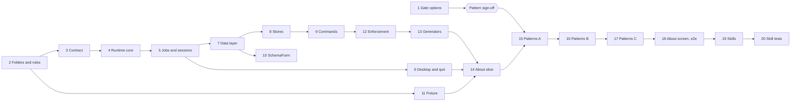

# P1b Data Layer and Patterns: Execution Plan

> **For agentic workers:** REQUIRED SUB-SKILL: Use superpowers:subagent-driven-development (recommended) or
> superpowers:executing-plans to implement this plan task-by-task. Steps use checkbox (`- [ ]`) syntax for
> tracking.

**Goal:** Build the skeleton every Studio feature uses: the contract's four shapes, the job, session, stream
and event services, the renderer's shared layer, the shared UX patterns, generators and enforcement. A
throwaway About feature proves all of it, and three tested skills teach it to coding agents.

**Architecture:** As approved on 26 Nov 2026 in [architecture.md](architecture.md) and
[conventions-and-skills.md](conventions-and-skills.md). The services that need neither Node nor Electron
(registry, jobs, sessions, streams, events) move into a new browser-safe package, `@ak-studio/runtime`. The
Electron main process and the browser's mock transport both serve from it, so the About slice behaves the
same in both (ruling 9).

**Tech Stack:** As P1a ([P1a-plan.md](P1a-plan.md#global-constraints)), plus React Hook Form and Ajv (P0 D12),
happy-dom and Testing Library, and TanStack Virtual for the streaming list.

**Spec:** [P1b-data-layer-and-patterns.md](P1b-data-layer-and-patterns.md). Design records:
[architecture.md](architecture.md), [conventions-and-skills.md](conventions-and-skills.md). Gate process:
[design-process.md](design-process.md).

## Global Constraints

- **Pinned versions.** No `^` or `~`. Every version from the [P1a plan](P1a-plan.md#global-constraints)
  stays. New in P1b: `react-hook-form@7.92.0` and `ajv@8.20.0` (P0 D12, verbatim). Other new packages take the
  latest release that is at least two weeks old (`pnpm view <pkg> time --json`): `happy-dom`,
  `@testing-library/react`, `@testing-library/dom`, `@testing-library/user-event` and `@tanstack/react-virtual`.
  The task that adds a package records its version and the date in a new "P1b additions" row of the
  [P0 decision record](P0-technology-selection.md#decision-record). No other new runtime dependency without a
  ruling in the ledger.
- **Layers** as in [architecture.md](architecture.md#layers), with `packages/runtime` added (ruling 9).
  `packages/ui` stays presentational: no `contract` import, no data access. Features never import each
  other. The renderer, `ui` and `runtime` import nothing from `electron` or Node built-ins.
- **Electron security baseline from P1a stays intact:** sender checks, CSP, no network, one `window.studio`
  global. No new preload surface (ruling 6).
- **Every input strict** (`z.strictObject`); every output a plain `z.object`, so undeclared fields are
  stripped. No operation output or stream event has a `key`, `apiKey` or `token` field.
- **Copy rules** from [conventions-and-skills.md](conventions-and-skills.md#copy-rules): sentence case, OAK's
  words, errors say what happened and then what to do. Strings live in one strings module per feature or
  package.
- **Visual rules:** role tokens only, no arbitrary values, Tabler outline icons, solid floating layers, the
  8 px control radius.
- **File header comments:** every new file starts with a comment saying what it is and why, as in P1a.
- **Commits** end with the session's attribution line. No secrets, local absolute paths or personal data in
  any file. Each task is committed only once the owner has agreed to commit per task for P1b.
- **Verification commands** (from `ak-studio/`): `pnpm lint`, `pnpm typecheck`, `pnpm test`,
  `pnpm test:storybook`, `pnpm test:e2e`. All must pass at the end of every task; the report gives the counts.

## Pre-flight rulings (26 November 2026)

Each says what it costs if wrong.

1. **Linux only, CI not run.** As in P1a, the workflow is written and parsed, not executed. Each "fails CI"
   item in the spec's Verification is proved locally by a self-test that plants the violation and expects the
   check to fail. CI rows are marked **Deferred**. Cost: one CI run and its fixes.
2. **Branch.** Work continues on `feature/950-agent-kernel-studio-phase-1`. Cost: none.
3. **Gate split.** Tasks 1 to 14 do not wait for the design gate. Tasks 15 to 18 and the `ak-studio-ui` skill
   in Task 19 wait for the sign-off of their rows. Task 1 writes the options, so the owner can decide while
   Tasks 2 to 14 run. Cost: none.
4. **P1a sign-off still open.** The shell layout and the base component set are not signed off. P1b builds on
   them as they are. Cost: rework in Task 8 (tabs from manifests) and the pattern tasks if the shell changes.
5. **Open decisions on their proposed defaults:** skill sample tasks are run by hand and recorded in the PR;
   undo history is built in P5. Cost: none now.
6. **Events use the existing `subscribe`.** No new transport primitive. Two streams carry everything:
   `events` (job, session, recorded-command and domain events, one union) and `stream.read` (the chunks of
   one stream, backlog first). A third primitive would reopen the preload, the sender checks and both
   transports. Cost: none known.
7. **Builders layer on `defineOperation` and `defineStream`** and keep `name`; the architecture's sketch says
   `id`. The existing operations are reclassified: `app.info` a query; `app.setTheme`, `app.setLayout` and
   the three `window.*` requests commands; `window.state` stays a plain stream. Cost: none.
8. **One schema check per batch.** `stream.read` events are batches. Each batch is parsed once, not each
   line one by one. This is what the 10,000-line check rests on. Cost: a cheaper check if the profile says so.
9. **`@ak-studio/runtime`.** `ServiceRegistry` (moved from `apps/desktop/src/main/bridge/registry.ts`),
   `ProjectScopes`, `SecretMasker`, `EventBus`, `StreamHub`, `JobService`, `SessionService` and the
   interfaces and fakes for `CommandRunner`, `ProjectFs`, `Watcher` and `JobRecordStore` live in
   `packages/runtime`, which imports only `contract` and `zod`. The desktop app keeps the Node and Electron
   implementations (`NodeJobRecordStore`, later the real `CommandRunner` and `ProjectFs`) and the domain
   services. The mock transport runs a real `ServiceRegistry` from `runtime` over fixture-backed services, so
   the About slice and every later feature behave the same in the browser. The architecture's layer table
   gains the row. Cost if wrong: moving files back into `apps/desktop`.
10. **Stand-ins until later phases.** The capability catalog is empty until P2, so no operation declares a
    capability in P1b (a contract test checks every declared id is in the catalog); the registry's refusal
    and `useCapability` are tested against a fake catalog. Known secret values reach `SecretMasker` through
    `add(value)`; `SecretStore` calls it from P4; P1b's tests and the About fake feed it. Project scope is
    proven by unit tests; `ProjectService` opens and closes it in P2. Cost: none.
11. **Quit and unload prompts are native dialogs** in `apps/desktop/src/main/index.ts`, not the approval
    pattern: they must work when the renderer is busy or broken. Running jobs: `before-quit`. Unsaved working
    copies: the renderer's `beforeunload`, answered by Electron's `will-prevent-unload`. Cost: restyling, if
    the owner wants an in-app prompt.
12. **The native application menu stays static** (Edit, View, Help; drawn on macOS only). "Menus built from
    manifests" in P1b means the in-app menus and the command palette. Building the macOS menu from manifests
    joins the macOS re-entry point. Cost: a small task at that point.
13. **Mod+J** becomes the app command `shell.toggleBottomPanel`. Mod is Cmd on macOS and Ctrl elsewhere. App
    shortcuts do not act while a modal is open, a change from P1a. Cost: none.
14. **Operations the architecture does not name.** `job.cancel` (the spec needs cancel);
    `jobs.interrupted` and `jobs.dismissInterrupted` (the crash-recovery notice). Domain events are one event
    type, `domain.changed`, with a `domain` field, not one type per domain. Cost: renaming.
15. **The command palette joins the design gate.** It is UI the P1b gate table does not list. The P1b doc
    gains a row for it, and its sign-off goes with the session and streaming row.
16. **Storybook indexes the renderer's stories too.** `packages/ui/.storybook/main.ts` adds
    `apps/renderer/src/**/*.stories.tsx`, so feature and `shared/` stories get the same axe and theme runs.
    The config file is exempt from the boundary rules, as in P1a. Cost: moving Storybook to the workspace
    root if the exemption proves awkward.

## File structure

New and moved files only.

```
ak-studio/
  packages/
    contract/src/
      shapes.ts          query, command, job, session builders; Operation metadata (shape, errors, capability)
      domain.ts          ProjectId, Revision, Job, UserRequest, Session, StreamChunk, CommandRecord, StudioEvent
      jobs.ts            job.respond, job.cancel, jobs.list, jobs.interrupted, jobs.dismissInterrupted
      sessions.ts        session.start, session.stop, sessions.list
      events.ts          the `events` and `stream.read` streams
      errors.ts          (changed) StudioError gains file, line, action; the catalog grows
    runtime/             NEW. Browser-safe services core (ruling 9)
      src/registry.ts    ServiceRegistry (moved), capability refusal, masking of error detail
      src/scope.ts       ProjectScopes, ProjectScope
      src/secrets.ts     SecretMasker
      src/events.ts      EventBus
      src/streams.ts     StreamHub: batching, bounded backlog, masking
      src/jobs.ts        JobService, JobRunner, JobContext
      src/sessions.ts    SessionService, SessionKind
      src/ports/         CommandRunner, ProjectFs, Watcher, JobRecordStore: interfaces and fakes
      src/about/         AboutService (throwaway, ruling 9; deleted when P2 lands its first real feature)
    kernel-catalog/src/  Capability, CapabilityStatus, CapabilityCatalog, EMPTY_CATALOG
    ui/src/components/   the patterns (Tasks 15 to 17): job-progress, approval, background-notice,
                         session-control, streaming-list, command-row, changed-on-disk, unsaved-changes,
                         version-notice, state-message, command-palette
  apps/
    desktop/src/main/
      infra/NodeJobRecordStore.ts
      services/registerServices.ts   (changed) runtime services wired; quit rule
    renderer/src/
      app/               shell, router, providers, feature registry (moved from shell/, routes/, App.tsx)
      shared/            bridge/ (moved), query/, events/, streams/, jobs/, sessions/, working-copy/,
                         capability/, commands/, errors/, forms/, patterns/ (connected wrappers)
      features/about/    the proving slice, made with the generator
  fixtures/support-triage/   the fixture project from brief 00
  tools/
    generators/          new-feature, new-operation, new-component and their templates
    check-classes.mjs    the arbitrary-value check, with a fixture self-test
    check-stories.mjs    story coverage, with a fixture self-test
  tests/visual/          Playwright screenshots of every story, dark and light (Linux)
  .agents/skills/        ak-studio-architecture, ak-studio-ui, ak-studio-new-feature
  .claude/skills         symbolic link to .agents/skills
  AGENTS.md
```

## Tasks

### Task 1: Design gate options (docs only)

**Done** (commit `2cf49cf8`). Owner sign-off of all five rows: `7f1575a9`.

Done by the controller, with one subagent to read the artboards. No code.

**Files:** create `docs/specs/950-agent-kernel-studio-phase-1/research/technology/p1b-design-gate-options.md`;
modify `implementation/P1b-data-layer-and-patterns.md` (the palette row, ruling 15).

- [ ] **Step 1:** For each pattern in the P1b gate table, plus the command palette: list where it appears in
  the Claude Design's artboards (P2 to P10 rows of the phase docs) and the briefs, with artboard links.
- [ ] **Step 2:** For each "question to settle", write two or three options and a recommendation, with what
  each costs. Keep to what P2 and P3 need; mark the rest as "settle when first used".
- [ ] **Step 3:** Shape the sign-off as five yes-or-no rows: job progress, approval and background notice;
  session control, streaming list and the command palette; changed on disk and the unsaved guard; version
  gate, empty, cannot read and error; and anything the owner wants drawn on the canvas first (step 3 of the
  gate) instead of decided from the note.
- [ ] **Step 4:** Run the link check. Commit. Send the owner the note.

### Task 2: Renderer folders and boundary rules

**Done on Linux** (commits `97c4f48b..f44513ed`).

**Files:** move `apps/renderer/src/{App.tsx,shell/,routes/,useAppTheme.ts,useWindowMaximized.ts,theme.ts}`
into `src/app/`, and `src/bridge/` and `src/queries.ts` into `src/shared/`. Modify `.dependency-cruiser.cjs`
and `tools/depcruise-selftest/`. Add a DOM test setup to `apps/renderer` and `src/app/shell/Shell.test.tsx`.
Add `packages/runtime` as an empty member (`package.json`, `tsconfig.json`, `src/index.ts`), with the same
browser-safe rules as `ui`.

**Produces:** the folders `app/`, `shared/` and `features/` that every later task writes into; the renderer
test environment `happy-dom` with Testing Library; the package `@ak-studio/runtime`.

- [ ] **Step 1:** Move the files with `git mv`; fix imports; `main.tsx` stays the entry. No behaviour change:
  every existing test passes unchanged except for import paths.
- [ ] **Step 2:** Rules: `features/<a>` must not import `features/<b>`; `shared` must not import `features` or
  `app`; `features` must not import `app`; `runtime` imports only `contract`, `zod` and itself, no Node
  built-ins and no `electron`. Self-test fixtures: one planted file per new rule, each of which must be
  reported. (The spec's "a feature importing another feature fails CI".)
- [ ] **Step 3:** Add `happy-dom`, `@testing-library/react`, `@testing-library/dom` and
  `@testing-library/user-event` (pinned, recorded). Vitest runs `*.test.tsx` in happy-dom and `*.test.ts` in
  node.
- [ ] **Step 4:** Tests for the shell's untested error paths: the layout-save toast (`app.setLayout` fails, the
  toast shows, the layout stays as the person set it) and the bridge-error banner (`app.info` fails, the
  banner shows the error's message).
- [ ] **Step 5:** Verify (all five commands). Commit.

### Task 3: Contract shapes, domain types, events and errors

**Done on Linux** (commits `f44513ed..25098ea7`; the options note `2cf49cf8` came first).

**Files:** `packages/contract/src/{shapes,domain,jobs,sessions,events}.ts` (new), `operations.ts`,
`errors.ts`, `index.ts`, tests beside each.

**Consumes:** `defineOperation`, `defineStream`, `operations`, `streams` (P1a).

**Produces (exact names):**
- `query({ name, input, output, errors?, capability? })`, `command({ ...same })`: each returns an
  `Operation` with the extra read-only fields `shape: "query" | "command"`, `errors: readonly ErrorCode[]`,
  `capability?: string`.
- `job({ name, input, result, errors?, capability?, title, cancellable, survivesQuit })`: an `Operation` with
  `shape: "job"`, whose output is `z.object({ jobId: JobId })`, plus `result` (the zod schema of the job's
  result) and the three job fields. `jobKinds`, a map from name to job definition, for `JobService`.
- `defineSessionKind({ kind, args, info, errors? })` and `sessionKinds`, the map `SessionService` checks.
- `domain.ts`: `ProjectId`, `JobId`, `SessionId`, `StreamId` (non-empty strings); `Revision` (64 lowercase
  hex characters, a SHA-256); `jobSchema`, `userRequestSchema`, `sessionSchema`, `streamChunkSchema`
  (`{ seq: number, at: number, channel: "stdout" | "stderr" | "info", text: string }`), `commandRecordSchema`
  (shape only; filled in P2), `studioEventSchema`, a union on `type`: `job.updated { job }`,
  `session.updated { session }`, `command.recorded { record }`, `domain.changed { domain, projectId? }`. The
  `Job`, `UserRequest` and `Session` fields are exactly those in
  [architecture.md](architecture.md#jobs) and [#sessions](architecture.md#sessions), with `projectId?` added.
- `jobs.ts`: commands `job.respond { jobId, requestId, answer: { optionId?: string, name?: string } }`,
  `job.cancel { jobId }`; queries `jobs.list {} -> { jobs: Job[] }`, `jobs.interrupted {} -> { records:
  InterruptedJob[] }`; command `jobs.dismissInterrupted { jobId }`.
- `sessions.ts`: `session.start { kind, projectId?, args } -> { sessionId }`, `session.stop { sessionId }`,
  `sessions.list {} -> { sessions: Session[] }`.
- `events.ts`: stream `events` (input `{}`, event `studioEventSchema`); stream `stream.read` (input
  `{ streamId }`, event `{ chunks: StreamChunk[], dropped: number, ended: boolean }`).
- `errors.ts`: `studioErrorSchema` gains `file?: string`, `line?: number`,
  `action?: { label: string, commandId: string, args?: unknown }`. New codes: `project.notOpen`,
  `file.changedOnDisk`, `file.outsideProject`, `kernel.capabilityUnavailable`, `job.notFound`,
  `job.notWaiting`, `job.requestMismatch`, `job.notCancellable`, `session.notFound`, `session.unknownKind`,
  `session.alreadyRunning`, `session.failed`.

- [ ] **Step 1:** Tests first: each builder sets `shape` and its fields; inputs stay strict; `job` outputs
  `{ jobId }`; every key in `operations`, `streams`, `jobKinds` and `sessionKinds` equals its name or kind;
  every operation has a `shape` (the reclassification in ruling 7); every code an operation lists is in the
  catalog; every capability an operation names is in the catalog (empty in P1b, so none may); no output or
  event schema, walked recursively, has a field named `key`, `apiKey` or `token`.
- [ ] **Step 2:** Implement. Reclassify the P1a operations. Add the new operations and streams to `operations`
  and `streams`.
- [ ] **Step 3:** `pnpm typecheck` shows what the bigger maps break; the registry's missing-handler test will
  fail until Task 5. Mark those tests `todo` in this task, naming Task 5, so the suite stays green.
- [ ] **Step 4:** Verify. Commit.

### Task 4: Runtime core: registry, scope, masking, events, streams, ports

**Done on Linux** (commits `25098ea7..a9d629a0`).

**Files:** `packages/runtime/src/{registry,scope,secrets,events,streams,index}.ts`, `src/ports/*.ts`, tests
beside each. Move `apps/desktop/src/main/bridge/registry.ts` and its test here; the IPC server imports it from
`@ak-studio/runtime`. Add the `packages/runtime` row to the layer table in [architecture.md](architecture.md#layers)
(ruling 9).

**Consumes:** Task 3's contract.

**Produces (exact names):**
- `ServiceRegistry` (P1a API kept) with constructor options `{ contract?, log?, capabilities?:
  CapabilityChecker, masker?: SecretMasker }`. `CapabilityChecker = { status(capability: string, projectId?:
  ProjectId): "available" | "needs-upgrade" | "removed" }`. A request whose operation names a capability that
  is not `available` answers `kernel.capabilityUnavailable` without calling the handler. Every error's
  `detail` and `message` pass through `masker.mask`. A handler returning a code its operation does not list is
  logged as a bug and still returned.
- `ProjectScopes`: `open(projectId, { root }) -> ProjectScope`, `get(projectId)`,
  `require(projectId)` (throws `StudioFailure` `project.notOpen`), `close(projectId)`, `closeAll()`.
  `ProjectScope`: `projectId`, `root`, `onDispose(fn)`, `dispose()` (runs disposers in reverse order, once).
- `SecretMasker`: `add(value)`, `remove(value)`, `mask(text)` (each known value, at least 4 characters,
  replaced with `••••`).
- `EventBus`: `emit(event: StudioEvent)`, `register(registry)` (serves `events`).
- `StreamHub`: constructor `{ masker, schedule?: (fn) => cancel, backlogLines = 5000, batchLines = 500 }`.
  `create() -> StreamId`, `write(streamId, channel, text)` (splits on line breaks), `end(streamId)`,
  `register(registry)` (serves `stream.read`). A subscriber gets the backlog in its first batch, then at most
  one batch per scheduled flush (16 ms by default). `dropped` counts lines that fell out of the backlog.
- Ports, each an interface plus a fake in `src/ports/fakes.ts`: `CommandRunner` (`run({ executable, args,
  cwd, env?, signal }) -> { commandId, exitCode, durationMs }`, with an output callback), `ProjectFs`
  (`read(path) -> { content, revision }`, `write(path, content, baseRevision)`, refusing paths outside the root
  with `file.outsideProject` and a stale base with `file.changedOnDisk`; the error carries no content, the view re-reads), `Watcher`
  (`watch(root, onChange(paths))`), `JobRecordStore` (`started(record)`, `ended(jobId, state)`,
  `unfinished()`, `dismiss(jobId)`).

- [ ] **Step 1:** Tests first, with fakes and an injected scheduler. The registry: capability refusal;
  masking of `detail`; an undeclared code is logged. Scopes: dispose order; `require` on a closed project.
  Streams: backlog on late subscribe; batching; the backlog bound and `dropped`; 10,000 lines written at once
  reach the subscriber in batches of at most `batchLines`, and the parse count equals the batch count, not the
  line count (ruling 8); masking applies to chunks. Fakes: `ProjectFs` refuses `../x` and absolute paths
  outside the root, and a stale `baseRevision`.
- [ ] **Step 2:** Implement. Move the registry; keep its P1a tests passing in the new place.
- [ ] **Step 3:** Verify. Commit.

### Task 5: JobService and SessionService

**Done on Linux** (commits `a9d629a0..21b59810`).

**Files:** `packages/runtime/src/{jobs,sessions}.ts` and tests;
`apps/desktop/src/main/infra/NodeJobRecordStore.ts` and test.

**Consumes:** Task 3 (`jobKinds`, `sessionKinds`, the job and session operations); Task 4 (`EventBus`,
`StreamHub`, `ProjectScopes`, `JobRecordStore`).

**Produces (exact names):**
- `JobService` constructor `{ events, streams, scopes, records, now? }`.
  `define(name, runner: JobRunner)`, where `JobRunner = (input, ctx: JobContext) => Promise<result>`, and
  `JobContext = { jobId, signal: AbortSignal, step(step, steps, label), ask(request) -> Promise<answer>,
  stream: { write(channel, text) }, addCommand(commandId) }`. `handler(name)` returns the request handler that
  starts a job of that kind and answers `{ jobId }`. `register(registry)` serves `job.respond`, `job.cancel`,
  `jobs.list`, `jobs.interrupted` and `jobs.dismissInterrupted`. `quitPlan() -> { toCancel: Job[], blocking:
  Job[] }`. `cancelAll(jobs) -> Promise<void>`.
- Rules: states as in the architecture; one open request at a time (a second `ask` waits for the first
  answer); jobs of the same kind on the same project queue in order; cancel aborts `signal`, ends in
  `cancelled`, and denies an open request; a scope's disposal cancels its jobs; every change emits
  `job.updated`; a record is written at start and at end; the result is parsed against the kind's `result`
  schema (a mismatch fails the job with `bridge.invalidOutput`).
- `SessionService` constructor `{ events, streams, scopes }`. `define(kind, starter: SessionStarter)`, where
  `SessionStarter = (args, ctx) => Promise<{ info, stop(): Promise<void> }>`. Serves `session.start`,
  `session.stop` and `sessions.list`. One session per kind per project (`session.alreadyRunning`); a scope's
  disposal stops its sessions; every change emits `session.updated`; a starter that throws ends in `failed`.
- `NodeJobRecordStore(dir)`: one JSON file per job in `<appData>/jobs/`, written atomically (temporary file,
  then rename).

- [ ] **Step 1:** Tests first with fakes and fake timers: every state transition; `ask` and `respond` with
  the wrong `requestId` (`job.requestMismatch`) or when not waiting (`job.notWaiting`); cancel while waiting;
  queueing by kind and project; `quitPlan` splits by `survivesQuit`; an unfinished record shows in
  `jobs.interrupted` after a new `JobService` starts on the same store; session start, stop, the duplicate
  kind, a failing starter, scope disposal. `NodeJobRecordStore` in a temporary folder.
- [ ] **Step 2:** Implement. Remove the `todo` markers from Task 3 for the job and session operations.
- [ ] **Step 3:** Verify. Commit.

### Task 6: Desktop wiring and the quit rule

**Done on Linux** (commits `21b59810..ce28c832`).

**Files:** `apps/desktop/src/main/services/registerServices.ts`, `apps/desktop/src/main/index.ts`, tests.

**Consumes:** Tasks 4 and 5.

- [ ] **Step 1:** `registerServices` builds one `SecretMasker`, `EventBus`, `StreamHub`, `ProjectScopes`,
  `JobService` (with `NodeJobRecordStore` in the app's data folder) and `SessionService`, registers them, and
  returns them for `index.ts`. The registry's contract test passes with no `todo` left.
- [ ] **Step 2:** Quit rule (ruling 11) as a function with an injected `ask` port, tested without Electron:
  nothing running quits at once; jobs with `survivesQuit: false` ask "Quit and cancel 2 jobs?" and cancel
  them, waiting up to 5 seconds; a job with `survivesQuit: true` blocks with "Wait" (the default) and a warned
  "Quit anyway". `index.ts` wires it to `before-quit` with `dialog.showMessageBox`. The same rule runs when the
  window's close button closes the last window.
- [ ] **Step 3:** `will-prevent-unload` in `index.ts` shows a native "Leave without saving?" dialog naming what
  is unsaved, for the renderer's `beforeunload` (Task 7).
- [ ] **Step 4:** Verify. Commit.

### Task 7: Renderer data layer

**Done on Linux** (commits `ce28c832..28d07d07`).

**Files:** `apps/renderer/src/shared/{query,events,errors,working-copy}/` and tests;
`shared/bridge/mockTransport.ts` (rebuilt on `runtime`).

**Consumes:** Tasks 3 to 5.

**Produces (exact names):**
- `keys(domain)` returns `{ all: [domain], project: (projectId) => [domain, projectId], detail: (projectId,
  ...parts) => [domain, projectId, ...parts] }`. Every query key is built with it.
- `useStudioQuery(name, input, { key, enabled? })` and `useStudioMutation(name, { onSuccess? })`, over
  TanStack Query. Both expose `showPending`, true only after the call has run for 300 ms.
- `connectEvents(queryClient, transport) -> () => void`: one `events` subscription for the app. On
  `domain.changed` it invalidates `[domain, projectId]`, or `[domain]` with no project. Job, session and
  recorded-command events go to the stores (Task 8) through `onJob`, `onSession` and `onCommand` callbacks.
- `errorPresentation(code) -> { title, placement: "inline" | "banner" | "toast" }` and the map behind it.
  Test: every code in the catalog has an entry (the spec's "an error code without a presentation fails CI").
- `useWorkingCopy({ value, revision, write })` returns `{ draft, setDraft, dirty, conflict, save(), discard(),
  takeTheirs(), keepMine() }`. A new `revision` from the server while `dirty` sets `conflict`, and the draft is
  kept. `save()` sends `baseRevision`; `file.changedOnDisk` sets `conflict`.
- `useUnsavedGuard(label, dirty)`: registers what is unsaved. Leaving the route asks through TanStack Router's
  blocker; reload and close go through `beforeunload` (Task 6).
- The mock transport: a `ServiceRegistry` from `runtime` with the fixture-backed `app.*` and `window.*`
  handlers it has today, plus `JobService`, `SessionService`, `StreamHub` and `EventBus` on an in-memory
  `JobRecordStore`.

- [ ] **Step 1:** Tests first (happy-dom): `showPending` stays false for a 200 ms call and turns true at 300 ms;
  an event invalidates only its domain's keys; the presentation coverage test; working copy: dirty, conflict on
  a new revision, `keepMine` writes with the new base, `takeTheirs` drops the draft, a stale save sets
  `conflict`; the guard blocks navigation and `beforeunload` while dirty.
- [ ] **Step 2:** Implement; move `queries.ts` onto `keys` and the hooks. The existing mock transport tests
  pass against the rebuilt mock.
- [ ] **Step 3:** Verify. Commit.

### Task 8: Stores, reattach and capabilities

**Done on Linux** (commits `50628835..b0296747`).

**Files:** `apps/renderer/src/shared/{streams,jobs,sessions,capability}/`, `packages/kernel-catalog/src/`, tests.

**Consumes:** Task 7 (`connectEvents`, the hooks).

**Produces (exact names):**
- `useStreamStore`, `useStream(streamId) -> { lines, dropped, ended }`. One `stream.read` subscription per
  stream, counted by view; it closes when the last view unmounts. Bounded buffer, 5,000 lines by default.
- `useJobStore`, `useJob(jobId) -> Job | undefined`, `useStartJob(name) -> { start(input) -> Promise<JobId> }`,
  `respondToJob`, `cancelJob`. `useSessionStore`, `useSession(kind, projectId?)`, `startSession`,
  `stopSession`.
- `reattach(transport)`: on start, `jobs.list` and `sessions.list` fill the stores before events are applied.
  Events that arrive during the fetch are applied after it, newest wins by `job.id` and a sequence number
  (`Job` and `Session` gain `seq`, set by the service on each change; add it to Task 3's schemas in this task).
- `packages/kernel-catalog`: `Capability` (the P2 shape), `CapabilityStatus`, `CapabilityCatalog = { has(id),
  status(id, version) }`, `EMPTY_CATALOG`. P2 fills the entries and the version logic.
- `CatalogProvider`, `useCapability(id) -> CapabilityStatus`. An id the catalog does not have throws in
  development and tests.

- [ ] **Step 1:** Tests first: the buffer bound; one subscription for two views; unsubscribe on the last
  unmount; reattach with a job running and an event racing the list; `useCapability` against a fake catalog.
- [ ] **Step 2:** Implement. Verify. Commit.

### Task 9: App commands, manifests, shortcuts

**Done on Linux** (commits `b0296747..4e764b60`; review hardening `28306dbc`).

**Files:** `apps/renderer/src/shared/commands/`, `apps/renderer/src/app/{features,registry}.ts`,
`app/shell/`, `packages/ui/src/components/bottom-panel.tsx`, tests.

**Produces (exact names):**
- `defineCommand({ id, title, args?: ZodType, shortcut?: string, when?: () => boolean, run(args) })`.
- `FeatureManifest = { id, tab?: { label, path, order }, routes?, commands: AppCommand[], capabilities:
  string[] }`, `defineFeature(manifest)`.
- `app/features.ts`: the one list of manifests. `app/registry.ts` builds the tabs, routes, the command list and
  the shortcut map from it. The shell's tabs come from manifests: one manifest per current tab (Canvas, Code,
  Config, Test & Trace, Deploy), each still showing its empty state.
- `runCommand(id, args)`: looks the command up, parses `args`, runs it. An unknown id or bad args is a
  development error, not a crash.
- Shortcuts: `Mod` is Cmd on macOS and Ctrl elsewhere; not active while a modal is open (ruling 13).
  `shell.toggleBottomPanel` on Mod+J replaces the shortcut declared in `bottom-panel.tsx`.

- [ ] **Step 1:** Tests first: the clash test (two commands with one shortcut fail, platform by platform); the
  manifest test (every capability a manifest names is in the catalog; every command id is unique and every
  `runCommand` id in the source exists, found by a source scan); Mod+J toggles the panel and does nothing
  behind a modal; tabs render from manifests.
- [ ] **Step 2:** Implement. The command palette's UI waits for the gate (Task 16); this task exposes the
  command list it will read.
- [ ] **Step 3:** Verify. Commit.

### Task 10: SchemaForm skeleton

**Done on Linux** (commits `4e764b60..254de293`).

**Files:** `apps/renderer/src/shared/forms/`, `tools/compile-schemas.mjs`, tests.

**Produces:** `SchemaForm({ schema, validate, value, onSubmit, overrides? })`: renders string, number,
integer, boolean and enum fields from a JSON schema with the P1a components, holds the working copy in React
Hook Form, and checks fields with a validator precompiled by Ajv standalone (`coerceTypes` off, P0 D12).
`compile-schemas.mjs` turns `*.schema.json` into `*.validate.js`. Filled out in P3.

- [ ] **Step 1:** Add `react-hook-form@7.92.0` and `ajv@8.20.0`. Tests first: `"30"` for an integer is rejected
  (strict); a required field; an enum; the override map replaces one field's control; the precompiled
  validator runs under the app's CSP (no `new Function`).
- [ ] **Step 2:** Implement with a sample schema (a slice of `AKConfig`, the `session` section). One story,
  marked provisional until the P3 gate.
- [ ] **Step 3:** Verify. Commit.

### Task 11: Fixture project and the mock's data

**Done on Linux** (commits `254de293..66ee4154`).

**Files:** `ak-studio/fixtures/support-triage/` and `fixtures/README.md`;
`apps/renderer/src/shared/bridge/fixtures.ts`.

- [ ] **Step 1:** Build the folder from the "Fixture data" section of
  [00-project-brief.md](../00-project-brief.md), exactly as listed there: no invented files. A test checks the
  file list against the brief's tree.
- [ ] **Step 2:** The mock transport's fixture data reads from it at build time (a Vite raw import), so stories,
  the mock and later end-to-end tests share one source.
- [ ] **Step 3:** Verify. Commit.

### Task 12: Enforcement checks

**Done on Linux** (commits `66ee4154..2c69877d`; the CI workflow is written, not run: ruling 1).

**Files:** `tools/check-classes.mjs` and fixtures; `tools/check-stories.mjs` and fixtures;
`tools/story-requirements.json`; `packages/ui/.storybook/main.ts` (ruling 16); `tests/visual/`;
`playwright.config.ts`; `package.json` scripts; `.github/workflows/studio.yml`; Biome's restricted imports.

- [ ] **Step 1:** `check-classes.mjs`: fails on an arbitrary value in a class name (`p-[13px]`,
  `bg-[#fff]`) or an inline colour style in `.tsx` under `apps/renderer/src` and `packages/ui/src`. Time-box one
  day (the spec's risk table); the fallback is a review checklist line. Self-test with planted files.
- [ ] **Step 2:** `check-stories.mjs`: every component file in `packages/ui/src/components` and every
  `components/` and `screens/` file under `features/` has a stories file; patterns list their required story
  names in `story-requirements.json`, and a missing one fails. Self-test with planted files.
- [ ] **Step 3:** Biome's restricted-imports rule for `electron` and Node built-ins in the renderer, `ui` and
  `runtime`, alongside dependency-cruiser.
- [ ] **Step 4:** Storybook indexes the renderer's stories (ruling 16); axe already runs on every story
  (`a11y: { test: "error" }`) and now covers them.
- [ ] **Step 5:** Visual regression: Playwright screenshots of every story in the built Storybook, dark and
  light, compared with committed baselines under `tests/visual/__screenshots__/linux/`. A `test:visual`
  script; the workflow runs it on `ubuntu-latest` only.
- [ ] **Step 6:** `lint` runs both checks and their self-tests. Record which spec verification each self-test
  proves locally (ruling 1). Verify. Commit.

### Task 13: Generators

**Done on Linux** (commits `2c69877d..9db350e2`).

**Files:** `tools/generators/{new-feature,new-operation,new-component}.mjs`, `tools/generators/templates/`,
tests; `package.json` scripts `new:feature`, `new:operation`, `new:component`.

- [ ] **Step 1:** `pnpm new:feature <name>` creates `features/<name>/` with `manifest.ts`, `api/keys.ts`,
  `model/store.ts`, `components/`, `screens/<Name>Screen.tsx` with stories, a strings module and a test, and adds
  the manifest to `app/features.ts`. `pnpm new:operation <feature> <name> --shape query|command|job` adds the
  contract declaration, a handler stub in a named service, the hook and a test. `pnpm new:component <name>`
  adds a `packages/ui` component, its stories and its exports.
- [ ] **Step 2:** Names are checked (kebab-case, no path characters), as in P1a's path-safe generator. A test
  runs each generator in a temporary copy of the workspace and checks the output passes `biome check`, the
  boundary rules and the story check.
- [ ] **Step 3:** Verify. Commit.

### Task 14: About slice, without its screen

**Done on Linux** (commits `9db350e2..4ea5346d`).

**Files:** `packages/runtime/src/about/`, contract additions, `apps/renderer/src/features/about/` (made with
Task 13's generators).

- [ ] **Step 1:** Generate the feature, then add, through the generators:
  - query `about.info` (the app's version and platform);
  - command `about.setNote { note, baseRevision } -> { revision }`, with `about.note -> { note, revision }`
    as its query; a stale `baseRevision` answers `file.changedOnDisk` (no content; the view re-reads the note);
  - job `about.demoJob` with three steps of about a second each, a `confirm` request after step 2, a stream
    line per step, `cancellable: true`, `survivesQuit: false`;
  - session kind `about.ticker`, writing a line a second to its stream until stopped, with a `burst` argument
    that writes 10,000 lines at once;
  - app command `about.runDemoJob`, with no shortcut.
- [ ] **Step 2:** `AboutService` registers in `registerServices` and in the mock transport.
- [ ] **Step 3:** Tests through the hooks against the mock transport: every shape, the stale write, answer
  and cancel.
- [ ] **Step 4:** Measure the "too heavy" risk: count the feature code each shape took. If a query, a command
  or a job needs more than about a page, write down what to simplify before P2 in the report.
- [ ] **Step 5:** Verify. Commit.

### Gate: pattern sign-off

**Done** (all five rows approved as recommended, 26 Nov 2026, commit `7f1575a9`).

Tasks 15 to 18 are not dispatched until the matching rows of the P1b sign-off table are filled.

### Task 15: Patterns A: job progress, approval, background notice

**Done on Linux** (commits `4b756be7..973c1634`).

Presentational parts in `packages/ui` with stories for every state (gate step 4); connected wrappers in
`shared/patterns/` (`JobProgress`, `Approval`, `BackgroundJobNotice`) reading the job store. Approval answers
only through `job.respond`; `confirm-by-name` enables approve only when the typed name matches. Each
component's required stories go in `story-requirements.json`.

### Task 16: Patterns B: session control, streaming list, command row, command palette

**Done on Linux** (commits `973c1634..2d0a72b5`).

`SessionControlView` and `SessionControl`; `StreamingListView` (virtualised with `@tanstack/react-virtual`;
follows the end until the person scrolls up; "Jump to latest"; copy; clear; ANSI colours mapped to tokens as
approved) and `StreamingList` over `useStream`; `CommandRow`; `CommandPalette` (React Aria, built from the
command list of Task 9, showing each shortcut).

### Task 17: Patterns C: changed on disk, unsaved guard, version gate, state messages

**Done on Linux** (commits `2d0a72b5..3751101e`).

`ChangedOnDiskBanner` with "Keep mine", "Take theirs" and "Compare"; `UnsavedChangesDialog` for in-app
navigation; `VersionNotice` in its three sizes and `CapabilityGate` over `useCapability`; one family for the
empty, cannot-read and error states, and `ErrorView` placing any `StudioError` by `errorPresentation`.

### Task 18: About screen and end-to-end verification

**Done on Linux** (commits `3751101e..d7d0ab2b`). Browser reload cannot reattach (the mock lives in the
page), so reattach after a reload is proved in Electron; the browser proves leaving mid-job and coming back.

The About screen from the patterns, reached from a tab or the palette. End-to-end, browser and Electron:

- [ ] every shape works: the query, the stale write, the job with its request answered and with cancel, the
  ticker started and stopped, the palette command;
- [ ] reload mid-job: the job and its stream reattach;
- [ ] quitting with the demo job running asks first; a `survivesQuit` job blocks the quit (a test-only kind,
  behind the existing `AK_STUDIO_TEST_HOOKS` switch);
- [ ] killing the app mid-job shows the job as interrupted on the next launch;
- [ ] the 10,000-line burst: the window stays responsive (a frame-time check while the burst arrives) and
  the list shows the last line.

### Task 19: Skills and tooling

**Done on Linux** (commits `d7d0ab2b..a3692748`; the owner's two bug fixes `d540782b` and `278fc9fe` sit inside the range).

- [ ] `ak-studio/.agents/skills/` with `ak-studio/.claude/skills` linked to it; `ak-studio/AGENTS.md`; one line
  in the root `AGENTS.md`; `ak-studio/README.md` notes that a Windows clone needs symbolic links enabled.
- [ ] `ak-studio-architecture` and `ak-studio-new-feature` (before the gate); `ak-studio-ui` (after Tasks 15 to
  17). Same frontmatter as the `ak-dev-*` skills. Each with a sample task beside it.
- [ ] Freeze the matching sections of `architecture.md` and `conventions-and-skills.md`, with a note pointing
  to the skill.
- [ ] A Studio section in `.agents/skills/ak-dev-review-pr/`.
- [ ] Configure the shadcn CLI (`components.json` exists) and the shadcn MCP server against `packages/ui`.

### Task 20: Skill tests and close-out

**Done on Linux** (commits `a3692748..7c8769d3`).

- [x] Each skill's sample task run three times by a coding agent in a scratch worktree, using only the skill:
  nine runs. Each must pass lint, boundaries, stories and review with no hand edits. A failing skill is
  rewritten and its three runs repeated. Recorded in the PR (ruling 5).
- [x] Skill tests, recorded here (ruling 5): 9/9 runs passed "Done means", three per skill, on 27 Nov 2026
  (sonnet agents, one scratch worktree each, three batches). Each skill was revised between rounds: after
  batch 1 (`8da19a0a`, `eb002db9`, `ce34c2d0`, `c3f53528`, `451a1693`), after batch 2 (`b6e7068b`, `e67bf0cb`,
  `775ed912`), and in a close-out pass after batch 3 (`f7a26b5f`, `0275d483`, `7c8769d3`). The rounds 2 and 3
  runs found no wrong statement in the skills; the remaining gaps were guidance on load, logs and recipes.
- [x] Tick the P1b doc, fill the README progress row, record every Deferred item.

## Order



Tasks run one at a time (no parallel implementers). Task 1 is docs and runs first, so the owner can decide
while Tasks 2 to 14 run.

## Self-review against the spec

| P1b requirement | Task |
|---|---|
| Approval gate | Done 26 Nov 2026 |
| Design gate, eight patterns (and the palette, ruling 15) | 1, then 15 to 17 |
| 1b.1 Builders, events, `StudioError`, catalog, `Revision`, `UserRequest`; job and session operations | 3, 5 (`seq`: 8) |
| 1b.2 Registry checks, capability refusal | 4 (start-up check exists since P1a) |
| 1b.2 Project scope | 4 (opened by P2) |
| 1b.2 `JobService`, quit rule, crash records; `SessionService` | 5, 6 |
| 1b.2 Stream batching, bounded backlog, masking | 4 |
| 1b.2 `CommandRunner`, `ProjectFs`, `Watcher` interfaces with fakes | 4 |
| 1b.2 Domain events | 3 (`domain.changed`), 7 (invalidation); services emit them from P2 |
| 1b.3 Query keys, invalidation, pending after 300 ms, working copy and guard | 7 |
| 1b.3 Stream, job and session stores, reattach; `useCapability`, `CapabilityGate` | 8, 17 |
| 1b.3 App commands, palette, menus, shortcuts, clash test, Mod+J | 9, 16 (ruling 12 for the native menu) |
| 1b.3 DOM test setup and the shell's error paths | 2 |
| 1b.3 `SchemaForm` skeleton | 10 |
| 1b.4 Patterns | 15 to 17 |
| 1b.5 Generators | 13 |
| 1b.5 Fixture and the mock's data | 11 |
| 1b.5 Enforcement, visual regression, axe | 2, 3, 7, 9, 12 |
| 1b.6 About slice and reload | 14, 18 |
| 1b.7 Skills, links, AGENTS.md, review section, shadcn | 19 |
| 1b.7 Skill tests | 20 |
| Verification: four shapes in Electron and the browser; quit; interrupted; 10,000 lines | 18 |
| Verification: each planted violation fails | 2, 3, 7, 9, 12 locally; CI **Deferred** (ruling 1) |

**Cost note.** Task 20 is nine agent runs, plus three more for each skill that has to be rewritten. Tasks 15
to 17 are the largest; each may split in two at dispatch if its review package grows past one reviewer's sitting.
