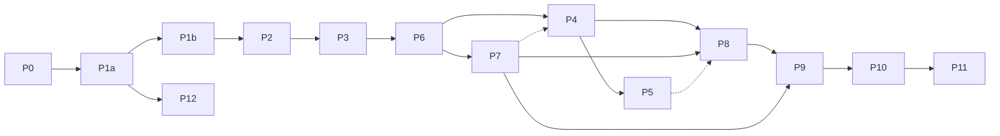

# P4 to P12 · Outlines

These phases are outlined, not detailed. Each gets its own detailed doc (same layout as
[P2](P2-project-and-kernel-version.md) and [P3](P3-read-only-builder.md)) when the phase before it is close to
done, so the detail is written against what was actually built. Every phase with screens passes the
[design gate](design-process.md) first.

What each phase of Open Agent Kernel (OAK) Studio must deliver comes from the team's
[Phase 1 PRD](../PHASE-1-PRD.md) (revised 25 November 2026), which supersedes
issue #950 where they differ. The design input for each phase is the matching brief (00 to 09) in the spec
folder, listed in the [README](../README.md#phase-1-files). The briefs'
layouts are a starting sketch; a signed-off story supersedes its artboard.

Every phase is built as feature slices on the [architecture](architecture.md), follows the ground rules and
pattern catalogue in [conventions-and-skills.md](conventions-and-skills.md), and adds to the pattern catalogue
and skills when it introduces something new. Its detailed doc names the features, services, operations and
jobs it adds.

## Order

This plan follows the PRD's milestones (decided 25 November 2026; it replaces the issue's order of 23
November). The coding agent and business rules (P6, P7) come straight after P3, then create and edit (P4,
P5). The team's reason: the coding agent and business rules are what set the app apart, and canvas editing is
its costliest part. Nothing is dropped by the order.

| PRD milestone | Phases |
|---|---|
| 1. Open and read a project | P2, P3 |
| 2. Coding agent, accept and revert, business rules and `ak rules check` | P6, P7 |
| 3. Create and edit | P4, P5 |
| 4. Local run, chat, trace, tests, run history, simulated users, the CI workflow | P8, P9 |
| 5. Deploy to one target, from state backend and plan to destroy | P10 |
| 6. The remaining four targets | P11 |
| None: installers are a PRD deliverable, not a milestone | P12 |

A solid arrow means "needs"; a dotted arrow means "comes after, in the PRD order" only.

What the order changes:

- **P6 installs the OAK skills itself** (`ak skill install --assistant claude`) when an opened project lacks
  them. In the old order P4's wizard did this first.
- **P6 owns the "Coding agents" section of Settings** (brief 09), because it comes before P4's Settings work.
- **P7 runs the test file itself.** The "Untested" state and "Generate tests" need a pytest run before P9
  exists. P7 runs `uv run pytest` through the command runner and reads the per-case results; P9 adds history,
  comparison and scenarios on top of the same run.
- **P4's "Describe it with AI" entries work from the start**, on Welcome and on every wizard step, because P6
  already exists.
- **P10 takes tests and business rules as prerequisites**, so it needs P7's check and P9's test results.
- No built work changes: P6 needs only P3.

---

## P6 · Build with AI

| | |
|---|---|
| Business aspect | Asking a coding agent to make changes, and staying in control of them |
| PRD milestone | 2 (Coding agent, accept and revert, business rules), first half |
| Depends on | P3. The three-system CI must run before P6 starts ([README](../README.md#order-and-dependencies)) |
| Screens | Build with AI drawer: Chat and Code views, approval cards, pending changes, the "Review changes" modal; Settings, "Coding agents" section |
| Design input | Brief 05; brief 09 (`Settings-CodingAgents`) |
| Claude Design | [`Builder-AIDrawer`](https://claude.ai/artifact/HxwXUwENoUhpnjKdQb1k8j#artboard-AIDrawer), [`Builder-AIDrawer-FirstExchange`](https://claude.ai/artifact/HxwXUwENoUhpnjKdQb1k8j#artboard-Builder-AIDrawer-FirstExchange), [`Builder-AIDrawer-Resolved`](https://claude.ai/artifact/HxwXUwENoUhpnjKdQb1k8j#artboard-Builder-AIDrawer-Resolved), [`Builder-AIDrawer-Code`](https://claude.ai/artifact/HxwXUwENoUhpnjKdQb1k8j#artboard-Builder-AIDrawer-Code), [`Builder-AIDrawer-Disconnected`](https://claude.ai/artifact/HxwXUwENoUhpnjKdQb1k8j#artboard-Builder-AIDrawer-Disconnected), [`Settings-CodingAgents`](https://claude.ai/artifact/HxwXUwENoUhpnjKdQb1k8j#artboard-Settings-CodingAgents). Not drawn: `Builder-AIDrawer-AgentMenu`, `Builder-AIDrawer-Bottom`, `Builder-AIDrawer-Review` |

**Outcome.** A person who has Claude Code installed and signed in asks Claude, running locally in the
folder, for a change; approves its permission requests as cards; sees what changed on the canvas and in a
diff; accepts or reverts each turn.

**Work, in outline**

- One agent-neutral coding-agent interface, shaped like the Agent Client Protocol (ACP): start a session in
  the working directory, send a prompt, stream events, relay permission requests and their answers, report
  the files a turn changed, interrupt. The event kinds are named by the interface, not by Claude: messages,
  plan steps, tool calls, file edits, commands, permission requests. A second agent is then a new adapter,
  not a change to the drawer, the approval cards or revert. The Claude Agent SDK, driving the user's own
  Claude Code, is its only adapter
  ([architecture](architecture.md#the-coding-agent-and-the-users-claude-code), D14 in the P0 record: use of
  the subscription decided; the row is pending review).
- **Skills.** When the project has no OAK skills in `.claude/commands/`, the drawer offers to install them:
  `ak skill install --assistant claude` through the command runner. Settings lists the installed skills
  (`ak-init`, `ak-build`, `ak-add-capabilities`, `ak-add-integration`, `ak-test`, `ak-cloud-deploy`) with
  "Update skills".
- Checkpoint before each turn: git when the folder is a repository, the app's own snapshot otherwise. Accept
  and revert belong to the app, not to the adapter.
- The "Review changes" modal: a canvas diff and the file diffs, with "Accept all", "Accept selected" and
  "Revert".
- Approval cards: "Approve", "Deny" and "Always allow this command in this project". The allow-list is a
  per-project setting in the working directory (brief 09); proposed in `.akstudio/`
  ([architecture](architecture.md#where-each-kind-of-data-lives)). Proposed: an allow-list found in a newly
  opened folder is listed and confirmed before it is used, like the folder's hooks.
- Settings, "Coding agents": Claude Code's state and path; permissions for this project ("Edit project files";
  running commands: "Ask every time" or "Allow listed commands"); a locked row "Never apply or destroy
  Terraform"; the toggle "Take a checkpoint before each turn"; Codex, Cursor, Windsurf and GitHub Copilot
  shown as "Not set up".
- The agent's commands appear in the Commands panel, marked as the agent's.
- The agent never applies or destroys Terraform.
- The Studio uses the Claude Code already installed and signed in on the user's machine (owner's decision,
  24 November 2026). On our reading of Anthropic's rules, awaiting the owner's confirmation, it never
  stores, reads or asks for a credential, and shows no login of its own.
- A status view: not installed, not signed in, or ready, with the version and which credential Claude Code
  is using. The disconnected state says which sign-in the Studio expects (the user's own Claude Code sign-in)
  and tells the user to sign in from a terminal.
- The opened folder's agent hooks and permission rules are listed and confirmed before they are loaded.
- Run the live turn S5 could not (the spike code is deleted, so P6 writes its own check): streaming, approve,
  deny, interrupt and usage on a working subscription. A lowest supported Claude Code version, checked in the
  status view.
- A user with only the Claude desktop app has no `claude` command: the status view sends them to the Claude
  Code installer. The adapter never uses the SDK's `sessionStore`, which appears to read the credential file
  (not exercised).

**Skill.** `ak-studio-coding-agent-adapter`. The coding agent is a session; an agent turn is a job; each
permission request puts it in `waiting-for-user` and renders with the approval pattern.

**Design questions.** Drawer docking with the layout fixed in P3. How a long agent turn shows progress. How a
partly accepted turn looks. What the drawer shows when Claude Code is missing or not signed in. The wording:
the feature is "Claude Agent"; "Claude Code" names only the user's installed program.

**Open before starting.** Agreement to Anthropic's Commercial Terms, and Anthropic's confirmation that a
third-party app may drive the user's signed-in Claude Code (its pages do not say so; see the architecture).
The questions for Anthropic in [open decisions 1e and 7](../README.md#open-decisions), including two
third-party reports that are not confirmed. Whether an API-key route ships beside the subscription route:
decided in this phase. The lowest Claude Code version supported. Whether the per-project agent settings
(permissions, the command allow-list) are committed with the project, and whether a committed allow-list is
confirmed before use.

---

## P7 · Business rules

| | |
|---|---|
| Business aspect | Linking plain-language rules to the code, config and tests that enforce them |
| PRD milestone | 2 (Coding agent, accept and revert, business rules and `ak rules check`), second half |
| Depends on | P6 |
| Screens | Rules view in the drawer; agentic development workspace; rule results in the Problems panel |
| Design input | Brief 06 |
| Claude Design | [`Builder-AIDrawer-Rules`](https://claude.ai/artifact/HxwXUwENoUhpnjKdQb1k8j#artboard-Builder-AIDrawer-Rules), [`AgenticDev-Workspace`](https://claude.ai/artifact/HxwXUwENoUhpnjKdQb1k8j#artboard-AgenticDev), [`AgenticDev-RuleDetail`](https://claude.ai/artifact/HxwXUwENoUhpnjKdQb1k8j#artboard-AgenticDev-RuleDetail), [`AgenticDev-OutOfSync`](https://claude.ai/artifact/HxwXUwENoUhpnjKdQb1k8j#artboard-AgenticDev-OutOfSync), [`AgenticDev-GenerateTests`](https://claude.ai/artifact/HxwXUwENoUhpnjKdQb1k8j#artboard-AgenticDev-GenerateTests). Not drawn: `AgenticDev-Diff` |

**Outcome.** A person writes a rule in plain language; the coding agent implements and links it; the app shows
whether each rule is enforced, untested, drafted or out of sync. They generate tests for a rule, with
adversarial cases for compliance and safety rules, and fix an out-of-sync rule by changing the code, the rule
or the tests. CI runs the same check with `ak rules check`.

**Work, in outline**

- The rule file format in `.akstudio/`: documented and versioned, committed with the project. A rule's links
  are data: file, line range, config key, node id, test case ids.
- Rule categories from brief 06: routing, approval, compliance, data, tone, safety, access.
- `ak rules check`, a **new** `ak` subcommand in `ak-py` (today the CLI has only `ak skill`,
  `ak-py/src/agentkernel/cli/ak.py`). It is core package work, so it follows the repository's own
  `design.md`, `spec.md`, `plan.md` process and ships in an OAK release. What it does, from brief 06:
  - Deterministic, with no model: every linked file, line range, config key, node and test case still
    exists, and the project's introspection still finds what each link names.
  - Exits non-zero when a rule is out of sync or a link is broken. Untested rules are listed as warnings;
    `--require-tests` makes them fail.
  - A `--json` output for the Studio, with a `schemaVersion`.
- **One check implementation, in Python.** The Studio runs `ak rules check --json` from the project's
  environment, through the command runner, whenever a linked file changes, and shows the results in the Rules
  view and the Problems panel. On OAK versions without the command, the Studio runs the same Python
  module, shipped with the Studio as a helper (as P3's introspection helper is). It is never re-written in
  TypeScript. The catalog records the version that adds the command.
- **States, in order of severity:** out of sync, untested, drafted, enforced. A card shows its most severe
  state. Untested ranks above drafted because it looks finished but has no evidence (brief 00; the research
  reaches the same view).
- **A test run.** P7 runs the test file with `uv run pytest` through the command runner, to know which linked
  tests pass and to check generated tests. P9 builds history and comparison on the same run.
- "Generate tests" runs the coding agent with `ak-test`. For compliance and safety rules the request also
  asks for adversarial cases that try to break the rule. Microsoft's ASSERT generates adversarial tests from
  policies in the same way (research). The cases go into `app_test.py`, are linked to the rule, and are
  accepted or reverted like any other change.
- "Fix with AI" on an out-of-sync rule asks which side should change: the code (the default), the rule or
  the tests. Kiro's "fix the spec, the implementation or the test" is the precedent (research). Each choice
  runs the coding agent and ends in accept or revert.
- **Access rules** are enforced by OAK's `identity` and `authorization` blocks. From brief 06:
  - A grant is what stops a caller. Once the `authorization` block exists the policy denies by default, and a
    principal runs an agent only when a grant gives it a level on that agent.
  - A tool tier does not stop a tool call yet. A rule about one tool links to an access-level check inside
    that tool (`ToolContext.get().access_level`), with the tier beside it, never to the tier alone.
  - An agent's `visibility` in `registry.agents.<id>` is one of the links.
  - Every caller needs a grant, the channels included: a Slack user arrives as the principal
    `messaging:slack`. "Implement" on an access rule runs the coding agent with `ak-add-capabilities`, and
    its review shows the grants that keep the existing channels and the local tester working. This is the
    lock-out check.

**Design questions.** How a rule's links are shown and followed. The workspace layout next to the canvas.

**Open details carried from the brief.** The rule file format, and whether rules also appear as comments in the
code they govern. Which line-range changes count as out of sync. Whether a drafted rule fails `ak rules check`
or is only a warning, as an untested rule is.

---

## P4 · Create and configure a project

| | |
|---|---|
| Business aspect | Starting a project and changing its configuration without hand-editing YAML |
| PRD milestone | 3 (Create and edit), first half |
| Depends on | P3; P6 for the "Describe it with AI" entries |
| Screens | New project wizard; Welcome's "Describe a project" and "Create a project here"; Config tab in edit mode; Code tab light edits; Settings (toolchain, secrets, cloud, general) |
| Design input | Briefs 02, 03, 04 (Config, Code), 09 |
| Claude Design | [`Start-NewProject-Folder`](https://claude.ai/artifact/HxwXUwENoUhpnjKdQb1k8j#artboard-Start-NewProject-Folder), [`Start-NewProject-Framework`](https://claude.ai/artifact/HxwXUwENoUhpnjKdQb1k8j#artboard-NewProject), [`Start-NewProject-Provider`](https://claude.ai/artifact/HxwXUwENoUhpnjKdQb1k8j#artboard-Start-NewProject-Provider), [`Start-NewProject-Template`](https://claude.ai/artifact/HxwXUwENoUhpnjKdQb1k8j#artboard-Start-NewProject-Template), [`Start-NewProject-Creating`](https://claude.ai/artifact/HxwXUwENoUhpnjKdQb1k8j#artboard-Start-NewProject-Creating); [`Builder-Config`](https://claude.ai/artifact/HxwXUwENoUhpnjKdQb1k8j#artboard-Builder-Config); [`Settings-Toolchain`](https://claude.ai/artifact/HxwXUwENoUhpnjKdQb1k8j#artboard-Settings), [`Settings-Secrets`](https://claude.ai/artifact/HxwXUwENoUhpnjKdQb1k8j#artboard-Settings-Secrets), [`Settings-Cloud`](https://claude.ai/artifact/HxwXUwENoUhpnjKdQb1k8j#artboard-Settings-Cloud), [`Settings-General`](https://claude.ai/artifact/HxwXUwENoUhpnjKdQb1k8j#artboard-Settings-General) |

**Outcome.** From an empty folder, a person picks an OAK version, a framework, a model provider and a
template, and gets a project that opens on the canvas. They edit any `config.yaml` section as a form, make
light edits in the Code tab, and add secret names.

**Work, in outline**

- New project wizard: folder, **OAK version** (latest by default, older ones selectable), framework,
  model provider, template, "Initialise a git repository" (checked by default); then `uv` environment
  creation, `ak skill install --assistant claude` and `git init`, all through the command runner.
- "Describe it with AI" on every wizard step, and "Describe a project" on Welcome: both open the Build with AI
  drawer (P6), which scaffolds the project. "Create a project here" in P2's "not an OAK project" state starts
  the wizard on that folder.
- Scaffold templates, selected by version range from the catalog. Decide whether templates are Studio-owned or
  reuse what the bundled `ak-init` skill describes.
- Config editing: write `config.yaml` keeping comments and key order. Validate with the installed version
  before saving.
- Code tab: light edits, with the same revision rules as config writes. "Open in editor" stays the way to do
  real work.
- Secrets: a secret is a key name plus the OAK secret provider that resolves it (`secret.provider.type` in
  `config.yaml`). The Secrets table reads the provider and shows `.env` for the `env` provider. `.env` is read
  and written in the main process only; the renderer sees key names, the provider and whether each resolves.
- Settings: toolchain, secrets, general preferences, usage data (off by default). "Cloud": the profiles
  configured on this computer, with account and default region, and the sign-in commands (`az login`,
  `gcloud auth application-default login`) shown for the user to run. The app stores no cloud credentials.
- Preferences that survive version changes: P1a's `AppService` keeps only the keys it knows (`theme`, `layout`)
  and its strict layout schema resets an unknown shape, so an older build's write drops a newer build's
  preferences. Decide forward-compatible preferences (keep unknown keys, or version the file) before adding any.

**Design questions.** How many wizard steps. What the wizard shows while the environment is created (it can
take minutes). How the version choice explains what a newer version adds. How a form shows an invalid value
before save. Whether local model providers (Ollama, LM Studio, LiteLLM) are in the provider list (research: a
natural fit for a desktop app). Whether new projects get an `AGENTS.md` that points to the OAK skills
(research: developers now expect one from a project template).

**Skill.** `ak-studio-scaffold-template`. The bundled `ak-init` skill is prose, not a generator, so each
template has a reviewed reference project and a test that regenerates it (see "What the Studio writes into
a project" in [architecture.md](architecture.md)). Decide before this phase whether the templates move into
`ak-py` as files that both the skill and the Studio read.

**Config writes** carry the base revision and fail with `file.changedOnDisk` on a conflict; secret values
travel renderer to main only, in a command that is never recorded.

**Key risk.** Round-trip YAML editing that keeps comments. Pick and test the library in this phase's first
task.

---

## P5 · Build on the canvas

| | |
|---|---|
| Business aspect | Building the agent system visually |
| PRD milestone | 3 (Create and edit), second half |
| Depends on | P4 |
| Screens | Canvas in edit mode: palette, drag and drop, editable inspector, context menu |
| Design input | Brief 04 |
| Claude Design | [`Builder-Canvas`](https://claude.ai/artifact/HxwXUwENoUhpnjKdQb1k8j#artboard-BuilderCanvas). Not drawn: `Builder-Canvas-Dragging`, `Builder-Canvas-ContextMenu` |

**Outcome.** A person adds agents, tools, handoffs, channels, guardrails and stores on the canvas, and the
project files change accordingly.

**Work, in outline**

- Palette, gated by the catalog and by installed frameworks.
- Config-backed nodes (channels, protocols, stores, guardrails, sandbox, tracing, execution mode) write
  `config.yaml` deterministically, reusing P4's writer.
- Protocol nodes write the agent's registry entry, `registry.agents.<id>.surfaces` (a list from `rest`, `a2a`,
  `mcp` and `agui`; every surface when unset). They never write the removed `a2a.agents`, `mcp.agents` or
  `agui.agents` lists: a config that still sets one fails to load.
- Python-backed nodes (agent, tool, handoff, hook) are written only through scaffold templates. No
  general-purpose Python rewriting. Anything a template cannot express is handed to the coding agent (P6) or
  to the user's editor.
- A "writing `app.py`" state on the node, and the write shown in the Commands panel.

**Patterns first used here.** Undo and redo (an undo is a new write), and working copies for edits in
progress.

**Design questions.** What happens when a canvas edit cannot be expressed by a template, and how code the
canvas cannot represent is shown (research). How an edit made here and an edit made on disk at the same moment
are reconciled. Grouping and filtering for large graphs, building on P3's answer.

**Key risk.** This is the PRD's named main risk: correct Python across eight frameworks. Start with one
framework end to end, then add the rest one at a time. The phase can ship with a subset of frameworks editable
and the others read-only.

---

## P8 · Run, chat and trace

| | |
|---|---|
| Business aspect | Trying the project locally and seeing what it did |
| PRD milestone | 4 (Run and test), first half |
| Depends on | P4; P7 for the rule chips (the rule ids come from its links) |
| Screens | Run control in the top bar; Test & Trace tab: chat, trace; Run log |
| Design input | Brief 07 |
| Claude Design | [`TopBar`](https://claude.ai/artifact/HxwXUwENoUhpnjKdQb1k8j#artboard-TopBar) (run control), [`Builder-TestTrace`](https://claude.ai/artifact/HxwXUwENoUhpnjKdQb1k8j#artboard-TestTrace), [`Builder-TestTrace-Stopped`](https://claude.ai/artifact/HxwXUwENoUhpnjKdQb1k8j#artboard-Builder-TestTrace-Stopped), [`Builder-TestTrace-StartFailed`](https://claude.ai/artifact/HxwXUwENoUhpnjKdQb1k8j#artboard-Builder-TestTrace-StartFailed), [`Builder-TestTrace-Streaming`](https://claude.ai/artifact/HxwXUwENoUhpnjKdQb1k8j#artboard-Builder-TestTrace-Streaming) |

**Outcome.** A person starts the project locally, chats with it, approves a paused tool call, and reads the
trace of the run with timing, tokens and estimated cost, and the rules each span enforces.

**Work, in outline**

- The local server is a **session**, not a job; a chat exchange and an environment sync are jobs.
- Run service: environment sync, start and stop the local server, stream its log, free the port on exit.
- Chat over the same REST and streaming interface a deployed project exposes. The agent select lists the
  project's catalog from `GET /api/v1/agents`.
- Live view from stream events. Span detail from a local OpenTelemetry (OTLP) receiver. The run is started
  with tracing pointed at it, for that run only, through environment variables and without editing
  `config.yaml`: `AK_TRACE__ENABLED=true`, `AK_TRACE__TYPE=openllmetry`, and `TRACELOOP_BASE_URL` set to the
  receiver.
- Span kinds are mapped from both the OpenTelemetry GenAI attributes and OpenLLMetry's own
  (`traceloop.span.kind`), as `ak-py/src/agentkernel/trace/fetch.py` does.
- A control in the trace header chooses where local traces go: the app (default) or the project's own tracing
  provider.
- Tokens and cost come only from spans; the stream events carry no usage. Cost is labelled as an estimate,
  and both are hidden when no span has them.
- Rule chips on spans: a span whose guardrail, tool or hook is a rule's enforcing element carries that rule's
  id (from P7's links). Parlant shows which rule fired in the same way (research).
- MCP made visible (research: Foundry's Inspector does this): the MCP servers an agent uses, MCP tool calls as
  spans, and MCP approval requests in the approval cards.
- Human-in-the-loop approvals in the chat. During a local test the person at the keyboard is the approver.
- **A project that sets `identity` or `authorization`.** With no credential, the Test column acts as the
  anonymous principal, so it lists and reaches only what the project's grants and each agent's visibility
  allow an anonymous caller. A refused call is shown as refused, with the status the runtime returns, never as
  an empty reply.

**Version awareness.** Stream event types, tracing options and human-in-the-loop support differ by version and
by framework; the catalog gates them.

**Design questions.** Chat and trace side by side or stacked. What the trace shows for a framework with no
span detail. Where the cost estimate's price table comes from and how it is kept current. How a test runs as a
named caller (a principal of the `static` identity provider is the likely answer). Whether the Test column
uses AG-UI events, which most of OAK's frameworks have adapters for (research).

---

## P9 · Tests, scenarios and CI

| | |
|---|---|
| Business aspect | Proving the project works, and keeping it proven |
| PRD milestone | 4 (Run and test), second half |
| Depends on | P8; P7's test run, which it extends |
| Screens | Test & Trace tab: test results, run history and comparison, scenarios, simulated user |
| Design input | Brief 07 |
| Claude Design | [`Builder-TestTrace-Failing`](https://claude.ai/artifact/HxwXUwENoUhpnjKdQb1k8j#artboard-Builder-TestTrace-Failing), [`Builder-TestTrace-History`](https://claude.ai/artifact/HxwXUwENoUhpnjKdQb1k8j#artboard-Builder-TestTrace-History), [`Builder-TestTrace-Simulate`](https://claude.ai/artifact/HxwXUwENoUhpnjKdQb1k8j#artboard-Builder-TestTrace-Simulate), [`Builder-TestTrace-CIWorkflow`](https://claude.ai/artifact/HxwXUwENoUhpnjKdQb1k8j#artboard-Builder-TestTrace-CIWorkflow). Not drawn: `Builder-TestTrace-Compare` |

**Outcome.** A person runs the test file, reads why a case failed, compares two runs, saves a chat as a test
case, runs a simulated user, and adds a CI workflow file.

**Work, in outline**

- `uv run pytest` through the command runner, using `test-config.yaml` for the comparison mode and judge
  model; results with judge score and reason.
- Run history in `.akstudio/runs/` (ignored by git): time, commit, and per case the result, score and reason.
  Comparison of two runs reads only from there.
- Saved scenarios and simulated-user scenarios in `.akstudio/`. A simulated user is played by the judge model
  in `test-config.yaml` by default, and talks to the local run over the same interface as the chat. "Save as
  test case" adds a finished exchange to `app_test.py`.
- "Add CI workflow" writes `.github/workflows/ak-checks.yml` only: `uv sync`, `uv run pytest`,
  `uv run ak rules check`. It lists the secret names CI needs. The app does not commit, push or run CI.

**Design questions.** Whether comparison adds "tradeoff" beside regression, improvement and unchanged, as
Braintrust does (research). A "guardrail fired" marker and a canned red-team scenario pack, or a Promptfoo
export of saved scenarios (research). CI systems other than GitHub Actions.

---

## P10 · Deploy to one target

| | |
|---|---|
| Business aspect | Shipping the project to the cloud from this computer, safely |
| PRD milestone | 5 (Deploy to one target, from state backend and plan to destroy) |
| Depends on | P8; P9 and P7 for the test and business-rule prerequisites |
| Screens | Deploy tab: target, state backend, prerequisites, variables, plan, confirm, apply, outputs, redeploy, change target, destroy |
| Design input | Brief 08 |
| Claude Design | [`Builder-Deploy-NoTarget`](https://claude.ai/artifact/HxwXUwENoUhpnjKdQb1k8j#artboard-Builder-Deploy-NoTarget), [`Builder-Deploy-StateBackend`](https://claude.ai/artifact/HxwXUwENoUhpnjKdQb1k8j#artboard-Builder-Deploy-StateBackend), [`Builder-Deploy-Prerequisites`](https://claude.ai/artifact/HxwXUwENoUhpnjKdQb1k8j#artboard-Builder-Deploy-Prerequisites), [`Builder-Deploy`](https://claude.ai/artifact/HxwXUwENoUhpnjKdQb1k8j#artboard-Deploy), [`Builder-Deploy-Confirm`](https://claude.ai/artifact/HxwXUwENoUhpnjKdQb1k8j#artboard-Builder-Deploy-Confirm), [`Builder-Deploy-Applying`](https://claude.ai/artifact/HxwXUwENoUhpnjKdQb1k8j#artboard-Builder-Deploy-Applying), [`Builder-Deploy-Done`](https://claude.ai/artifact/HxwXUwENoUhpnjKdQb1k8j#artboard-Builder-Deploy-Done), [`Builder-Deploy-Failed`](https://claude.ai/artifact/HxwXUwENoUhpnjKdQb1k8j#artboard-Builder-Deploy-Failed), [`Builder-Deploy-Destroy`](https://claude.ai/artifact/HxwXUwENoUhpnjKdQb1k8j#artboard-Builder-Deploy-Destroy). Not drawn: `Builder-Deploy-Redeploy`, `Builder-Deploy-ChangeTarget` |

**Outcome.** A person deploys to one cloud target, calls the endpoint, redeploys a change, and destroys the
deployment.

**Work, in outline**

- `deploy.apply` and `deploy.destroy` are jobs marked to survive quit: the app will not kill Terraform
  mid-apply, and an interrupted run is reported on the next launch.
- **An app-level interrupted-job notice.** In P1b the interrupted-job notice shows on the owning screen only
  (`InterruptedJobs`, mounted by About), so a crash is learnt of when that screen opens. P10's apply, the first real
  long job, adds an app-level notice (or the tab icon) for interrupted records, shown at launch whatever tab is open.
- **Remote state by default.** On a first deploy with no `deploy/backend.tf`, the tab asks where Terraform
  keeps its state. "Remote (recommended)" runs `deploy.backend.create`, a job that asks a confirm-by-name
  question naming the cloud account, then creates the backend with the cloud's own command-line tool in the
  target's account and region and writes `deploy/backend.tf`. Every command shows in the Commands panel. The
  backend, from brief 08: an S3 bucket with versioning, encryption and native state locking (`use_lockfile`)
  on AWS; a Cloud Storage bucket with versioning on Google Cloud; a Storage account container on Azure.
- **State holds secrets.** Terraform state is plain text and includes the values of variables passed at run
  time, so the model keys reach the state even though they never reach `terraform.tfvars` (research). The
  remote backend must be encrypted; check that the Azure and Google Cloud backends are. `.gitignore` covers
  `*.tfstate`.
- **Local state only by choice.** "Local file" is for scratch deploys. It shows a warning: the state stays in
  `deploy/` on this computer, is lost with it, and holds the model keys in plain text. Switching between local
  and remote runs `terraform init` with state migration, shown in the Commands panel.
- `terraform destroy` removes the deployment, not the state backend.
- Deploy service: generate `deploy/`; package (`uv export --no-hashes`, `uv pip install --target`); then
  `terraform init`, `plan`, `apply`, `output`, `destroy`, called directly with argument lists.
- Prerequisites, each a check: Terraform; Docker for a target that ships a container image; the cloud
  command-line tool signed in; the state backend; "Configuration fits the target"; the latest test run (P9);
  business rules (`ak rules check`, P7). A warning does not block applying. A failed check does.
- Variables form rendered from `deploy/variables.tf`.
- Plan parsed into counts and a grouped resource list.
- Confirmation that names the cloud account. Secrets passed at run time, never written to
  `terraform.tfvars`.
- Redeploy: "Changed since the last deploy" lists the changed files, then the same plan and confirm.
- One deploy target per project, in `deploy/`. Changing the target warns the user that the current
  deployment must be destroyed first; the destroy is the explicit confirmation that names the account (standing
  principle 3), never automatic, and only then are the files in `deploy/` replaced.
- Deploy history in `.akstudio/`.

**Version awareness.** The target list and the Terraform module version come from the project's OAK
version. The first target is chosen at the start of this phase; AWS containerized is the brief's fixture.

**Design questions.** The confirmation step is the most safety-critical screen in the app; it gets its own
options exploration. How the state bucket is named, and whether one bucket serves several projects in the same
account. Whether a small smoke test of the deployed endpoint belongs here.

---

## P11 · The remaining targets

| | |
|---|---|
| Business aspect | Any cloud |
| PRD milestone | 6 (The remaining four targets) |
| Depends on | P10 |
| Screens | No new screens; per-target prerequisites, variables and state backend |
| Claude Design | No new artboards. Each target's prerequisites, variables and state backend follow the P10 artboards |

**Outcome.** Every Terraform target the project's OAK version supports can be deployed and destroyed.

**Note.** The PRD names five targets: AWS serverless, AWS containerized, Azure containerized, Google Cloud
serverless and Google Cloud containerized. Azure Functions is retired (issue #957,
`docs/specs/957-retire-azure-functions/design.md`). The catalog decides what a project's version offers.
Docker is needed by both containerized targets and by Google Cloud serverless; AWS serverless needs it only
when the Lambda is packaged as an image.

---

## P12 · Packaging and release

| | |
|---|---|
| Business aspect | Getting the app onto people's computers |
| PRD milestone | None. The installers are a PRD deliverable (section 5), not a milestone |
| Depends on | P1a for the build pipeline; runs last for signing and release. The three-system CI already runs by then ([README](../README.md#order-and-dependencies)) |
| Screens | About, update notice |
| Claude Design | None drawn yet (About, update notice) |

**Outcome.** Signed installers for Windows, macOS and Linux, built in CI, with the PRD's acceptance run
(section 6) passed on each.

**Work, in outline**

- Code signing and notarisation; installer formats per platform.
- Auto-update, or a manual "update available" notice. Decide in this phase. Either must fit the standing
  principle that, with usage data off, the app makes no network calls of its own
  ([principles](../PHASE-1-PLAN.md#principles)).
- The release process and how Studio versions relate to OAK versions.
- Source and build instructions (a PRD deliverable): how to build and run the app from source, kept in
  `ak-studio/README.md` and checked on the three systems.
- The final product name and app identifier ([open decision 3](../README.md#open-decisions)).
- The PRD's acceptance run on all three platforms: with the toolchain installed, start from an empty folder,
  build the support-triage example with three agents, test it locally, deploy it to one cloud target, call
  the endpoint and destroy it. Every generated file is readable in the folder and every command is visible in
  the app.

**Note.** A local, unsigned build works from P1a onward (`ak-studio/` builds and runs on a developer's
computer). P12 is about distribution only. The licence is decided before any build leaves the team, so before
this phase ([open decision 9](../README.md#open-decisions)).

---

## After Release 1

Not planned here. The team's plan names these later phases; Release 1's seams (the browser-safe renderer, the
swappable transport, the agent-neutral coding-agent interface, `.akstudio/` files a server can read, secrets
by name, `ak rules check` outside the app) are shaped so they are additions, not rewrites.

| Later phase | Contents | Team's parked briefs |
|---|---|---|
| Deep configuration | Full pages for agents, tools, knowledge, channels, guardrails, memory | L09 to L14 |
| Operate | Playground against a deployed system, traces, conversations, evaluations history, schedules, deployments view, dashboard. Deploy environments, revisions and rollback, where the market is (research); a laptop apply is the dev environment | L03, L15 to L20 |
| Teams and hosting | A hosted Studio: sign-in, workspaces, roles and approvals, shared projects, billing | L01, L21 |
| More coding agents | Codex, Gemini CLI, Cursor and others, as adapters of P6's interface | None |

The team's parked briefs are in the
[`later-phases/`](../later-phases/README.md) folder, beside `implementation/`. They say "Do not design
from them yet" and predate the OAK rename and the 25 November develop merge: L20 still offers Azure Functions,
L10 and L12 predate `registry.agents.<id>.surfaces`, and L13 and L21 predate the `identity` and
`authorization` blocks.

Left out on purpose, because the research places them in later or hosted phases: a git commit and pull-request
flow, prompt versioning and span replay, online evaluation and A/B tests, breakpoints, and an end-user chat
widget.
