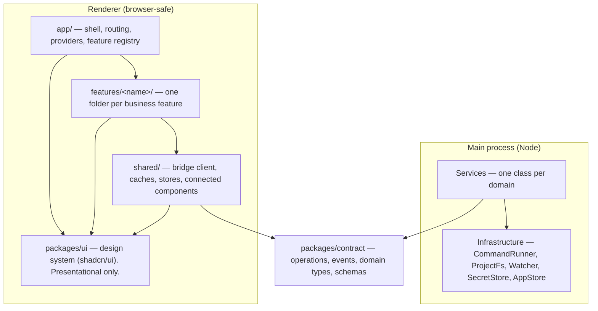
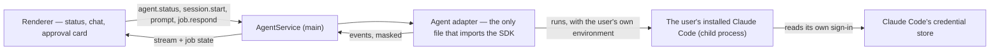

# Studio architecture: the data and feature layer

**Status:** revised after review on 23 November 2026; approved by the owner on 26 November 2026. Built in
[P1b](P1b-data-layer-and-patterns.md), followed by every later phase. After approval the
`ak-studio-architecture` skill is the maintained source and this file is the frozen design record.

Every screen in the Studio reads project files, runs commands, follows streams and waits on long jobs. If each
feature solves those problems its own way, the code drifts, and code written by a coding agent drifts
fastest. This document fixes **one way** to do each of them, so that features look the same whoever writes
them, and so that the Studio never needs a hack to get data out of Open Agent Kernel.

The rules are enforced by lint and tests where they can be (see "Enforcement"), and taught to coding agents
through the Studio skills ([conventions-and-skills.md](conventions-and-skills.md)).

## Layers

Arrows mean "may import".



At run time the renderer calls services only through the bridge, and infrastructure is the only thing that
touches the project's files, processes and OAK environment.

| Layer | May import | Must not import |
|---|---|---|
| `packages/ui` | React, shadcn/ui primitives, Tailwind | `contract`, `shared`, `features`, anything that fetches data |
| `packages/contract` | zod | Anything with side effects; Node or Electron APIs |
| `packages/runtime` | `contract`, zod | Node built-ins; `electron`; the renderer; `apps/desktop` |
| `renderer/shared` | `contract`, `ui`; `runtime` in the mock transport only (`shared/bridge/`) | `features` |
| `renderer/features/<a>` | `shared`, `ui`, `contract` | **Any other feature**; `electron`; Node built-ins |
| `renderer/app` | Everything in the renderer | `electron`; Node built-ins |
| `desktop/services` | `contract`, `runtime`, `desktop/infra` | The renderer; another service's internals (services talk through injected interfaces) |
| `desktop/infra` | `contract`, `runtime` (ports and schemas), Node, Electron | Services; the renderer |

**The runtime package.** `packages/runtime` holds the browser-safe services core (P1b ruling 9): the service
registry, project scopes, secret masking, `EventBus`, `StreamHub`, the job and session services, and the
interfaces of the ports (`CommandRunner`, `ProjectFs`, `Watcher`, `JobRecordStore`) with in-memory fakes. The
desktop main process serves the contract from it with the Node implementations of the ports; the renderer's
mock transport serves the same services over the fakes, so a feature behaves the same in the browser.

**Presentational and connected components.** A component with no data access lives in `packages/ui`
(`JobProgressView`, `ErrorMessage`, `VersionNotice`). Its connected wrapper, which reads a store or the
catalog, lives in `renderer/shared` (`JobProgress`, `ErrorView`, `CapabilityGate`). Features use the wrapper.

## One project per window

- A window has at most one open project. `projectId` identifies it in every operation.
- Opening a project creates a **project scope** in the main process: its watcher, its services' state, its
  jobs and sessions. Closing the project or the window disposes the scope: watchers stop, sessions stop, and
  running jobs follow the quit rule under "Jobs".
- App-level services (`AppService`, `WindowService`, `ToolchainService`) live outside any scope.

## Window chrome

The window has no system title bar (Linux and Windows: `frame: false`; macOS: a hidden title bar with the
traffic lights in our top bar). The renderer's top bar is the drag region (`app-region: drag`, every control in
it opts out) and draws the minimise, maximise and close buttons, which call `window.minimize`,
`window.toggleMaximize` and `window.close`. `WindowService` in the main process serves them against a small
`ControlledWindow` interface, so it has no Electron import; `index.ts` passes the window in. The `window.state`
stream tells the renderer when the window is maximised, so the middle button can say "Restore". Full screen
counts as not maximised. The application menu is still installed, only not drawn, so its shortcuts work.

## Where each kind of data lives

The most important rule of the Studio: **every piece of data has exactly one owner**, and the renderer never
keeps a second copy that can silently disagree with it.

| Kind of data | Examples | Owner (source of truth) | How the renderer holds it |
|---|---|---|---|
| Project state | `config.yaml`, the project graph, the file tree, rules, deploy history | Files on disk, read and derived by main-process services | **Query cache** (TanStack Query), invalidated by domain events |
| Machine state | Toolchain, OAK version, recent projects | Main-process services | Query cache |
| Streams | Command output, run log, coding-agent events, trace spans | Main-process services | **Stream store**: one bounded buffer per stream |
| Jobs and sessions | A test run, `terraform plan`; the local server, a coding-agent session | `JobService` and `SessionService` | **Job and session stores**, mirrored from events |
| UI state | Selected node, open panel, active tab, canvas zoom | The renderer | **Feature store** (Zustand), one per feature |
| Working copies | Canvas node positions while dragging; a config form being edited; an unsent chat message | The renderer, briefly | Feature store or form state, under the working-copy rule below |
| Preferences | Theme, panel sizes, density | `AppService` (the app's data folder) | Query cache; written through a command |
| Secrets | A key name plus the Open Agent Kernel (OAK) secret provider that resolves it (`secret.provider.type` in `config.yaml`: `env`, `aws_ssm`, `kubernetes` or a dotted path). `.env` is the local store of the `env` provider | The provider. For `env`, `SecretStore` in the main process only | Names, provider and resolve state only. The UI never assumes `.env` is the only store |
| Per-project agent settings | Coding-agent permissions, the command allow-list ("Always allow this command in this project"), the checkpoint toggle | The project's working directory (the team's brief 09). Proposed: `.akstudio/`, read and written by `AgentService`. Whether the file is committed is open until P6 | Query cache. Proposed: settings found in a newly opened folder are listed and confirmed before use, like the folder's hooks |
| The coding agent's sign-in | The user's Claude Code sign-in (normally a subscription) | Claude Code itself; the Studio never holds it | Status only: installed, signed in, version, credential source |

Rules:

1. **No optimistic writes to project files.** A save shows a pending state until the main process confirms the
   file is written and re-read.
2. **A feature store holds UI state, not server data.** The one exception is a working copy.
3. **Working-copy rule.** A feature may hold an editable copy of server data only while the user is editing it.
   The copy records the version it was taken from, is written back by one command at a defined moment (drag
   end, form save), and is dropped once the write is confirmed. If the source changes underneath it, the copy
   is flagged as conflicting and the user chooses. Nothing else reads from a working copy.
4. **Every query key is built by the feature's key factory**, shaped `[domain, projectId, ...detail]`.
5. **Invalidation is by domain event, decided in the main process.** The watcher reports changed paths to the
   services. Each service decides what that means for its domain, recomputes what it derives (the graph
   service reruns introspection once, debounced, and keeps the last good graph meanwhile), and emits a domain
   event: `config.changed`, `graph.changed`, `files.changed`, `rules.changed`. The renderer maps each event to
   the query-key prefix of the same domain. The renderer never reasons about file paths.
6. **Secret values never travel from the main process to the renderer.** A value the user types travels once,
   renderer to main, in a command that is never logged or recorded. Raw process output and error detail are
   masked for known secret values before they cross the bridge.

## Writing files safely

- Every read of a file-backed resource returns a `revision` (a content hash).
- Every command that writes a file carries the `baseRevision` it was edited from.
- If the file's current revision differs, the command fails with `file.changedOnDisk` and the new content.
  The UI shows the changed-on-disk pattern and keeps the user's working copy.
- Writes are atomic (write a temporary file, then rename), keep line endings, and go through `ProjectFs`.

## The contract

`packages/contract` declares every operation once. There are four shapes, and only four:

| Shape | Use for | Renderer side | Example |
|---|---|---|---|
| `query` | Reading state; no side effects | `useQuery` via the feature's hook | `config.readSection`, `toolchain.detect` |
| `command` | One write that normally finishes in under a second | `useMutation` via the feature's hook | `config.writeSection`, `secrets.set` |
| `job` | Finite work that is slow, cancellable or has steps. It ends. | `useJob` | `project.create`, `tests.run`, `deploy.plan`, `deploy.backend.create`, `agent.turn` |
| `session` | Something long-lived that runs until stopped. It has no result. | `useSession` | `run.server`, `agent.session`, `trace.receiver` |

Plus one-way **events** from the main process: the domain events above, `job.updated`, `session.updated`,
`stream.chunk`, `command.recorded`.

```ts
// packages/contract/src/config.ts — the shape every operation follows
export const configWriteSection = command({
  id: "config.writeSection",
  input: z.object({ projectId: ProjectId, section: z.string(), value: z.unknown(), baseRevision: Revision }),
  output: z.object({ revision: Revision }),
  errors: ["project.notOpen", "config.invalid", "file.changedOnDisk"],
  capability: undefined, // or a catalog id that must be available
});
```

- Inputs are validated with zod in the main process. Outputs are checked against their schema too.
- Every stream event is validated against the stream's schema, in the main process and in the mock. An invalid
  event ends the stream with an error. P1b's high-volume streams (for example batched log chunks) may need a
  cheaper check; that is decided when they are designed.
- Every operation names the error codes it can return, so the UI can handle each one.
- An operation that needs a kernel feature names its capability id; the main process refuses it with
  `kernel.capabilityUnavailable` when the project's version lacks it.
- A command that runs past 300 ms shows a pending state automatically. A command that regularly runs past a
  second is redeclared as a job.

## Streams

- A stream belongs to a job, a session or a recorded command, and is addressed by `streamId`.
- The main process batches chunks (one message per stream per animation frame at most) and keeps a bounded
  backlog, so a burst of output cannot flood the bridge.
- The renderer's stream store keeps a bounded buffer per stream. A late subscriber first receives the backlog.
- Subscriptions are cancelled when the last view of a stream unmounts.

## Jobs

Every slow, finite thing is a job, with one model and one UI pattern.

```ts
type Job = {
  id: string;
  kind: string;                 // "project.create", "deploy.apply", ...
  title: string;                // sentence case, shown in the UI
  state: "queued" | "running" | "waiting-for-user" | "succeeded" | "failed" | "cancelled";
  progress?: { step: number; steps: number; label: string };
  request?: UserRequest;        // present while waiting-for-user
  commandIds: string[];         // the CommandRunner records behind it
  streamId?: string;
  result?: unknown;             // typed per kind in the contract
  error?: StudioError;
  cancellable: boolean;
  survivesQuit: boolean;        // see the quit rule
};

type UserRequest = {
  id: string;
  kind: "confirm" | "confirm-by-name" | "permission" | "choice";
  title: string;
  summary: string;              // what will happen
  affects: string[];            // cloud account, files, resources
  expectedName?: string;        // for confirm-by-name
  options?: { id: string; label: string; destructive?: boolean }[];
};
```

- **Answering.** `job.respond({ jobId, requestId, answer })` is the only way to answer. `waiting-for-user`
  covers a Terraform plan to confirm, a coding-agent permission request and a paused human-in-the-loop tool
  call; they all render with the approval pattern. A job has one open request at a time.
- **Serialising.** Jobs of the same kind on the same project do not overlap.
- **Reload.** `JobService` lives in the main process. A reloaded window calls `jobs.list` and reattaches to
  running jobs and their streams.
- **Quit rule.** On quit or project close with running jobs, the app asks. Jobs marked `survivesQuit: false`
  are cancelled and their process trees killed. Jobs marked `survivesQuit: true` (`terraform apply` and
  `destroy`, where killing the process risks the state file) block the quit until they finish, with an
  explicit, warned override.
- **Creating real infrastructure.** `deploy.backend.create` (the Terraform state backend) is a job whose
  first step is a `confirm-by-name` request naming the cloud account, as for `deploy.apply`. It creates the
  backend with the cloud's own command-line tool and writes `deploy/backend.tf`. `deploy.destroy` never
  removes the backend.
- **Crash recovery.** Each job writes a small record in the app's data folder when it starts and when it
  ends. A record with no end is shown on the next launch as "interrupted", with the command that was running
  and what to check.

## Sessions

```ts
type Session = {
  id: string;
  kind: string;                 // "run.server", "agent.session"
  state: "starting" | "running" | "stopping" | "stopped" | "failed";
  info?: unknown;               // typed per kind: port, URL, model
  streamId?: string;
  commandIds: string[];
  error?: StudioError;
};
```

- Started with `session.start`, stopped with `session.stop`, one per kind per project.
- A session can spawn jobs (an agent turn inside an agent session; a chat exchange against the local server).
- All sessions stop when the project scope is disposed.

## The coding agent and the user's Claude Code

Revised 24 November 2026. The owner's decision: the user's machine already has Claude Code with a
subscription, and that subscription is used. Our reading of Anthropic's rules, which the owner has yet to
confirm: the Studio therefore runs that Claude Code and never takes, stores or passes on its token. This replaces the design of 23 November, in which the user pasted an API key into the Studio.

Spike [S5](../research/technology/spike-s5-coding-agent.md) tested the earlier design, on Linux, with no real credential.
Its results on the adapter, approvals, errors and the untrusted folder still apply. Its results on the key
store and the isolated environment are superseded. The spike's second half (24 November, Linux) ran the
mechanics of the new design. **No turn has run on a subscription:** the sign-in on the spike machine had
expired. Each rule below says what it rests on.



**The credential**

- **The Studio never holds it.** There is no key field, no key store and no token in the app's data folder.
  The Studio does not read Claude Code's credential files or the operating system's keychain entry, and does
  not pass a token in the environment. Claude Code authenticates itself, as it does in a terminal.
- **Sign-in happens in Claude Code.** When Claude Code is not signed in, the Studio says so and tells the
  user to sign in from a terminal. It does not show a login screen of its own or collect a token.
- **The Studio does not choose the credential.** Claude Code applies its own precedence: an
  `ANTHROPIC_API_KEY` or cloud-provider setting in the user's environment outranks the subscription sign-in.
  The Studio does not strip or override these. It shows which source is in use (the agent reports it when a
  turn starts), so a user is not billed on a key by surprise.
- **Nothing credential-like crosses the bridge.** No operation output or stream chunk may contain a `key`,
  `apiKey` or `token` field: a contract test fails if one appears, and the registry parses every output
  against its schema, which strips undeclared fields. (Verified in S5.) The browser transport used for UI
  work refuses every agent operation. (Verified in S5.)
- **Why this shape: Anthropic's rules,** read on 24 November 2026 from the Claude Code legal and compliance
  page and the Agent SDK overview. They say developers "may not collect, store, or intermediate Claude.ai
  credentials or session tokens", that "sign-in to a Claude account must complete through Anthropic's own
  flow", and that "the Claude Code binary must not be modified", nor any of its authentication methods
  removed or restricted. They also say each end user authenticates with their own credentials and is billed
  under their own agreement. They also bar third parties from routing requests "through Free, Pro, Max, or
  Ultra plan credentials on behalf of their users", which is the sentence this design has to survive, and say
  that running Claude Code in a product "requires agreeing to our Commercial Terms of Service".
  So a subscription token pasted into or stored by the Studio is ruled out, and
  running the user's own unmodified, signed-in Claude Code is the only subscription route left.
- **That route is our reading, not a stated permission.** No page says a third-party desktop app may drive
  the user's signed-in Claude Code. The SDK overview says that, unless previously approved, third parties may
  not offer claude.ai login or its rate limits "including agents built on the Claude Agent SDK". The owner
  must confirm with Anthropic before P6 starts (the legal page says to contact sales). The check gates P6, not
  P0 or P1a, so earlier phases do not wait on a reply.

**The agent process**

- **One adapter.** Only the adapter imports the SDK; a boundary rule enforces it. `AgentService` depends on
  the agent-neutral interface, so tests use a scripted fake and another agent can be added later. (Verified
  in S5.)
- **The interface is shaped like the Agent Client Protocol (ACP)**, as the team's plan asks: status; start a
  session in the working directory; send a prompt; stream events; relay permission requests and their
  answers; report the files a turn changed; interrupt. The event kinds are the interface's own, not Claude's:
  message, plan step, tool call, file edit, command, permission request. Checkpoints, accept and revert
  belong to `AgentService`, not to the adapter. A second agent is a new adapter.
- **The user's installation, not a bundled one.** The adapter finds the user's `claude` executable and points
  the SDK at it (`pathToClaudeCodeExecutable`). The Studio does not ship or modify the executable, which
  also takes the bundled executable out of the installer (767 MB down to 404 MB unpacked on Linux) and removes
  the earlier asar workaround. (Verified in S5: the SDK installs without its bundled executable and reaches `init` and the authentication error against an external Claude Code.)
  Version skew is barely tested: SDK 0.3.330 met Claude Code 2.1.330, its own version, and reached the
  sign-in error against 2.1.321. `agent.status` enforces a lowest supported version. The install locations in the spike were written from memory and must be checked against the documentation.
- **Finding it.** The adapter looks on `PATH`, then in the documented install locations, then at a path the
  user can set. A user who has only the Claude desktop app has no `claude` command: the desktop app keeps a
  private copy, which the Studio must not use. That user sees "not installed". (Found on the spike machine, which runs Claude Code on a subscription
  through the desktop app: it had no `claude` command, and the sign-in on disk was not usable by a `claude`
  command line. Why is not known. So a desktop-app user may have to install and sign in separately.)
- **No SDK session store.** The SDK's `sessionStore` resume path appears to read Claude Code's credential
  file, or the macOS Keychain, inside the host process. (Reported from reading the SDK's shipped code during
  S5; not exercised and not independently checked.) The adapter must not use it; a boundary test forbids the option.
- **The user's environment.** An app started from a desktop launcher does not get the terminal's `PATH` or
  exported variables; the install-location lookup is meant to find `claude` there. (S5 started the packaged
  app with a minimal environment and it correctly reported "not installed". The lookup itself passed only a
  unit test with a stub; no real installation has been found from a launcher.) The agent runs with the user's home, configuration folder and environment, so
  the sign-in, git identity, `uv` cache and cloud credentials are present. The user's own Claude Code
  settings, hooks and MCP servers load, as they would in a terminal. The isolated environment of the earlier
  design is dropped: it existed to keep a local sign-in out, which is now the opposite of the goal.
- **Status before use.** `agent.status` reports one of: not installed, installed but too old, not signed in,
  ready (with the version and the credential source). It comes from `claude auth status`, which prints JSON
  and exits 1 when not signed in. (Verified in S5.) Limits found: it reports a set `ANTHROPIC_API_KEY` as
  signed in without checking it; its JSON cannot tell an expired sign-in from none; its text output can, but
  contains the user's email and organisation, so the Studio does not parse it. The JSON for a working
  subscription was not seen.
- **Permission mode is explicit.** The adapter always passes `permissionMode: "default"`. Left out, the SDK
  may choose a mode in which a model approves tool calls and the user is never asked. (From the SDK
  documentation; the approval path ran only against a fake.)
- **Non-interactive mode must keep the sign-in.** Claude Code's documentation says its "bare" mode never
  reads the sign-in and will become the default for non-interactive runs. The adapter must not use bare
  mode. This is a dependency on Anthropic to watch at every upgrade.
- **Subscription limits.** The plans' limits "assume ordinary, individual usage". The Studio runs one turn at
  a time per project and no background or unattended turns.

**The opened folder is not trusted**

S5 found that a hook in a project's `.claude/settings.json` ran with no prompt. With the user's own
environment, such a hook runs as the user, exactly as it would if they started Claude Code in that folder
from a terminal. The Studio holds no secret of its own for it to steal, but opening a folder in the Studio
must not be a quieter way to run its code.

- A project's agent settings (hooks, permission rules) are **not** loaded by default. The first time a
  project is opened with the agent, the Studio lists the hooks and pre-allowed tools it found and asks; only
  then does it load them. The user's own settings are theirs and load without a question.
- OAK's own instructions are wanted: `ak skill install --assistant claude` writes them to
  `.claude/commands`, and they load as commands with project settings on. (Verified in S5.)
- **No clean switch exists yet.** Turning all hooks off keeps the project's commands but also stops the
  user's own plugin hooks; leaving project settings out drops the commands too. (Verified in S5.) P6 must
  find a per-folder way to hold back only the project's hooks, or fall back to the confirmation above.
- **The turns are the user's sessions.** Their plugins, plugin hooks and MCP servers load, and Claude Code
  writes its transcripts and state to the user's own configuration folder, as from a terminal. (Observed in S5.)

**Sessions, turns and approvals**

- The agent is a **session** (`agent.session`), one per project. A turn is a **job** inside it, with the
  turn's events as its stream. A turn is one agent process; the next turn in the same project resumes the
  same conversation.
- A permission request puts the job in `waiting-for-user` with a `UserRequest` of kind `permission`, shown
  with the approval pattern and answered only through `job.respond`. One request is open at a time; others
  queue.
- Interrupt denies every open request and stops the turn. So do stopping the session, closing the project
  and quitting.
- **State is replayed.** A window that reloads or a view that mounts late gets the job's current state and
  its open request from `jobs.list`, like any other job. S5's spike screen did not do this: review of its code found that a pending
  request would be lost on a tab switch, leaving the turn hung (no request fired in a real run). The agent gets no private event channel.
- Token use arrives on the turn's result and is shown per turn. On a subscription the cost figure is an
  estimate of API price, not a charge; the UI labels it so, or hides it.

**Errors and wording**

- Failures map to catalog codes: `agent.notInstalled`, `agent.notSignedIn` (also when the sign-in is
  rejected or expired), `agent.busy`, `agent.failed`. Authentication is detected from the SDK's error field,
  not from message text alone. (Verified in S5 with a wrong API key and with an expired subscription
  sign-in; both arrive as the same error.)
- **Naming.** The Studio's own feature is "Claude Agent"; the Studio never calls itself or its feature
  "Claude Code". It does name Claude Code where it means the user's installed program: "Claude Code is not
  installed", "Sign in to Claude Code". Raw agent text is never shown as the message; it may appear only in
  the collapsed, masked `detail`.

## Errors

```ts
type StudioError = {
  code: string;            // from the error catalog, e.g. "toolchain.missing", "config.invalid"
  message: string;         // sentence case, says what happened
  detail?: string;         // raw output, masked, collapsed by default
  file?: string; line?: number;
  action?: { label: string; commandId: string; args?: unknown }; // an app command the user can run next
};
```

- Codes live in one catalog in `packages/contract`. A code with no presentation fails a test.
- `ErrorView` renders any error inline, in a banner or in a toast, by the placement rules in
  [conventions-and-skills.md](conventions-and-skills.md).
- Thrown exceptions never cross the bridge; the service boundary converts them.

## OAK versions in the code

- `useCapability(id)` returns `available`, `needs-upgrade` or `removed` from the P2 catalog.
- `<CapabilityGate id="...">` wraps any control or section that needs a capability and renders the
  version-unavailable pattern when it is missing. No feature writes its own version check.
- Each feature's manifest lists the capabilities it uses, so a test can confirm every one exists.

## Features

A feature is one business slice: Welcome, Canvas, Code, Config, Commands, Run, Tests, Deploy, Build with AI,
Rules, Settings. Every feature has the same folder:

```
features/config/
  manifest.ts       id, tab or route, app commands, shortcuts, capabilities. The only file app/ imports.
  api/              query keys and hooks over the contract (useConfigSection, useWriteConfigSection)
  model/            the feature store (UI state and working copies) and selectors
  components/       components used only by this feature
  screens/          the screens the router mounts
  *.stories.tsx     beside each component and screen, with fixture data
  *.test.ts(x)      beside what they test
```

- **The manifest is how a feature joins the app.** The app registry reads every manifest to build the tabs,
  routes, command palette, menu and shortcuts. Adding a feature never edits the shell.
- **Features never import each other.** Cross-feature actions go through **app commands**: a feature declares
  commands in its manifest (`code.revealFile`, `ai.fixProblem`, `canvas.selectNode`), each with a typed
  argument, and any feature runs one with `runCommand(id, args)`. The same commands feed the palette, menus,
  shortcuts and error actions. Shared data goes through the query cache.
- **A generator creates the folder** (`pnpm new:feature <name>`), so the skeleton is never hand-written.

## Forms

- Config forms are generated from the installed version's JSON schema by one `SchemaForm`, with React Hook
  Form holding the working copy.
- Field-level checks (required, type, enum, range) run in the renderer from the same JSON schema, for
  immediate feedback.
- **The kernel is the authority.** Before a save, the main process validates the whole section with the
  installed OAK. A value the renderer accepted and the kernel rejects is shown as a `config.invalid`
  error on its field.

## Main-process services

- One class per domain: `ProjectService`, `ToolchainService`, `KernelService`, `GraphService`,
  `ConfigService`, `RunService`, `TestService`, `DeployService`, `AgentService`, `RulesService`,
  `SecretService`, `JobService`, `SessionService`, `AppService`.
- Dependencies are passed to the constructor (`CommandRunner`, `ProjectFs`, `Watcher`, `SecretStore`, the agent adapter), so
  services are tested with fakes and no real process.
- The browser-safe feature services are listed once, as factories `(deps) => service`, in
  `packages/runtime/src/features.ts`; the desktop app builds them with the real ports (from P2) and the mock
  transport with the fakes (P1b).
- A service registers its handlers against the contract; the registry fails start-up if any operation has no
  handler.
- Only `CommandRunner` starts processes. Only `ProjectFs` touches the working directory, and it refuses paths
  outside it. Only `SecretStore` reads `.env` values; `SecretService` maps each secret name to its provider.

## What the Studio writes into a project

Code the Studio generates must look exactly like code a person would write with OAK, so a project
never shows it was made by the Studio.

1. **One source for templates.** The bundled skills (`ak-init`, `ak-cloud-deploy`) are prose instructions with
   code snippets, not generators, so there is nothing to compare output against mechanically. The Studio's
   templates are therefore checked two ways: each template's output is stored as a **reference project** in
   `ak-studio/fixtures/templates/`, reviewed by a person against the skill's snippets when it is added or
   changed; and a test regenerates every reference and fails on any difference. Longer term, the snippets
   move into template files inside `ak-py` that both the skill and the Studio read (an open decision).
2. **No Studio markers in code.** No generated-code banners, region comments or IDs in `app.py`, `tool.py` or
   `config.yaml`. Anything the Studio needs to remember goes in `.akstudio/`.
3. **Minimal diffs.** Writing a config section changes only that section and keeps comments and key order.
   Writing Python only adds or replaces whole template blocks.
4. **Formatted, but only what was written.** The project's formatter, if it has one, is applied to the
   generated block only. The Studio never reformats code it did not write.
5. **The project passes its own checks** (tests, lint, `ak` validation) after every Studio write; a template
   whose output fails them is a bug.

## Get data from the kernel, not around it

When the Studio needs information OAK already has, the kernel should **expose it**, not have the
Studio parse or guess it. Proposed additions to `ak-py`, each specified through the repository's normal
`design.md`, `spec.md`, `plan.md` process:

| Addition | Gives | Replaces in the Studio | Needed by |
|---|---|---|---|
| `ak inspect --json` | Agents, framework, tools, handoffs, hooks and registered surfaces of the project, starting from the agent registry (`AgentDescriptor`) | The Studio-owned introspection helper | P3 |
| `ak config schema --json` | `AKConfig` JSON schema of the installed version | Calling `model_json_schema()` from a Studio script | P3 |
| **Secret fields marked in `AKConfig`** | A machine-readable mark on every field that holds a secret | A hand-kept list of secret field names | P3 |
| `ak config resolve --json` | The resolved configuration with secret values replaced by key names | Merging YAML and `AK_*` variables in the Studio | P3; depends on the row above |
| `ak features --json` | The capabilities this version has | Part of the Studio-side catalog, for new versions | After P3 |
| `ak rules check --json` | Rule check results. The one implementation of the checks, in Python; the app, CI and a later hosted Studio all run it | A Studio-side copy of the checks: on versions without the command, the Studio runs the same Python module, shipped as a helper, never a TypeScript copy | P7 |

- **Secrets today.** `AKConfig` holds tokens as plain `str` fields (for example `slack.bot_token` in
  `ak-py/src/agentkernel/core/config.py`); nothing marks them as secret. Until the kernel marks them, the
  Studio keeps its own list of secret field paths, has a test that fails when a new field's name or
  description looks like a secret and is not listed, and treats any unknown string under a listed section as
  hidden by default.
- Output formats carry a `schemaVersion` and are documented, so other tools can use them too.
- The Studio uses a kernel command when the project's version has it (a catalog entry), and its own helper as
  the fallback for older versions. The fallback shrinks as old versions fall below the supported floor.
- This is how the framework improves alongside the Studio: every hack the Studio would need becomes a small,
  documented kernel feature instead.

## Enforcement

| Rule | Enforced by |
|---|---|
| Layer boundaries; no feature imports another feature | dependency-cruiser rules in CI |
| No `electron` or Node import in the renderer or `ui` | dependency-cruiser, plus Biome's restricted-imports rule |
| Only design-system colours | Tailwind's default palette is removed in `@theme`, so a class like `text-blue-500` does not exist and fails the build |
| No arbitrary values (`p-[13px]`) or inline colour styles | A small custom check over class names (a Biome plugin or a script), written in P1b |
| Every operation has a handler | Registry check at start-up and a contract test |
| Every error code has a presentation | Contract test |
| The agent SDK is imported only by the agent adapter | dependency-cruiser rule |
| No operation output or stream chunk has a `key`, `apiKey` or `token` field | Contract test over every output schema |
| Every capability and app command a manifest names exists | Unit test |
| Templates reproduce their reference projects | Regeneration test |
| Every secret-looking config field is in the secret list | Unit test against the in-tree `AKConfig` |
| Every component and screen has stories for its required states | A script that reads the story index, written in P1b |
| Accessibility | axe on every story; a scripted keyboard test for the canvas and other composite widgets |
