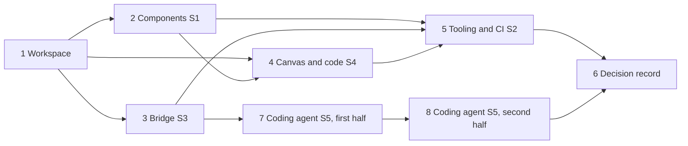

# P0 Technology Selection: Execution Plan

> **For agentic workers:** REQUIRED SUB-SKILL: Use superpowers:subagent-driven-development (recommended) or
> superpowers:executing-plans to implement this plan task-by-task. Steps use checkbox (`- [ ]`) syntax for
> tracking.

**Goal:** Run the four P0 spikes, record what was found, and fill the P0 decision record with pinned versions.

**Architecture:** One throwaway Electron app, `ak-studio-spikes/app`, built with electron-vite. Each spike adds
one screen to it. Spike code lives on its own branch and is never merged; only the findings notes and the
decision record are brought back.

**Tech Stack:** Electron 45, electron-vite 6 on Vite 8, React 19, TypeScript 7, Tailwind CSS 4, shadcn/ui
(React Aria base), React Flow, CodeMirror 6, zod, Vitest, Playwright, Storybook, electron-builder, pnpm.

**Spec:** [P0-technology-selection.md](P0-technology-selection.md). Evidence:
[research/tech-stack-evaluation.md](research/tech-stack-evaluation.md). The architecture the spikes must not
contradict: [architecture.md](architecture.md).

## Global Constraints

- **Decided, not up for re-evaluation:** Vite as the bundler; shadcn/ui with Tailwind CSS as the component
  library.
- **Spike code is throwaway.** Nothing under `ak-studio-spikes/` is merged or copied into `ak-studio/`.
- **Pin exact versions.** No `^` or `~` in any `package.json`. Versions checked on 23 November 2026:
  `electron@45.4.1`, `electron-vite@6.0.0`, `vite@8.3.8`, `tailwindcss@4.3.5`, `shadcn@4.23.0`,
  `react-aria-components@1.22.1`, `@xyflow/react@13.0.2`, `@dagrejs/dagre@3.1.3`, `@codemirror/merge@6.12.3`,
  `react-hook-form@7.92.0`, `ajv@8.20.0`, `@orpc/server@1.16.5`, `vitest@5.1.1`, `playwright@1.65.1`,
  `storybook@10.6.8`, `electron-builder@26.18.0`, `dependency-cruiser@18.9.0`, `@biomejs/biome@2.6.8`,
  `typescript@7.0.2`. Node 24, pnpm 12.
- **The renderer imports nothing from `electron` or Node.** It must also run in a plain browser.
- **Electron security baseline:** `contextIsolation: true`, `sandbox: true`, `nodeIntegration: false`.
- **Style reference: React Spectrum (Spectrum 2).** The shadcn/ui components are restyled so their basic
  style resembles Spectrum 2: its control sizes and density, shapes and radii, state styling (hover, pressed,
  focus ring, disabled, invalid) and spacing rhythm. Take the measurements from the live Spectrum 2
  documentation (<https://react-spectrum.adobe.com/>), not from memory. Colours and fonts stay Agent
  Kernel's. Do not use Adobe's icons, fonts, logo or brand colours; the reference is the style, not the
  identity.
- **Tokens:** use the colours in `docs/src/css/custom.css` as a stand-in. The Studio palette is decided later
  (P1a design gate); the spike only proves the mechanism.
- **Several of these tools are newer than the examples below were written against.** If a command or API does
  not behave as written, read its `--help` or docs, make the smallest change that works, and **record the
  difference in the spike note**. A difference is a finding, not a failure.
- **Time boxes** from the spec: S1 three days, S2 two days, S3 two days, S4 two days. An overrun is recorded
  and counts against the candidate.
- **Every task ends with a findings note** in `docs/specs/950-agent-kernel-studio/research/`, in this shape:

  ```markdown
  # Spike S<n>: <title>
  **Date:** <date>  **Ran on:** <operating systems>  **Time spent:** <days>
  ## Result
  Pass | Pass with changes | Fail — one sentence.
  ## Pass criteria
  | Criterion | Result | Evidence |
  ## What differed from the plan
  ## Versions that worked
  ## Recommendation for the decision record
  ```

## File Structure

```
ak-studio-spikes/                 on branch spike/950-studio-p0 only
  app/                            the one spike app (electron-vite)
    electron.vite.config.ts
    src/main/index.ts             window, security baseline, bridge wiring
    src/main/handlers.ts          bridge handlers, shared with the WebSocket server
    src/main/ws-server.ts         the same handlers over WebSocket (S3)
    src/preload/index.ts          exposes the transport, nothing else
    src/renderer/src/
      main.tsx  App.tsx           a tab per spike
      bridge/contract.ts          operations and schemas (S3)
      bridge/transport.ts         Transport interface, IPC and WebSocket implementations (S3)
      spikes/ComponentsSpike.tsx  S1
      spikes/BridgeSpike.tsx      S3
      spikes/CanvasSpike.tsx      S4
      spikes/CodeSpike.tsx        S4
      spikes/layout.worker.ts     S4
      styles/app.css              Tailwind and tokens (S1)
    tests/                        Vitest and Playwright
docs/specs/950-agent-kernel-studio/research/
  spike-s1-components.md  spike-s2-build.md  spike-s3-bridge.md  spike-s4-canvas-code.md
.github/workflows/studio-spike.yml   on the spike branch only
```

---

### Task 1: Spike workspace and a running Electron app (S2, part 1)

**Files:**
- Create: `ak-studio-spikes/app/` (scaffolded), `ak-studio-spikes/README.md`
- Modify: `ak-studio-spikes/app/src/main/index.ts`, `ak-studio-spikes/app/package.json`

**Interfaces:**
- Produces: a running app with `pnpm dev`, `pnpm build`; `src/renderer/src/App.tsx` with one tab per spike.

- [ ] **Step 1: Create the spike branch from the plan branch**

```bash
git switch -c spike/950-studio-p0 claude/agent-studio-phases-plan-285138
mkdir -p ak-studio-spikes && cd ak-studio-spikes
```

- [ ] **Step 2: Scaffold with electron-vite's official scaffolder**

```bash
pnpm create @quick-start/electron@1.0.31 app --template react-ts
cd app && pnpm install
```

Expected: a project with `src/main`, `src/preload`, `src/renderer` and `electron.vite.config.ts`.

- [ ] **Step 3: Pin versions**

Edit `package.json`: set `electron` `45.4.1`, `electron-vite` `6.0.0`, `vite` `8.3.8`, `typescript` `7.0.2`,
and remove every `^` and `~`. Then:

```bash
pnpm install
pnpm dev
```

Expected: an Electron window opens showing the template page. If TypeScript 7 breaks the build, set
`typescript` to the latest `6.x`, rerun, and record it.

- [ ] **Step 4: Apply the security baseline**

In `src/main/index.ts`, set the window's `webPreferences` to exactly:

```ts
webPreferences: {
  preload: join(__dirname, '../preload/index.js'),
  contextIsolation: true,
  sandbox: true,
  nodeIntegration: false,
},
```

and block navigation and new windows:

```ts
mainWindow.webContents.setWindowOpenHandler(() => ({ action: 'deny' }));
mainWindow.webContents.on('will-navigate', (e) => e.preventDefault());
```

Run `pnpm dev`. Expected: the window still opens. A sandboxed preload must be emitted as CommonJS; if the
window is blank, check the preload's output format in `electron.vite.config.ts` and record the setting needed.

- [ ] **Step 5: Replace the template page with a tab shell**

`src/renderer/src/App.tsx`:

```tsx
import { useState } from 'react';

const tabs = ['Components', 'Bridge', 'Canvas', 'Code'] as const;
type Tab = (typeof tabs)[number];

export default function App() {
  const [tab, setTab] = useState<Tab>('Components');
  return (
    <div style={{ display: 'flex', flexDirection: 'column', height: '100vh' }}>
      <nav style={{ display: 'flex', gap: 8, padding: 8 }}>
        {tabs.map((t) => (
          <button key={t} onClick={() => setTab(t)} aria-pressed={t === tab}>{t}</button>
        ))}
      </nav>
      <main style={{ flex: 1, overflow: 'auto' }} data-testid={`tab-${tab}`}>{tab} spike goes here</main>
    </div>
  );
}
```

- [ ] **Step 6: Prove the renderer runs in a plain browser**

Add to `package.json` scripts: `"dev:web": "vite src/renderer --port 5180"`. Run `pnpm dev:web` and open
`http://localhost:5180`. Expected: the same four tabs render in the browser. If the renderer's Vite config
lives only inside `electron.vite.config.ts`, add `src/renderer/vite.config.ts` with the React plugin and
record that it was needed.

- [ ] **Step 7: Measure**

```bash
time pnpm build
```

Change a string in `App.tsx` with `pnpm dev` running and time the update by eye (stopwatch). Change a string
in `src/main/index.ts` and confirm Electron restarts. Write both numbers down for the S2 note.

- [ ] **Step 8: Commit**

```bash
git add ak-studio-spikes && git commit -m "chore(spike): scaffold P0 spike app with electron-vite"
```

---

### Task 2: Components and theming (S1 — decisions D1, D2, D12)

**Files:**
- Create: `src/renderer/src/styles/app.css`, `src/renderer/src/spikes/ComponentsSpike.tsx`,
  `tests/components.keyboard.spec.ts`
- Modify: `src/renderer/src/main.tsx`, `src/renderer/src/App.tsx`
- Note: `research/spike-s1-components.md`

All paths are under `ak-studio-spikes/app/`.

**Interfaces:**
- Consumes: the tab shell from Task 1.
- Produces: `ComponentsSpike` rendered in the Components tab; the list of React Aria base gaps.

- [ ] **Step 1: Initialise shadcn/ui on the React Aria base**

```bash
pnpm dlx shadcn@4.23.0 init --template vite --base aria --cwd . --yes
```

Expected: `components.json`, a CSS file with theme variables, and Tailwind 4 installed. The scaffolded
project is electron-vite, not plain Vite: if `init` cannot find the Vite config or the CSS entry, point
`components.json` at `src/renderer/src/styles/app.css` and the renderer's alias, and record what was needed.

- [ ] **Step 2: Declare the tokens and remove Tailwind's default palette**

`src/renderer/src/styles/app.css` (keep the block `init` generated below this, mapping its variables to these):

```css
@import "tailwindcss";

@theme {
  --color-*: initial;                 /* no default palette: text-blue-500 must not exist */
  --color-canvas: #011428;
  --color-surface: #02284F;
  --color-overlay: #0D315A;
  --color-primary: #FF5E32;
  --color-on-primary: #011428;
  --color-text: #E8EEF7;
  --color-muted: #9FB3CC;
  --color-border: rgb(255 255 255 / 0.12);
  --color-success: #26A64D;
  --color-warning: #F7A544;
  --color-danger: #DB4444;
  --radius-pill: 9999px;
  /* Add the control heights, radii and spacing steps measured in Step 2a here, as --spacing-* and --radius-* */
}

[data-theme="light"] {
  --color-canvas: #FFFFFF;
  --color-surface: #F5F8FC;
  --color-overlay: #FFFFFF;
  --color-text: #02284F;
  --color-muted: #3F598A;
  --color-border: rgb(2 40 79 / 0.14);
}

.glass { background: rgb(13 49 90 / 0.72); backdrop-filter: blur(16px); border: 1px solid var(--color-border); }
```

- [ ] **Step 2a: Measure the Spectrum 2 reference**

Open the Spectrum 2 documentation for Button, TextField, Picker, ComboBox, Menu, Dialog, Popover, Tabs,
TableView and TreeView. For each, record in the spike note, at the medium size: control height, horizontal
padding, corner radius, font size and weight, border width, the focus-ring width and offset, and how hover,
pressed, disabled and invalid differ from default. Also record the spacing steps and the type scale it uses.
Put the results in a table: this table becomes the first draft of the Studio's size and shape tokens.

Then add those values to `@theme` as tokens (`--spacing-control-m`, `--radius-control`, and so on) so that
components use them and never a literal number.

- [ ] **Step 3: Verify the palette is gone**

Add `className="text-blue-500"` to any element, run `pnpm build`, and search the built CSS:

```bash
grep -c "text-blue-500" out/renderer/assets/*.css
```

Expected: `0` (the class produces no rule). Remove the test class. If shadcn's generated components reference
default-palette classes and now render unstyled, list which ones in the note.

- [ ] **Step 4: Add the components to evaluate**

```bash
pnpm dlx shadcn@4.23.0 add button input dialog popover select combobox menu context-menu tabs table tree tooltip command resizable sonner --yes
```

Expected: files under the configured components folder. **Record every name the React Aria base does not
have.** For each missing one, write the component directly on `react-aria-components@1.22.1` and note it.

- [ ] **Step 5: Build the spike screen**

`ComponentsSpike.tsx` must show, on one page, each restyled to resemble Spectrum 2 using the Step 2a tokens
and the Agent Kernel colours, with a dark/light switch that sets `data-theme` on `<html>`. Floating layers
(Dialog, Popover, Menu) are built twice, once solid as Spectrum has them and once with `.glass`, so the
design gate can choose:

1. Button in primary, secondary, outline, ghost and danger; Tag; Input.
2. A Dialog and a Popover using `.glass`.
3. A table with 5,000 generated rows, virtualised, with sortable columns.
4. A tree of 200 nodes, three levels deep, where a node can be dragged onto another.
5. A Combobox with 500 options.
6. A context menu on tree nodes.
7. A command palette opened with Ctrl/Cmd+K.
8. Three resizable panels.

Generate the data with:

```ts
export const rows = Array.from({ length: 5000 }, (_, i) => ({
  id: i, name: `agent-${i}`, framework: ['openai', 'langgraph', 'adk'][i % 3], tools: i % 7,
}));
```

- [ ] **Step 6: Render one generated form (D12)**

Dump a slice of the real schema:

```bash
cd ../../ak-py && uv run python -c "import json; from agentkernel.core.config import AKConfig; s=AKConfig.model_json_schema(); print(json.dumps({'session': s['properties']['session'], '\$defs': s['\$defs']}))" > ../ak-studio-spikes/app/src/renderer/src/spikes/session.schema.json && cd -
pnpm add -E react-hook-form@7.92.0 ajv@8.20.0
```

Render the `session` section as a form from that JSON: resolve `$ref`s, one field per property, the field's
`description` as help text, its `default` shown, and Ajv validation on blur. Note how unions (`anyOf`) and
nested objects came out; that decides how much per-field override the real `SchemaForm` needs.

- [ ] **Step 7: Write the keyboard test**

`tests/components.keyboard.spec.ts` (Playwright, against `pnpm dev:web`):

```ts
import { test, expect } from '@playwright/test';

test('components are operable by keyboard alone', async ({ page }) => {
  await page.goto('http://localhost:5180');
  await page.getByRole('button', { name: 'Components' }).click();

  await page.keyboard.press('ControlOrMeta+K');
  await expect(page.getByRole('dialog')).toBeVisible();
  await page.keyboard.press('Escape');
  await expect(page.getByRole('dialog')).toBeHidden();

  const tree = page.getByRole('treegrid').or(page.getByRole('tree')).first();
  await tree.focus();
  await page.keyboard.press('ArrowDown');
  await page.keyboard.press('ArrowRight');
  await expect(tree.locator('[aria-expanded="true"]').first()).toBeVisible();

  const grid = page.getByRole('grid').first();
  await grid.focus();
  await page.keyboard.press('End');
  await expect(grid.getByText('agent-4999')).toBeVisible();
});
```

```bash
pnpm add -D -E @playwright/test@1.65.1 && pnpm exec playwright install chromium
pnpm dev:web & pnpm exec playwright test tests/components.keyboard.spec.ts
```

Expected: PASS. A failure here is a finding about that component, not a test to weaken.

- [ ] **Step 8: Manual checks**

- Scroll the 5,000-row table quickly: no blank flashes longer than a frame or two.
- Run a screen reader (NVDA, VoiceOver or Orca) over the dialog, the combobox and the tree; note anything
  not announced.
- Switch dark and light: both the solid and the glass floating layers stay readable.
- **Side by side with Spectrum 2:** put the spike's Button, text field, Picker, Menu, Dialog and table next
  to the same components on the Spectrum 2 documentation site and take a screenshot of each pair. Size,
  shape, spacing and states should read as the same family; colour and font differ on purpose. Attach the
  screenshots to the note and list every place the restyle could not match, with the reason.

- [ ] **Step 9: Write `research/spike-s1-components.md` and commit**

Pass criteria to report (from the spec): the components read as the same family as Spectrum 2 in the
side-by-side screenshots; every component matches the tokens without overriding library internals; every component is keyboard-operable; no more than two components need a second primitive library.
State the D1 base (React Aria or Base UI), D2 and D12 recommendations.

**If it fails:** rerun Steps 1 to 8 with `--base base`, adding `@tanstack/react-table` and
`@tanstack/react-virtual` for the table and a tree component, and report both.

```bash
git add ak-studio-spikes docs/specs/950-agent-kernel-studio/research/spike-s1-components.md
git commit -m "chore(spike): S1 components and theming, with findings"
```

---

### Task 3: The bridge (S3 — decisions D5, D8)

**Files:**
- Create: `src/renderer/src/bridge/contract.ts`, `src/renderer/src/bridge/transport.ts`,
  `src/main/handlers.ts`, `src/main/ws-server.ts`, `src/renderer/src/spikes/BridgeSpike.tsx`,
  `tests/handlers.test.ts`
- Modify: `src/main/index.ts`, `src/preload/index.ts`
- Note: `research/spike-s3-bridge.md`

**Interfaces:**
- Produces:
  - `interface Transport { request(op: string, input: unknown): Promise<unknown>; subscribe(op: string, input: unknown, onChunk: (chunk: unknown) => void): () => void }`
  - `handlers.request(op, input): Promise<unknown>` and
    `handlers.subscribe(op, input, emit): () => void` in `src/main/handlers.ts`
  - `getTransport(): Transport` in `transport.ts`

- [ ] **Step 1: Write the failing test for the handlers**

`tests/handlers.test.ts`:

```ts
import { describe, expect, it } from 'vitest';
import { handlers } from '../src/main/handlers';

const wait = (ms: number) => new Promise((r) => setTimeout(r, ms));

describe('bridge handlers', () => {
  it('answers a request', async () => {
    expect(await handlers.request('demo.echo', { text: 'hi' })).toEqual({ text: 'hi' });
  });

  it('rejects input that fails the schema', async () => {
    await expect(handlers.request('demo.echo', { text: 42 })).rejects.toThrow();
  });

  it('streams lines in batches and stops the process on cancel', async () => {
    const batches: string[][] = [];
    const cancel = handlers.subscribe('demo.run', { lines: 1_000_000, delayMs: 1 }, (c) =>
      batches.push((c as { lines: string[] }).lines),
    );
    await wait(300);
    cancel();
    const seen = batches.flat().length;
    expect(seen).toBeGreaterThan(0);
    await wait(500);
    expect(batches.flat().length).toBe(seen); // nothing arrives after cancel
    expect(handlers.runningProcessCount()).toBe(0);
  });
});
```

- [ ] **Step 2: Run it to see it fail**

```bash
pnpm add -D -E vitest@5.1.1 && pnpm add -E zod
pnpm exec vitest run tests/handlers.test.ts
```

Expected: FAIL, `Cannot find module '../src/main/handlers'`.

- [ ] **Step 3: Write the contract**

`src/renderer/src/bridge/contract.ts` (no Node or Electron imports):

```ts
import { z } from 'zod';

export const contract = {
  'demo.echo': { kind: 'request', input: z.object({ text: z.string() }) },
  'demo.run': { kind: 'stream', input: z.object({ lines: z.number().int().positive(), delayMs: z.number().int().min(0) }) },
} as const;

export type OpId = keyof typeof contract;
export type StreamChunk = { lines: string[]; done?: boolean; exitCode?: number | null };
```

- [ ] **Step 4: Write the handlers**

`src/main/handlers.ts`:

```ts
import { spawn, type ChildProcess } from 'node:child_process';
import { contract, type OpId, type StreamChunk } from '../renderer/src/bridge/contract';

const running = new Set<ChildProcess>();

function killTree(child: ChildProcess) {
  if (child.pid === undefined || child.exitCode !== null) return;
  if (process.platform === 'win32') {
    spawn('taskkill', ['/pid', String(child.pid), '/T', '/F']);
  } else {
    try { process.kill(-child.pid, 'SIGTERM'); } catch { /* already gone */ }
  }
}

function parse(op: string, input: unknown) {
  const def = contract[op as OpId];
  if (!def) throw new Error(`unknown operation: ${op}`);
  return def.input.parse(input);
}

export const handlers = {
  async request(op: string, input: unknown): Promise<unknown> {
    const data = parse(op, input);
    if (op === 'demo.echo') return data;
    throw new Error(`not a request: ${op}`);
  },

  subscribe(op: string, input: unknown, emit: (chunk: StreamChunk) => void): () => void {
    const { lines, delayMs } = parse(op, input) as { lines: number; delayMs: number };
    const script =
      `let i=0;const n=${lines},d=${delayMs};` +
      `const t=()=>{if(i>=n)return;console.log('line '+(i++));d?setTimeout(t,d):setImmediate(t)};t()`;
    const child = spawn(process.execPath, ['-e', script], {
      detached: process.platform !== 'win32', // own process group, so the whole tree can be killed
      env: { ...process.env, ELECTRON_RUN_AS_NODE: '1' },
    });
    running.add(child);

    let buffer: string[] = [];
    let partial = '';
    let cancelled = false;
    const flush = () => { if (buffer.length && !cancelled) { emit({ lines: buffer }); buffer = []; } };
    const timer = setInterval(flush, 16); // one message per frame at most

    child.stdout!.on('data', (d: Buffer) => {
      const parts = (partial + d.toString()).split('\n');
      partial = parts.pop() ?? '';
      buffer.push(...parts);
    });
    child.on('exit', (code) => {
      clearInterval(timer); flush(); running.delete(child);
      if (!cancelled) emit({ lines: [], done: true, exitCode: code });
    });

    return () => { cancelled = true; clearInterval(timer); killTree(child); };
  },

  runningProcessCount: () => running.size,
};
```

- [ ] **Step 5: Run the test to see it pass**

```bash
pnpm exec vitest run tests/handlers.test.ts
```

Expected: 3 passed. Run it on Windows, macOS and Linux (Task 5's CI does this too); cancel is the part that
differs by platform.

- [ ] **Step 6: Wire Electron IPC**

`src/preload/index.ts`:

```ts
import { contextBridge, ipcRenderer } from 'electron';

contextBridge.exposeInMainWorld('bridge', {
  request: (op: string, input: unknown) => ipcRenderer.invoke('bridge:request', op, input),
  subscribe: (op: string, input: unknown, onChunk: (chunk: unknown) => void) => {
    const id = crypto.randomUUID();
    const listener = (_e: unknown, msg: { id: string; chunk: unknown }) => { if (msg.id === id) onChunk(msg.chunk); };
    ipcRenderer.on('bridge:chunk', listener);
    ipcRenderer.send('bridge:subscribe', { id, op, input });
    return () => { ipcRenderer.removeListener('bridge:chunk', listener); ipcRenderer.send('bridge:unsubscribe', id); };
  },
});
```

In `src/main/index.ts`, after the window is created:

```ts
import { ipcMain } from 'electron';
import { handlers } from './handlers';

const subs = new Map<string, () => void>();
const fromOurWindow = (e: Electron.IpcMainEvent | Electron.IpcMainInvokeEvent) =>
  e.senderFrame?.url.startsWith(process.env.ELECTRON_RENDERER_URL ?? 'file://') ?? false;

ipcMain.handle('bridge:request', (e, op: string, input: unknown) => {
  if (!fromOurWindow(e)) throw new Error('forbidden sender');
  return handlers.request(op, input);
});
ipcMain.on('bridge:subscribe', (e, { id, op, input }) => {
  if (!fromOurWindow(e)) return;
  subs.set(id, handlers.subscribe(op, input, (chunk) => { if (!e.sender.isDestroyed()) e.sender.send('bridge:chunk', { id, chunk }); }));
});
ipcMain.on('bridge:unsubscribe', (_e, id: string) => { subs.get(id)?.(); subs.delete(id); });
```

- [ ] **Step 7: Write the transports**

`src/renderer/src/bridge/transport.ts`:

```ts
export interface Transport {
  request(op: string, input: unknown): Promise<unknown>;
  subscribe(op: string, input: unknown, onChunk: (chunk: unknown) => void): () => void;
}

declare global { interface Window { bridge?: Transport } }

export function createWsTransport(url: string): Transport {
  const ws = new WebSocket(url);
  const ready = new Promise<void>((r) => ws.addEventListener('open', () => r(), { once: true }));
  const pending = new Map<string, (m: { result?: unknown; error?: string }) => void>();
  const streams = new Map<string, (chunk: unknown) => void>();
  ws.addEventListener('message', (ev) => {
    const m = JSON.parse(ev.data as string);
    if (m.type === 'result') { pending.get(m.id)?.(m); pending.delete(m.id); }
    if (m.type === 'chunk') streams.get(m.id)?.(m.chunk);
  });
  const send = async (m: unknown) => { await ready; ws.send(JSON.stringify(m)); };
  return {
    request: (op, input) => new Promise((resolve, reject) => {
      const id = crypto.randomUUID();
      pending.set(id, (m) => (m.error ? reject(new Error(m.error)) : resolve(m.result)));
      void send({ type: 'request', id, op, input });
    }),
    subscribe: (op, input, onChunk) => {
      const id = crypto.randomUUID();
      streams.set(id, onChunk);
      void send({ type: 'subscribe', id, op, input });
      return () => { streams.delete(id); void send({ type: 'unsubscribe', id }); };
    },
  };
}

export function getTransport(): Transport {
  return window.bridge ?? createWsTransport('ws://localhost:5181');
}
```

- [ ] **Step 8: Write the WebSocket server over the same handlers**

`src/main/ws-server.ts`:

```ts
import { WebSocketServer } from 'ws';
import { handlers } from './handlers';

const wss = new WebSocketServer({ port: 5181 });
wss.on('connection', (ws) => {
  const subs = new Map<string, () => void>();
  ws.on('message', async (raw) => {
    const m = JSON.parse(raw.toString());
    if (m.type === 'request') {
      try { ws.send(JSON.stringify({ type: 'result', id: m.id, result: await handlers.request(m.op, m.input) })); }
      catch (e) { ws.send(JSON.stringify({ type: 'result', id: m.id, error: String(e) })); }
    }
    if (m.type === 'subscribe') subs.set(m.id, handlers.subscribe(m.op, m.input, (chunk) => ws.send(JSON.stringify({ type: 'chunk', id: m.id, chunk }))));
    if (m.type === 'unsubscribe') { subs.get(m.id)?.(); subs.delete(m.id); }
  });
  ws.on('close', () => subs.forEach((cancel) => cancel()));
});
console.log('bridge ws server on :5181');
```

```bash
pnpm add -E ws && pnpm add -D -E @types/ws tsx
```

Add script `"dev:ws": "tsx src/main/ws-server.ts"`.

- [ ] **Step 9: Write the spike screen**

`src/renderer/src/spikes/BridgeSpike.tsx`, mounted in the Bridge tab:

```tsx
import { useEffect, useRef, useState } from 'react';
import { getTransport } from '../bridge/transport';
import type { StreamChunk } from '../bridge/contract';

export function BridgeSpike() {
  const transport = useRef(getTransport());
  const cancel = useRef<(() => void) | null>(null);
  const [count, setCount] = useState(0);
  const [worstFrame, setWorstFrame] = useState(0);
  const [echo, setEcho] = useState('');

  useEffect(() => {
    let last = performance.now(); let id = 0;
    const tick = (now: number) => { setWorstFrame((w) => Math.max(w, now - last)); last = now; id = requestAnimationFrame(tick); };
    id = requestAnimationFrame(tick);
    return () => cancelAnimationFrame(id);
  }, []);

  const start = (lines: number, delayMs: number) => {
    setCount(0); setWorstFrame(0);
    cancel.current = transport.current.subscribe('demo.run', { lines, delayMs }, (c) =>
      setCount((n) => n + (c as StreamChunk).lines.length));
  };

  return (
    <div>
      <button onClick={async () => setEcho(JSON.stringify(await transport.current.request('demo.echo', { text: 'hi' })))}>Echo</button>
      <button onClick={() => start(10_000, 0)}>Burst 10,000</button>
      <button onClick={() => start(1_000_000, 1)}>Slow stream</button>
      <button onClick={() => cancel.current?.()}>Cancel</button>
      <p data-testid="echo">{echo}</p>
      <p data-testid="count">{count}</p>
      <p data-testid="worst-frame">{Math.round(worstFrame)}</p>
      <p>transport: {window.bridge ? 'electron-ipc' : 'websocket'}</p>
    </div>
  );
}
```

- [ ] **Step 10: Verify on both transports**

Electron: `pnpm dev`, Bridge tab. Browser: `pnpm dev:ws` and `pnpm dev:web`, open `http://localhost:5180`.
On each:

| Check | Expected |
|---|---|
| Echo | `{"text":"hi"}` |
| Burst 10,000 | count reaches 10000; worst frame under 100 ms |
| Slow stream, then Cancel | count stops; no `node`/Electron helper process left (Task Manager, `ps`) |
| Close the window mid-stream | no process left |

`BridgeSpike.tsx` and `contract.ts` must be byte-identical for both runs. That is the pass criterion.

- [ ] **Step 11: Compare with oRPC (half a day at most)**

```bash
pnpm add -E @orpc/server@1.16.5 @orpc/client@1.16.5
```

Following <https://orpc.dev/docs/adapters/electron>, declare the same two operations and serve them over
oRPC's Electron transport. Answer three questions in the note: does a streamed response arrive incrementally
in the renderer; does aborting it in the renderer stop the child process in main; does the same client code
work over HTTP or WebSocket. If any answer is no, the decision is the in-house contract.

- [ ] **Step 12: Write `research/spike-s3-bridge.md` and commit**

Report the table from Step 10 per operating system, the oRPC answers, and the D5 recommendation. For D8, note
whether anything observed argues against Zustand, TanStack Query and TanStack Router; otherwise recommend
them as listed.

```bash
git add ak-studio-spikes docs/specs/950-agent-kernel-studio/research/spike-s3-bridge.md
git commit -m "chore(spike): S3 typed bridge over IPC and WebSocket, with findings"
```

---

### Task 4: Canvas and code viewer (S4 — decisions D6, D7)

**Files:**
- Create: `src/renderer/src/spikes/CanvasSpike.tsx`, `src/renderer/src/spikes/layout.worker.ts`,
  `src/renderer/src/spikes/CodeSpike.tsx`
- Note: `research/spike-s4-canvas-code.md`

**Interfaces:**
- Consumes: tokens and `.glass` from Task 2.
- Produces: `CanvasSpike` and `CodeSpike` in their tabs.

- [ ] **Step 1: Install**

```bash
pnpm add -E @xyflow/react@13.0.2 @dagrejs/dagre@3.1.3
pnpm add -E codemirror @codemirror/lang-python @codemirror/lang-yaml @codemirror/merge@6.12.3 @codemirror/lint
```

- [ ] **Step 2: Write the layout worker**

`src/renderer/src/spikes/layout.worker.ts`:

```ts
import dagre from '@dagrejs/dagre';

type In = { nodes: { id: string }[]; edges: { source: string; target: string }[] };

self.onmessage = (e: MessageEvent<In>) => {
  const g = new dagre.graphlib.Graph().setGraph({ rankdir: 'LR', nodesep: 24, ranksep: 80 }).setDefaultEdgeLabel(() => ({}));
  e.data.nodes.forEach((n) => g.setNode(n.id, { width: 220, height: 96 }));
  e.data.edges.forEach((ed) => g.setEdge(ed.source, ed.target));
  const t0 = performance.now();
  dagre.layout(g);
  self.postMessage({
    ms: performance.now() - t0,
    positions: e.data.nodes.map((n) => ({ id: n.id, x: g.node(n.id).x, y: g.node(n.id).y })),
  });
};
```

- [ ] **Step 3: Write the canvas spike**

`CanvasSpike.tsx`. The code below is written for the React Flow 12 API. On 13.0.2 (released 16 November
2026 with breaking store and hook changes), follow <https://reactflow.dev/whats-new> where it differs and
record each difference.

```tsx
import { useEffect, useMemo, useState } from 'react';
import { ReactFlow, Background, MiniMap, Controls, Handle, Position, type Node, type Edge } from '@xyflow/react';
import '@xyflow/react/dist/style.css';

const N = 300;
const rawNodes = Array.from({ length: N }, (_, i) => ({ id: `n${i}` }));
const rawEdges = Array.from({ length: N - 1 }, (_, i) => ({ source: `n${Math.floor(i / 3)}`, target: `n${i + 1}` }));

function AgentNode({ data, selected }: { data: { label: string }; selected: boolean }) {
  return (
    <div className="glass" style={{ width: 220, height: 96, borderRadius: 12, padding: 12,
      outline: selected ? '2px solid var(--color-primary)' : 'none' }}>
      <Handle type="target" position={Position.Left} />
      <strong>{data.label}</strong>
      <div style={{ fontSize: 12, color: 'var(--color-muted)' }}>OpenAI Agents SDK · 2 tools</div>
      <Handle type="source" position={Position.Right} />
    </div>
  );
}
const nodeTypes = { agent: AgentNode };

export function CanvasSpike() {
  const [nodes, setNodes] = useState<Node[]>([]);
  const [layoutMs, setLayoutMs] = useState<number | null>(null);
  const edges = useMemo<Edge[]>(() => rawEdges.map((e, i) => ({ id: `e${i}`, ...e })), []);

  useEffect(() => {
    const worker = new Worker(new URL('./layout.worker.ts', import.meta.url), { type: 'module' });
    worker.onmessage = (e) => {
      setLayoutMs(e.data.ms);
      setNodes(e.data.positions.map((p: { id: string; x: number; y: number }) => ({
        id: p.id, type: 'agent', position: { x: p.x, y: p.y }, data: { label: p.id },
      })));
    };
    worker.postMessage({ nodes: rawNodes, edges: rawEdges });
    return () => worker.terminate();
  }, []);

  return (
    <div style={{ height: '100%' }}>
      <p data-testid="layout-ms">layout: {layoutMs === null ? '…' : `${Math.round(layoutMs)} ms`}</p>
      <ReactFlow nodes={nodes} edges={edges} nodeTypes={nodeTypes} fitView onlyRenderVisibleElements>
        <Background /><MiniMap /><Controls />
      </ReactFlow>
    </div>
  );
}
```

- [ ] **Step 4: Measure the canvas**

Run `pnpm dev`, open the Canvas tab, and with the browser's performance panel recording:

| Check | Expected |
|---|---|
| Layout of 300 nodes | Runs in the worker; the window stays responsive while it runs |
| Pan and zoom with all 300 nodes visible | No sustained drop below about 50 frames per second |
| Drag one node | Follows the pointer without lag |
| `backdrop-filter` on 300 nodes | If this is what makes it slow, record it: glass on canvas nodes may need to be solid |
| Keyboard | Tab reaches nodes; note what React Flow offers out of the box for the canvas keyboard model |

If 13.0.2 is not workable within half a day, `pnpm add -E @xyflow/react@12.12.0`, rerun, and report both.

- [ ] **Step 5: Write the code spike**

`CodeSpike.tsx` must show three things, themed with the tokens (CodeMirror themes are CSS-variable based):

1. A read-only viewer on a 2,000-line Python file. Generate it:

   ```ts
   export const bigPython = Array.from({ length: 400 }, (_, i) =>
     `def tool_${i}(order_id: str) -> dict:\n    """Look up order ${i}."""\n    return {"id": order_id, "n": ${i}}\n\n`).join('');
   ```

2. A side-by-side diff of that file against a copy with 20 changed lines, using `MergeView` from
   `@codemirror/merge`.
3. A YAML editor on this text, with inline errors produced by a `linter` from `@codemirror/lint` that parses
   the YAML and validates it with Ajv against `session.schema.json` from Task 2:

   ```yaml
   session:
     type: redis
     redis:
       url: redis://localhost:6379
       ttl: "not-a-number"
   ```

   Expected: an inline error on the `ttl` line (or on whichever field the schema rejects; pick one field the
   schema types as a number and set it to a string).

- [ ] **Step 6: Measure the editor**

| Check | Expected |
|---|---|
| Open the 2,000-line file | Under 200 ms to first paint |
| Scroll end to end | Smooth |
| Diff | Changed lines marked on both sides; scroll stays in sync |
| YAML error | Appears on the right line within 500 ms of typing |
| Bundle | `pnpm build`, then record the size of the renderer chunks that contain CodeMirror |

- [ ] **Step 7: Write `research/spike-s4-canvas-code.md` and commit**

State the D6 recommendation (React Flow 13.0.2 or 12.12.0; dagre sufficient or not; glass on nodes or not)
and D7 (CodeMirror 6 confirmed, or what was missing).

```bash
git add ak-studio-spikes docs/specs/950-agent-kernel-studio/research/spike-s4-canvas-code.md
git commit -m "chore(spike): S4 canvas and code viewer, with findings"
```

---

### Task 5: Tooling, packaging and three operating systems (S2, part 2 — D3, D4, D9, D10, D11, D13)

**Files:**
- Create: `ak-studio-spikes/app/electron-builder.yml`, `ak-studio-spikes/app/.dependency-cruiser.cjs`,
  `ak-studio-spikes/app/biome.json`, `ak-studio-spikes/app/tests/smoke.electron.spec.ts`,
  `.github/workflows/studio-spike.yml`
- Note: `research/spike-s2-build.md`

**Interfaces:**
- Consumes: the app and tests from Tasks 1 to 4.
- Produces: a green three-system CI run with three installers as artifacts.

- [ ] **Step 1: Storybook**

```bash
pnpm dlx storybook@10.6.8 init --yes
```

Add one story for the restyled Button with its variants. Run `pnpm storybook` and `pnpm build-storybook`.
Expected: both succeed and the story shows the tokens (Storybook must load `styles/app.css`). Record the
Storybook framework package it chose and any config needed for Tailwind 4.

- [ ] **Step 2: Biome**

```bash
pnpm add -D -E @biomejs/biome@2.6.8 && pnpm exec biome init
pnpm exec biome check src
```

Expected: runs and reports. Do not fix style findings in spike code; only confirm the tool works on
TypeScript 7 syntax and `.tsx`.

- [ ] **Step 3: Boundary check (D13)**

`.dependency-cruiser.cjs`:

```js
module.exports = {
  forbidden: [
    { name: 'renderer-no-electron', severity: 'error', from: { path: '^src/renderer' },
      to: { path: '^(electron|node:|fs$|path$|child_process$)', dependencyTypes: ['npm', 'core'] } },
    { name: 'renderer-no-main', severity: 'error', from: { path: '^src/renderer' }, to: { path: '^src/(main|preload)' } },
  ],
  options: { tsConfig: { fileName: 'tsconfig.web.json' }, doNotFollow: { path: 'node_modules' } },
};
```

```bash
pnpm add -D -E dependency-cruiser@18.9.0
pnpm exec depcruise src --config .dependency-cruiser.cjs
```

Expected: no violations. Then add `import 'node:fs'` to `App.tsx` and rerun. Expected: one
`renderer-no-electron` error and a non-zero exit. Remove the import. If `tsConfig` has a different file name
in the scaffold, use that one.

- [ ] **Step 4: Electron smoke test**

`tests/smoke.electron.spec.ts`:

```ts
import { test, expect, _electron as electron } from '@playwright/test';

test('the packaged main process opens a window and the bridge answers', async () => {
  const app = await electron.launch({ args: ['.'] });
  const page = await app.firstWindow();
  await page.getByRole('button', { name: 'Bridge' }).click();
  await page.getByRole('button', { name: 'Echo' }).click();
  await expect(page.getByTestId('echo')).toHaveText('{"text":"hi"}');
  await app.close();
});
```

```bash
pnpm build && pnpm exec playwright test tests/smoke.electron.spec.ts
```

Expected: PASS. Playwright's Electron support is labelled experimental; record any workaround.

- [ ] **Step 5: Package**

`electron-builder.yml`:

```yaml
appId: ai.yaala.akstudio.spike
productName: AK Studio Spike
directories: { output: release }
files: [out/**, package.json]
win: { target: nsis }
mac: { target: dmg, identity: null }
linux: { target: [AppImage, deb] }
```

```bash
pnpm add -D -E electron-builder@26.18.0
pnpm build && pnpm exec electron-builder --publish never
```

Expected: an installer for the current operating system under `release/`. Install and launch it once by hand.
It is unsigned; signing is P12.

- [ ] **Step 6: CI on three operating systems**

`.github/workflows/studio-spike.yml`, at the repository root on the spike branch:

```yaml
name: studio-spike
on:
  push:
    branches: [spike/950-studio-p0]
    paths: ['ak-studio-spikes/**', '.github/workflows/studio-spike.yml']
jobs:
  build:
    strategy:
      fail-fast: false
      matrix: { os: [ubuntu-latest, windows-latest, macos-latest] }
    runs-on: ${{ matrix.os }}
    defaults: { run: { working-directory: ak-studio-spikes/app } }
    steps:
      - uses: actions/checkout@v4
      - uses: pnpm/action-setup@v4
        with: { version: 12 }
      - uses: actions/setup-node@v4
        with: { node-version: 24, cache: pnpm, cache-dependency-path: ak-studio-spikes/app/pnpm-lock.yaml }
      - run: pnpm install --frozen-lockfile
      - run: pnpm exec depcruise src --config .dependency-cruiser.cjs
      - run: pnpm exec vitest run
      - run: pnpm build
      - run: pnpm exec playwright install chromium
      - name: Electron smoke test
        run: ${{ runner.os == 'Linux' && 'xvfb-run -a' || '' }} pnpm exec playwright test tests/smoke.electron.spec.ts
      - run: pnpm exec electron-builder --publish never
      - uses: actions/upload-artifact@v4
        with: { name: installer-${{ matrix.os }}, path: ak-studio-spikes/app/release/*.* }
```

**Ask the project owner before pushing:** this publishes the spike branch to the remote and uses CI minutes.

```bash
git add -A && git commit -m "chore(spike): S2 tooling, packaging and three-OS CI"
git push -u origin spike/950-studio-p0
gh run watch
```

Expected: all three jobs green; three installer artifacts. The `tests/handlers.test.ts` cancel test passing
on Windows is the key result here.

- [ ] **Step 7: Write `research/spike-s2-build.md` and commit**

Report: cold build time and hot reload time (Task 1), each tool's result on TypeScript 7, CI result per
operating system, installer produced per system, and anything electron-vite needed that the scaffold did not
give. State the recommendations for D3 (electron-vite confirmed, or the Electron Forge fallback), D4, D9,
D10, D11 and D13.

**If electron-vite fails** on a blocker (sandboxed preload, a platform, TypeScript 7 with no workaround):
repeat Tasks 1 and 5 with Electron Forge 8 and its Vite plugin, and report both.

```bash
git add docs/specs/950-agent-kernel-studio/research/spike-s2-build.md
git commit -m "docs(spike): S2 findings" && git push
```

---

### Task 6: Decision record and close-out

**Files:**
- Modify: `docs/specs/950-agent-kernel-studio/P0-technology-selection.md` (decision record, checklist, status),
  `docs/specs/950-agent-kernel-studio/README.md` (progress row, decision log, open decisions),
  `docs/specs/950-agent-kernel-studio/P1a-app-foundation.md` (stack names)

**Interfaces:**
- Consumes: the four spike notes.
- Produces: a complete, approved decision record on the plan branch.

- [ ] **Step 1: Bring the notes back to the plan branch**

```bash
git switch claude/agent-studio-phases-plan-285138
git checkout spike/950-studio-p0 -- docs/specs/950-agent-kernel-studio/research
git status --short
```

Expected: only the four `spike-s*.md` files are new. Nothing under `ak-studio-spikes/`.

- [ ] **Step 2: Fill the decision record**

In `P0-technology-selection.md`, complete every row D1 to D13 of the "Decision record" table: the choice, the
exact pinned version that worked, a link to the spike note, the date. Where a spike disagreed with the
provisional choice, the spike wins; say so in one line under the table.

- [ ] **Step 3: Record what could not be met**

Under "Exit criteria", list any constraint C1 to C8 that a spike showed cannot be fully met, with its
consequence (for example "glass on canvas nodes is too slow at 300 nodes; canvas nodes are solid").

- [ ] **Step 4: Get approval**

Present the decision record to the project owner. Do not mark P0 done on your own judgment. Record the
approver and date in the table.

- [ ] **Step 5: Update the tracker and the next phase**

- `README.md`: set P0 to Done; add one decision-log row per decision that changed from provisional; remove
  open decisions 1 and 1a; set "Next action" to the P1a design gate.
- `P1a-app-foundation.md`: replace the "provisional choices" sentence in "Depends on" with a link to the
  decision record, and correct any stack name or version in the work packages.
- `P0-technology-selection.md`: tick the checklist; set Status to Done.

- [ ] **Step 6: Commit, then retire the spike code**

```bash
git add docs/specs/950-agent-kernel-studio && git commit -m "docs: record P0 technology decisions for #950"
```

Leave `spike/950-studio-p0` in place until P1a starts, as a reference. **Deleting the remote branch needs the
project owner's go-ahead**; when given:

```bash
git push origin --delete spike/950-studio-p0 && git branch -D spike/950-studio-p0
```

---

### Task 7: Coding agent, pasted-key design (S5 first half, D14) — superseded

Added 23 November 2026, when the owner's requirement was read as a key pasted into the Studio. Steps 1 to 6
and 8 ran. **Step 7 is cancelled:** on 24 November 2026 the owner settled that the Studio uses the user's
own signed-in Claude Code, so no test key is needed. Task 8 covers that design.
Runs on branch `spike/950-studio-p0`, in `ak-studio-spikes/app/`.

**Files:**
- Create: `src/main/agent/keyStore.ts`, `src/main/agent/codingAgent.ts`, `src/main/agent/sdkAdapter.ts`,
  `src/main/agent/codingAgent.test.ts`, `src/main/agent/keyStore.test.ts`,
  `src/renderer/src/spikes/AgentSpike.tsx`, `tests/agent.electron.spec.ts`
- Modify: `src/renderer/src/bridge/contract.ts` (agent operations), `src/main/handlers.ts`,
  `electron-builder.yml` (`asarUnpack`), `package.json`
- Create: `docs/specs/950-agent-kernel-studio/research/spike-s5-coding-agent.md`

**Interfaces:**
- Consumes: the bridge contract and `Transport` from Task 3 (request, subscribe, sender check).
- Produces: the findings note, which Task 6's decision record cites for D14.

**Facts from the documentation (checked 23 November 2026; re-check before relying on them):**
- Package `@anthropic-ai/claude-agent-sdk` (v0.3.330 at the time), Node 18.14 or later. It bundles a native
  Claude Code executable through optional dependencies; `pathToClaudeCodeExecutable` overrides it.
- `query({ prompt, options })` returns an async iterator of messages. Options used here: `cwd`, `env`,
  `permissionMode`, `canUseTool`, `includePartialMessages`, `abortController`, `settingSources`, `resume`.
- `env` replaces the subprocess environment. Credential precedence puts `ANTHROPIC_API_KEY` above a local
  sign-in, but a missing key falls through to that sign-in.
- `canUseTool(toolName, input, { signal, toolUseID, ... })` returns `{ behavior: 'allow', updatedInput }` or
  `{ behavior: 'deny', message }`.
- The result message carries `total_cost_usd`, `usage` and `modelUsage`.
- Anthropic's note: third-party products must not offer claude.ai login or its rate limits without approval;
  use API-key authentication. A product may say "Claude Agent" but must not call itself "Claude Code".

- [ ] **Step 1: Key store.** `keyStore.ts` exposes `setKey(value)`, `clearKey()`, `hasKey()` and
  `withKey(fn)`; there is no function that returns the key to a caller outside the main process. It encrypts
  with `safeStorage.encryptString` into a file under `app.getPath('userData')` with mode `0600`. Record
  `safeStorage.getSelectedStorageBackend()`; if it is `basic_text`, say in the note that the key is not truly
  encrypted on that machine. Unit-test with a fake `safeStorage`.
- [ ] **Step 2: Contract.** Add `agent.key.set` (input `{ key }`, output `{ stored: true }`),
  `agent.key.status` (output `{ hasKey, backend }`), `agent.key.clear`, `agent.start` (input
  `{ cwd, prompt }`), `agent.respond` (input `{ requestId, allow }`), `agent.interrupt`, and a subscription
  `agent.events`. No operation's output type contains the key. Write a test that fails if any output schema
  has a field named `key`, `apiKey` or `token`.
- [ ] **Step 3: SDK adapter behind an interface.** `sdkAdapter.ts` is the only file that imports the SDK. It
  exposes `run({ prompt, cwd, key, onEvent, onPermission, signal })`. It calls `query` with
  `env: { PATH, HOME: <isolated dir>, CLAUDE_CONFIG_DIR: <isolated dir>, ANTHROPIC_API_KEY: key }` (no spread
  of `process.env`), `settingSources: ['project']`, `permissionMode: 'default'`, `includePartialMessages: true`
  and the `abortController`.
- [ ] **Step 4: Service.** `codingAgent.ts` takes the adapter as a constructor argument. It maps SDK messages
  to bridge events (`text`, `tool`, `permission-request`, `result` with cost, `error`), holds one pending
  permission request at a time, resolves it from `agent.respond`, denies it on interrupt, and masks the key
  value in any event text before it is sent. Unit-test with a scripted fake adapter: streamed text; a
  permission request approved; one denied; interrupt while waiting; an authentication error mapped to
  `{ code: 'agent.auth', message }`; a key value inside event text is masked.
- [ ] **Step 5: Wire and show.** Register the handlers with the sender check. `AgentSpike.tsx`: a password
  field that sends the key once and clears itself, a status line, a prompt box, the event list, and an
  approval card with approve and deny.
- [ ] **Step 6: Keyless runs.** (a) In development, start a turn with the key `sk-ant-invalid`: expect the
  bundled executable to start and the turn to end in an authentication error, not in a successful reply. A
  successful reply voids the result: the local sign-in leaked in. (b) Package with `electron-builder --dir`
  and repeat from the packaged app; if the executable cannot start from inside the asar archive, add
  `asarUnpack` for the SDK's platform package and, failing that, `pathToClaudeCodeExecutable`. Record what
  worked.
- **Step 7 (cancelled 24 November 2026, see above): Live runs, only if `SPIKE_AGENT_KEY_FILE` points to a file holding a real key.** Never print
  the key. A real turn in a scratch folder: streaming, approve, deny, interrupt, cost. Ask the agent to run
  `env` through its shell tool and record whether the key appears. Put a skill under `.claude/` in the
  scratch folder and record whether it loads. Without the file, mark every live row "Not run — needs a key".
- [ ] **Step 8: Note and commit.** Write `spike-s5-coding-agent.md` with the same sections as the other
  notes: result, a criterion table with evidence, findings for the architecture (where the key lives, what
  crosses the bridge, how permissions map, packaging), what was not run. Commit:

```bash
git add ak-studio-spikes docs/specs/950-agent-kernel-studio/research/spike-s5-coding-agent.md
git commit -m "chore(spike): S5 coding agent with a key, with findings"
```

---

### Task 8: Coding agent on the user's own Claude Code (S5 second half, D14)

Added 24 November 2026. Runs on branch `spike/950-studio-p0`, in `ak-studio-spikes/app/`.

**Stop first:** Steps 3 to 6 use the Claude Code sign-in on the machine they run on. Do not run them without
the owner's go-ahead for that machine. Never read, print or copy a credential file or keychain entry.

**Files:**
- Modify: `src/main/agent/sdkAdapter.ts`, `src/main/agent/codingAgent.ts`, their tests,
  `src/renderer/src/bridge/contract.ts`, `src/renderer/src/spikes/AgentSpike.tsx`, `electron-builder.yml`,
  `tests/agent.electron.spec.ts`
- Delete: `src/main/agent/keyStore.ts`, `src/main/agent/keyStore.test.ts`
- Modify: `docs/specs/950-agent-kernel-studio/research/spike-s5-coding-agent.md`

**Interfaces:**
- Consumes: the adapter interface and agent contract from Task 7.
- Produces: the second half of the findings note, cited by D14.

**Facts from the documentation (checked 24 November 2026; re-check before relying on them):**
- Claude Code's credential precedence ends with the subscription sign-in; `ANTHROPIC_API_KEY` and cloud
  settings in the environment outrank it.
- "Bare" mode never reads the sign-in or the keychain, and is to become the default for `-p`.
- Anthropic's rules: no collecting, storing or intermediating of Claude.ai credentials; sign-in completes in
  Anthropic's own flow; the executable is not modified and none of its authentication methods restricted.

- [ ] **Step 1: Remove the key path.** Delete the key store and `agent.key.*`. Add `agent.status` with output
  `{ state: 'notInstalled' | 'notSignedIn' | 'ready', version?, credentialSource? }`. Keep the test that
  fails on any output field named `key`, `apiKey` or `token`.
- [ ] **Step 2: Find the installation.** The adapter resolves `claude` on the user's `PATH` and the
  documented install locations, and reads its version. Test with a stub executable on a temporary `PATH`,
  and with none. Repeat from the packaged app started from a desktop launcher, which does not get the
  terminal's `PATH` or exported variables.
- [ ] **Step 3: Run the SDK against it.** Pass `pathToClaudeCodeExecutable` and the user's own environment
  (no isolated home or configuration folder, no credential variable added). Record whether the SDK installs
  with its optional executable packages omitted and whether the versions work together. If either fails,
  drive the executable's non-interactive streaming mode from the adapter and record the flags from
  `claude --help`.
- [ ] **Step 4: Status.** Find, in the documentation or `claude --help`, how to tell signed-in from not
  without starting a turn. Map the results to `agent.status`. Record the command; do not guess it.
- [ ] **Step 5: Live turn.** In a scratch folder: streaming, approve, deny, interrupt, usage. Record the
  credential source the agent reports. Repeat with a dummy `ANTHROPIC_API_KEY` in the environment and
  confirm the Studio shows that the key, not the subscription, is in use and the turn fails cleanly.
- [ ] **Step 6: No credential read.** Trace file opens of the Electron main process during a turn
  (`strace -f -e trace=openat -p <pid>`, filtered to the main process) and confirm it opens no credential
  file. The child executable will; that is expected.
- [ ] **Step 7: Project instructions.** Run `ak skill install --assistant claude` in the scratch folder and
  record whether the result loads, and whether it can load without the folder's hooks.
- [ ] **Step 8: Note and commit.** Add the second half to `spike-s5-coding-agent.md`: a criterion table with
  evidence, and what was not run. Commit:

```bash
git add ak-studio-spikes docs/specs/950-agent-kernel-studio/research/spike-s5-coding-agent.md
git commit -m "chore(spike): S5 second half, the user's own Claude Code"
```

---

## Order and parallel work



Tasks 2 and 3 can run in parallel after Task 1. Task 4 needs Task 2's tokens and schema file. About nine
working days for one person, six with two.

## Self-review against the spec

| Spec item | Task |
|---|---|
| S1 checklist, D1 base, D2, Spectrum 2 style reference, palette removal, D12 form | 2 |
| S2 checklist: one-command build, hot reload, browser renderer, tools, installer, CI on three systems | 1, 5 |
| S3 checklist: request and stream, cancel stops the process, same renderer code on WebSocket, oRPC, security baseline, burst | 1 (baseline), 3 |
| S4 checklist: 300 nodes, layout off the main thread, React Flow 13 or 12, editor, diff, YAML errors | 4 |
| D8 state, data, routing | 3 (note); not built, taken as listed unless the spike argues otherwise |
| D13 architecture checks | 5 |
| Decision record, approval, spike code retired | 6 |
| S5 first half (superseded design): key store, write-only key, isolated environment, session on the bridge, packaged app (D14) | 7 |
| S5 second half: the user's installation, the SDK against it, status, live turn, no credential read, project instructions (D14) | 8 |
