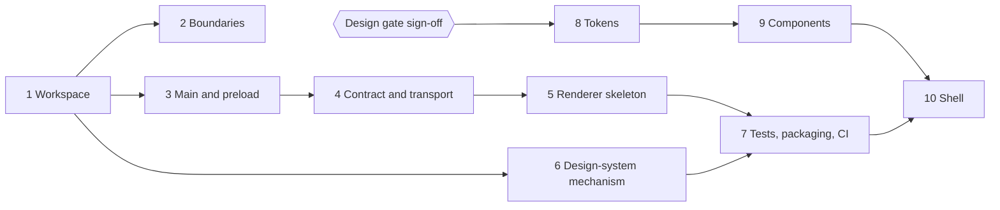

# P1a App Foundation: Execution Plan

> **For agentic workers:** REQUIRED SUB-SKILL: Use superpowers:subagent-driven-development (recommended) or
> superpowers:executing-plans to implement this plan task-by-task. Steps use checkbox (`- [ ]`) syntax for
> tracking.

**Goal:** Create `ak-studio/`: a pnpm workspace whose Electron app builds, opens a window with the security
baseline, talks to the main process through the typed bridge, runs the same renderer in a browser, and has the
design-system and Storybook mechanism ready for the design gate's decisions.

**Architecture:** Four workspace members and one app shell, as in [P1a](P1a-app-foundation.md#11-workspace).
The renderer never imports Electron or Node; it reaches the main process only through a `Transport`. The
contract package declares every operation once with zod schemas. Services in the main process are classes
registered against the contract. See [architecture.md](architecture.md).

**Tech Stack:** Electron 45, electron-vite 6 on Vite 8, React 19, TypeScript 7, Tailwind CSS 4, shadcn/ui
(React Aria base), zod 4, TanStack Query and Router, Zustand, Vitest, Playwright, Storybook 10, Biome,
dependency-cruiser, electron-builder, pnpm 12, Node 24.

**Spec:** [P1a-app-foundation.md](P1a-app-foundation.md). Decisions and versions:
[P0 decision record](P0-technology-selection.md#decision-record). Design input:
[research/p1a-design-gate-options.md](research/p1a-design-gate-options.md).

## Global Constraints

- **Pinned versions, verbatim from the P0 decision record.** No `^` or `~`. `electron@45.4.1`,
  `electron-vite@6.0.0`, `vite@8.3.8`, `react@19.3.0`, `react-dom@19.3.0`, `@types/react@19.3.0`,
  `typescript@7.0.2`, `@biomejs/biome@2.6.8`, `zod@4.6.7`, `tailwindcss@4.3.5`, `@tailwindcss/vite@4.3.5`,
  `tw-animate-css@1.4.0`, `shadcn@4.23.0`, `react-aria-components@1.22.1`, `class-variance-authority@0.7.1`,
  `lucide-react@1.77.0`, `vitest@5.1.1`, `@playwright/test@1.65.1`, `storybook@10.6.8`,
  `@storybook/react-vite@10.6.8`, `electron-builder@26.18.0`, `dependency-cruiser@18.9.0`, `@swc/core@1.16.22`.
  Node 24.22.1, pnpm 12.4.1. D8 (Zustand, TanStack Query, TanStack Router) is not pinned in the record: Task 1
  pins the latest release that is at least two weeks old and records the versions in the P0 record's D8 row.
- **The renderer and `packages/ui` import nothing from `electron` or Node built-ins.** The renderer runs in a
  plain browser against the mock transport.
- **Electron security baseline:** `contextIsolation: true`, `sandbox: true`, `nodeIntegration: false`, a content
  security policy, a custom protocol, navigation and new windows blocked, the sender checked on every message.
- **The app makes no network calls of its own.** Fonts are bundled.
- **Spike code is reference, not source.** Read `ak-studio-spikes/` on branch `spike/950-studio-p0` for what
  worked; write `ak-studio/` fresh. No file copied, and no `SPIKE_*` switch carried over.
- **Design-gate boundary.** Token *values*, base components and the shell layout wait for the P1a design gate
  sign-off. Before it, `packages/ui` holds the mechanism only, with stand-in tokens from
  `docs/src/css/custom.css`, each marked `/* provisional: P1a design gate */`.
- **Style reference: Spectrum 2** in size, shape, state and spacing; Agent Kernel's colours and fonts. Floating
  layers are solid. No Adobe icons, fonts, logo or brand colours.
- **Commits** end with the attribution line the session gives. No secrets, local absolute paths or personal
  data in any file.

## Pre-flight rulings (24 November 2026)

Recorded here and in the ledger; each says what it costs if wrong.

1. **Linux only.** P1a's outcome and verification ask for Windows, macOS and green CI on three systems. The owner
   deferred Windows and macOS, and the branch cannot be pushed yet (the account has read access only). So the
   three-system workflow is written and parsed but not executed, and every Windows, macOS and CI row is marked
   **Deferred**, not Pass. Cost if wrong: one CI run and its fixes once pushing is possible.
2. **Branch.** App code goes on `feature/950-studio-p1a`, created from the plan branch
   `claude/agent-studio-phases-plan-285138`, which stays documentation only. Cost: a rebase if the plan branch
   changes.
3. **Building on pending decisions.** Only D1a, D5 and D12 are approved; P1a builds on the other rows as
   drafted. A row the owner changes later costs the rework of the task that used it.
4. **D11 Electron policy.** The record pins `electron@45.4.1` and the policy says "latest stable at P1a start".
   This plan uses 45.4.1, so P1a matches the evidence; the owner review of D11 can move it.
5. **Gate split.** Tasks 1 to 7 do not wait for the design gate (P1a's design process: "non-UI work in the same
   phase does not wait"). Tasks 8 to 10 wait for sign-off and are not dispatched before it.
6. **Coding agent (D14) does not block P1a.** Nothing in P1a touches it.

## File structure

```
ak-studio/
  package.json            workspace root: scripts dev, build, test, lint, typecheck, storybook, package
  pnpm-workspace.yaml
  biome.json
  tsconfig.base.json      no baseUrl (TypeScript 7)
  .dependency-cruiser.cjs boundary rules; tools/depcruise-selftest/ holds the fixture
  README.md               build, run, test, package
  apps/
    desktop/              Electron main and preload (electron-vite), electron-builder.yml
      src/main/           index.ts, window.ts, protocol.ts, security.ts, services/AppService.ts,
                          bridge/ipcServer.ts, bridge/registry.ts
      src/preload/        index.ts: exposes the transport and nothing else
    renderer/             React app, no Electron import; runs in a browser
      src/                main.tsx, App.tsx, bridge/client.ts, routes/
  packages/
    contract/             operations.ts, transport.ts, errors.ts, index.ts
    ui/                   theme.css (@theme), components/ (empty until the gate), .storybook/
    kernel-catalog/       empty package, filled in P2
  tests/                  e2e (Playwright: browser and Electron)
```

## Tasks

### Task 1: Workspace and tooling

**Files:** create `ak-studio/package.json`, `pnpm-workspace.yaml`, `biome.json`, `tsconfig.base.json`,
`README.md`, one `package.json` and `tsconfig.json` per member; modify `Makefile`, `DEVELOPER_GUIDE.md`,
`docs/specs/950-agent-kernel-studio/P0-technology-selection.md` (D8 versions).

**Produces:** the commands `pnpm dev`, `pnpm build`, `pnpm test`, `pnpm lint`, `pnpm typecheck`,
`pnpm storybook`, `pnpm package` at `ak-studio/`; package names `@ak-studio/desktop`, `@ak-studio/renderer`,
`@ak-studio/contract`, `@ak-studio/ui`, `@ak-studio/kernel-catalog`.

- [ ] **Step 1:** Create the workspace with the five members and the pinned versions from Global Constraints.
  `packageManager: "pnpm@12.4.1"`, `engines.node: "24.22.1"`. pnpm's `minimumReleaseAge` stays on.
- [ ] **Step 2:** Pin D8: look up the latest `zustand`, `@tanstack/react-query` and `@tanstack/react-router`
  releases at least two weeks old (`pnpm view <pkg> time --json`); add them to `apps/renderer`; write the
  versions and the date into the D8 row of the P0 decision record.
- [ ] **Step 3:** Biome lints and formats TS and TSX; TypeScript 7 project references; `pnpm typecheck` runs
  `tsc -b`.
- [ ] **Step 4:** Root `Makefile` gains `studio-dev`, `studio-build`, `studio-test`, `studio-lint`, which run the
  matching `pnpm --dir ak-studio` command, and a `help` line each. `DEVELOPER_GUIDE.md` gains a short "Agent
  Kernel Studio" section pointing to `ak-studio/README.md`.
- [ ] **Step 5:** Verify: `pnpm install --frozen-lockfile` from a clean clone, then `pnpm lint`, `pnpm typecheck`
  pass with the empty members. Commit.

### Task 2: Boundary checks

**Files:** `ak-studio/.dependency-cruiser.cjs`, `ak-studio/tools/depcruise-selftest/`, root `package.json`
scripts `depcruise` and `depcruise:selftest`.

**Consumes:** Task 1's members.

- [ ] **Step 1:** Rules: `apps/renderer` and `packages/ui` must not import `electron` or any Node built-in;
  `packages/contract` imports only `zod`; `packages/ui` does not import `apps/*` or `@ak-studio/contract`;
  nothing imports `apps/desktop` except itself. Parser: swc (`@swc/core` 1.16.22).
- [ ] **Step 2:** Self-test: a fixture renderer file importing `electron`, checked by the same rules; the script
  fails unless that violation is reported. It also fails if dependency-cruiser reports fewer than 2 modules
  (the silent-pass hazard from P0 D13).
- [ ] **Step 3:** Verify: `pnpm depcruise` clean; `pnpm depcruise:selftest` passes; uninstall `@swc/core`
  temporarily and confirm the self-test fails. Commit.

### Task 3: Electron main and preload

**Files:** `apps/desktop/src/main/{index,window,protocol,security}.ts`, `apps/desktop/src/preload/index.ts`,
`apps/desktop/electron.vite.config.ts`, unit tests beside each file.

**Produces:** a main process that serves the renderer from `app://studio/`, and a preload that exposes exactly
one global, `window.studio`, with `request(op, input)` and `subscribe(op, input, onEvent) => unsubscribe`
(wired in Task 4).

- [ ] **Step 1:** One window; size, position and maximised state saved to the app's data folder and restored,
  clamped to a visible display.
- [ ] **Step 2:** Security baseline from Global Constraints. CSP: `default-src 'self'; script-src 'self';
  style-src 'self' 'unsafe-inline'; img-src 'self' data:; font-src 'self'; connect-src 'self'` (in
  development, also the electron-vite dev server origin). `will-navigate` and `setWindowOpenHandler` deny
  everything; external links are not opened in P1a.
- [ ] **Step 3:** `app.requestSingleInstanceLock()`; a second launch focuses the first window. Application menu
  per platform (macOS app menu; Edit and View menus everywhere; no developer tools in packaged builds).
- [ ] **Step 4:** No network: `session.defaultSession.webRequest.onBeforeRequest` cancels any request whose
  scheme is not `app:`, `devtools:` or (development only) the dev server. A test counts cancelled requests.
- [ ] **Step 5:** Verify with unit tests where Electron is not needed, and with Task 7's Electron smoke test.
  Commit.

### Task 4: Contract and transport

**Files:** `packages/contract/src/{operations,transport,errors,index}.ts`;
`apps/desktop/src/main/bridge/{registry,ipcServer}.ts`; `apps/desktop/src/main/services/AppService.ts`;
`apps/renderer/src/bridge/{ipcTransport,mockTransport,client}.ts`; tests.

**Produces (exact names):**
- `defineOperation({ name, input, output })` and the `operations` map; one operation in P1a:
  `app.info` with input `z.object({})` and output `z.object({ version: z.string(), platform: z.enum(['linux',
  'darwin', 'win32', 'browser']), theme: z.enum(['system', 'dark', 'light']) })`, plus `app.setTheme`.
- `interface Transport { request(name, input): Promise<Output>; subscribe(name, input, onEvent): () => void }`.
- `StudioError { code: string; message: string; detail?: string }`, carried as a value, never thrown across the
  bridge.
- `class ServiceRegistry` that fails start-up if any declared operation has no handler, parses every input in
  the main process, parses every output against its schema, and turns an exception into a `StudioError`.

- [ ] **Step 1:** Contract and `StudioError` with unit tests (valid and invalid input; output stripping of
  undeclared fields).
- [ ] **Step 2:** IPC server: one `ipcMain.handle('bridge:request')` and one `bridge:subscribe` channel pair;
  every message checks `event.senderFrame` belongs to the app's own window and `app://` origin, else rejects.
- [ ] **Step 3:** `AppService` (version, platform, theme preference stored in the app's data folder).
- [ ] **Step 4:** Renderer `ipcTransport` over `window.studio`, and `mockTransport` with fixture answers; the
  renderer picks the mock when `window.studio` is absent.
- [ ] **Step 5:** Contract test: every operation has a handler (a missing one fails); a request from a foreign
  frame is rejected (unit test with a fake event). Commit.

### Task 5: Renderer skeleton

**Files:** `apps/renderer/src/{main,App}.tsx`, `apps/renderer/src/routes/`, `apps/renderer/index.html`.

**Consumes:** Task 4's client. **Not in this task:** the shell layout, tabs and styling (Task 10, after the gate).

- [ ] **Step 1:** TanStack Router with hash history, one route; TanStack Query client; the theme preference read
  through `app.info` and applied as `data-theme` on `<html>` (`system` follows `prefers-color-scheme`).
- [ ] **Step 2:** One unstyled page that shows the app version and platform from `app.info`, and a theme switch
  that calls `app.setTheme`. Marked as a placeholder to be replaced by the shell.
- [ ] **Step 3:** `pnpm --filter @ak-studio/renderer dev` serves it in a browser on the mock transport. Commit.

### Task 6: Design-system and Storybook mechanism

**Files:** `packages/ui/src/theme.css`, `packages/ui/src/fonts.css`, `packages/ui/.storybook/`,
`packages/ui/src/tokens.stories.tsx`, `packages/ui/scripts/check-palette.mjs`, `components.json`.

- [ ] **Step 1:** Tailwind 4 `@theme` with `--color-*: initial` so the default palette is removed; role tokens
  (`surface`, `surface-raised`, `surface-overlay`, `text`, `text-muted`, `border-default`, `accent-primary`,
  `accent-ai`, `status-success`, `status-warning`, `status-danger`) for dark and light, each value marked
  provisional and taken from `docs/src/css/custom.css`. Size, radius and spacing tokens from the S1 table
  (Spectrum 2 medium).
- [ ] **Step 2:** Fonts bundled through `@fontsource` packages (Archivo, Inter, JetBrains Mono; all SIL OFL),
  no network loading. Which family is used where waits for the gate.
- [ ] **Step 3:** shadcn CLI configured against `packages/ui` (`components.json`, React Aria base, style
  `aria-nova`); no component added yet.
- [ ] **Step 4:** Storybook 10 with a token story (swatches with contrast ratios computed in the story, dark and
  light) and the accessibility addon running on every story in the test runner.
- [ ] **Step 5:** `check-palette` fails the build on a Tailwind default-palette class (`text-blue-500`) or an
  arbitrary value (`p-[13px]`) anywhere under `apps/renderer` or `packages/ui`; a test plants one of each in a
  fixture and expects failure. Commit.

### Task 7: Tests, packaging and CI

**Files:** `ak-studio/tests/e2e/{browser,electron}.spec.ts`, `ak-studio/playwright.config.ts`,
`apps/desktop/electron-builder.yml`, `.github/workflows/studio.yml`; modify the existing Python workflows'
triggers.

- [ ] **Step 1:** Playwright browser test: the renderer on the mock transport shows the version and switches
  theme. Electron smoke test (`xvfb-run -a` on Linux): the built app starts, shows the version from the real
  main process, switches theme, and makes no network request (Task 3's counter is zero).
- [ ] **Step 2:** `pnpm package` builds an unsigned Linux AppImage and an unpacked directory with
  electron-builder 26.18.0; record the size. Windows (NSIS) and macOS (dmg) targets are configured, not built.
- [ ] **Step 3:** `.github/workflows/studio.yml`: on pull requests and pushes touching `ak-studio/**`; matrix
  `ubuntu-latest`, `windows-latest`, `macos-latest`; steps: pnpm install, lint, typecheck, depcruise and its
  self-test, unit tests, Storybook build and accessibility run, Playwright, package, upload the installer.
  Least-privilege `permissions: contents: read`. Parse it with `actionlint` if available.
- [ ] **Step 4:** Add `paths-ignore: ['ak-studio/**']` to the Python test and quality workflows that run on every
  change (check each trigger first; only add it where a Studio-only change would otherwise run them).
- [ ] **Step 5:** Run every command locally on Linux and record the results. Mark the workflow and the Windows
  and macOS rows **Deferred (not executed)**. Commit.

### Task 8: Tokens with the chosen palette (waits for the design gate)

Replace the provisional token values with the approved palette, fonts, density and default theme. Add the
per-surface text variants the options note calls for, each checked at 4.5:1 by the token story. Not dispatched
before the sign-off row "Palette, tokens, density, theme" is filled.

### Task 9: Base components (waits for the design gate)

The set approved at the gate, proposed as only what P2 and P3 use. Each component added with the shadcn CLI,
restyled to the tokens, with stories for default, hover, focus, disabled, and invalid where it applies.

### Task 10: Desktop shell (waits for the design gate)

`DesktopShell`, `TopBar`, `AppTabs` (Canvas, Code, Config, Test & Trace, Deploy), `BottomPanel` (Problems, Run
log, Commands), `StatusBar`, built from Task 9's components; each tab's empty state names the phase that fills
it; panel sizes remembered. Replaces Task 5's placeholder page.

## Order



## Self-review against the spec

| P1a requirement | Task |
|---|---|
| 1.1 Workspace, commands, Makefile, developer guide, pinned versions, Biome, TS 7 | 1 |
| 1.1 Lint rule for `electron` and Node imports, with self-test | 2 |
| 1.2 Window, security baseline, preload, single instance, menu, no network | 3 |
| 1.3 Contract, `Transport` with IPC and mock, `AppService`, `StudioError`, contract test | 4 |
| 1.4 Tokens (mechanism), default palette removed, fonts bundled, accessibility check | 6 (values: 8) |
| 1.4 Base components | 9 |
| 1.5 Shell, empty states, routing, theme switch, panel sizes, browser run | 5 (skeleton), 10 |
| 1.6 CI on three systems, path filtering | 7 (written; execution deferred) |
| Verification: clean clone, browser, lint catch, contract test, smoke test, palette check | 1, 2, 4, 6, 7 |
| Verification: CI green on three systems, three installers | **Deferred** (ruling 1) |
