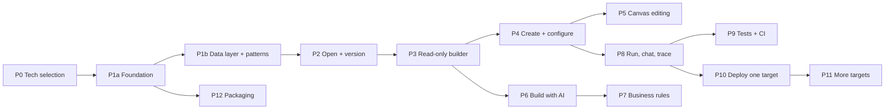

# Agent Kernel Studio: phased implementation plan

Tracks [issue #950](https://github.com/yaalalabs/agent-kernel/issues/950). This file is the progress tracker:
update the status table and the decision log as work lands.

**The product.** A desktop app (Electron) that builds, tests and deploys an Agent Kernel project from one
folder on the user's computer. A visual canvas and a coding agent sit on top of the real project files. It
builds locally, runs on Windows, macOS and Linux, and showcases the Agent Kernel feature set for whichever
Agent Kernel version the project uses.

**Naming.** The issue calls the whole local app "Phase 1" and splits it into seven milestones. This plan calls
that **Release 1** and splits it into implementation phases **P0 to P12**, each covering one business aspect.

## Progress

Status values: Not started, Design, In progress, In review, Done.

| Phase | Business aspect | Issue milestone | Status | Design signed off | Doc |
|---|---|---|---|---|---|
| P0 | Technology selection | Before 1 | In review (spikes ran on Linux; record drafted; Windows and macOS deferred by the owner; spike S5 added; no turn has run on a subscription yet) | n/a | [P0](P0-technology-selection.md) |
| P1a | App foundation: workspace, shell, bridge, design system | Before 1 | Started 24 Nov 2026: plan written; design-gate options drafted, waiting for the owner; non-UI tasks proceed | No | [P1a](P1a-app-foundation.md), [plan](P1a-plan.md) |
| P1b | Data and feature layer, shared patterns, Studio skills | Before 1 | Not started | No | [P1b](P1b-data-layer-and-patterns.md) |
| P2 | Open a project and know its Agent Kernel version | 1 | Not started | No | [P2](P2-project-and-kernel-version.md) |
| P3 | See the project: read-only Canvas, Code, Config | 1 | Not started | No | [P3](P3-read-only-builder.md) |
| P4 | Create and configure a project | 2 | Not started | No | [outline](later-phases.md#p4--create-and-configure-a-project) |
| P5 | Build on the canvas | 2 | Not started | No | [outline](later-phases.md#p5--build-on-the-canvas) |
| P6 | Build with AI | 3 | Not started | No | [outline](later-phases.md#p6--build-with-ai) |
| P7 | Business rules | 3 | Not started | No | [outline](later-phases.md#p7--business-rules) |
| P8 | Run, chat and trace | 4 | Not started | No | [outline](later-phases.md#p8--run-chat-and-trace) |
| P9 | Tests, scenarios and CI | 4 | Not started | No | [outline](later-phases.md#p9--tests-scenarios-and-ci) |
| P10 | Deploy to one target | 5 | Not started | No | [outline](later-phases.md#p10--deploy-to-one-target) |
| P11 | The remaining targets | 6 | Not started | n/a | [outline](later-phases.md#p11--the-remaining-targets) |
| P12 | Packaging and release | 7 | Not started | No | [outline](later-phases.md#p12--packaging-and-release) |

**Next action:** owner review of the [P0 decision record](P0-technology-selection.md#decision-record), and one live turn of spike S5 on a working Claude Code sign-in (the spike machine's had expired). Then the P1a design gate. Anthropic's confirmation of the coding-agent design is needed before P6, not before P1a. Windows and macOS are deferred.

P0 to P3 (including P1a and P1b) are detailed and can be picked up as written. P4 to P12 are outlines; each is detailed when the phase
before it is close to done.

## How a phase runs

1. **Detail it.** If the phase is still an outline, write its doc in the layout of P2 and P3.
2. **Design gate.** Every screen in the phase is finalised through [design-process.md](design-process.md)
   before its UI is built. The existing briefs and design canvas are unapproved input: use them as a starting
   sketch, and do not reopen the requirements in the issue.
3. **Build.** Work through the phase's work packages. Tick them in the phase doc.
4. **Verify.** Run the phase's verification list on all three operating systems.
5. **Close.** Set the status here to Done, add decisions to the log below, and detail the next phase.

## Order and dependencies

- The issue orders "create and edit" (P4, P5) before "coding agent" (P6, P7). The earlier plan on the feature
  branch puts the coding agent first. This plan follows the issue. P6 needs only P3, so it can move ahead of
  P4 without rework.
- After P3 the Studio already shows any Agent Kernel project visually. That is the first point worth showing
  to people.

## Cross-cutting: architecture and ground rules

| Document | Fixes | Built in |
|---|---|---|
| [architecture.md](architecture.md) | The data and feature layer: layers, who owns each kind of data, the contract's four shapes (query, command, job, session), safe file writes, jobs, errors, capability gating, feature folders and manifests, what the Studio writes into a project, and the kernel commands it should use instead of hacks | P1, followed by every phase |
| [conventions-and-skills.md](conventions-and-skills.md) | Ground rules for UI semantics, the UX pattern catalogue, development techniques, and the `ak-studio-*` skills that teach all of it to coding agents | P1, extended by every phase |

Both are proposals until approved at the start of [P1b](P1b-data-layer-and-patterns.md). Both were revised
after a review on 23 November 2026 (sessions, safe writes, domain-event invalidation, working copies, secret
handling, fewer skills written later, skills scoped to `ak-studio/`).

## Cross-cutting: Agent Kernel versions

Features are driven by the Agent Kernel version of the open project, because versions add features and make
breaking changes.

| Piece | What it does | Built in |
|---|---|---|
| Version detection | Reads the project's version from its environment, `uv.lock` or `pyproject.toml` | P2 |
| Capability catalog | One list of features with the version that adds each and the version that removes it. The whole app asks it "is F available here?" | P2 |
| Installed-version schema | Config forms are generated from the schema of the installed `agentkernel`, so fields, defaults and descriptions are always right for that version | P3 |
| Version-unavailable pattern | One UI pattern for "needs Agent Kernel ≥ X" | P2 design gate |
| Supported floor | The oldest version opened with full support; older projects open read-only | P2 |
| Version choice at creation | The new project wizard picks the version; templates follow it | P4 |
| Drift test | Fails when in-tree `ak-py` gains a feature the catalog does not list | P2 |

Detail: [P2](P2-project-and-kernel-version.md).

## Decision log

| Date | Decision | Where |
|---|---|---|
| 23 Nov 2026 | Plan lives in `docs/specs/950-agent-kernel-studio/`, separate from the unmerged brief pack | This file |
| 23 Nov 2026 | App source lives in this repository under `ak-studio/` | [P1a](P1a-app-foundation.md) |
| 23 Nov 2026 | Implementation phases are named P0 to P12 and mapped to the issue's milestones | This file |
| 23 Nov 2026 | Phase order follows the issue (create and edit before coding agent) | [later-phases.md](later-phases.md) |
| 23 Nov 2026 | Bundler: Vite, through electron-vite. Rspack is dropped. | [P0](P0-technology-selection.md) D3 |
| 23 Nov 2026 | Component library: shadcn/ui, styled with Tailwind CSS. React Spectrum is not used as a library. | [P0](P0-technology-selection.md) D1, D2 |
| 23 Nov 2026 | Style reference: the components' basic style resembles React Spectrum (Spectrum 2) in size, density, shape and states, with Agent Kernel's colours and fonts | [P0](P0-technology-selection.md) D1, [P1a](P1a-app-foundation.md) design gate |
| 23 Nov 2026 | Bridge: the in-house zod contract with the `Transport` interface, not oRPC. Same renderer code over IPC and WebSocket; sender checked on every IPC message, which oRPC's Electron path does not do. Approved by Dhananjaya Rajasinghe | [P0](P0-technology-selection.md) D5, [S3](research/spike-s3-bridge.md) |
| 23 Nov 2026 | Form validation is strict: Ajv `coerceTypes` off, so `"30"` for an integer `ttl` is rejected. Validators stay precompiled (CSP blocks runtime compile). Approved by Dhananjaya Rajasinghe | [P0](P0-technology-selection.md) D12, [S1](research/spike-s1-components.md) |
| 23 Nov 2026 | Floating layers are solid, as in Spectrum 2, not glass. Decided in P0. Approved by Dhananjaya Rajasinghe | [P0](P0-technology-selection.md) D1a, [conventions-and-skills.md](conventions-and-skills.md) |
| 23 Nov 2026 | Changed from provisional: shadcn/ui primitive base is React Aria, confirmed on Linux by S1 (two other libraries: splitter, toasts). Pending owner review | [P0](P0-technology-selection.md) D1, [S1](research/spike-s1-components.md) |
| 23 Nov 2026 | Changed from provisional: the architecture check is dependency-cruiser with the swc parser and a CI self-test, because without `@swc/core` it passes silently under TypeScript 7. Pending owner review | [P0](P0-technology-selection.md) D13, [S2](research/spike-s2-build.md) |
| 23 Nov 2026 | Changed from provisional: ESLint is dropped, Biome lints, because typescript-eslint cannot load under TypeScript 7.0. Pending owner review | [P0](P0-technology-selection.md) D10, [S2](research/spike-s2-build.md) |
| 23 Nov 2026 | Windows and macOS are deferred; Phase 0 evidence is from Linux. Decided by Dhananjaya Rajasinghe | [P0](P0-technology-selection.md#exit-criteria) |
| 23 Nov 2026 | New requirement: the Studio takes a key from the user and drives Claude with it to build agents. Spike S5 and decision D14 added to P0; the Claude Agent SDK runs in the main process and holds the key there. Replaces "the app never stores credentials" | [architecture](architecture.md#the-coding-agent-and-the-users-claude-code), [P6](later-phases.md#p6--build-with-ai) |
| 24 Nov 2026 | The coding agent uses the user's own Claude Code, already installed and signed in with a subscription. Decided by Dhananjaya Rajasinghe. Replaces the pasted-key design of 23 Nov. That the Studio itself never takes or stores the subscription token is our reading of Anthropic's rules, awaiting the owner's confirmation; under it, "the app never stores credentials" stands again. Mechanics ran on 24 Nov; no turn has run on a subscription; needs Anthropic's confirmation before P6 | [architecture](architecture.md#the-coding-agent-and-the-users-claude-code), [P0](P0-technology-selection.md) D14 |
| 24 Nov 2026 | P1a started at the owner's request. The P0 record is still in review (only D1a, D5, D12 approved); P1a builds on the drafted rows and is Linux only, with the three-system CI written but not executed | [P1a-plan.md](P1a-plan.md) |

## Open decisions

| # | Decision | Needed by | Notes |
|---|---|---|---|
| 1 | Owner review of the rest of the P0 decision record. D8 (state, data, routing) was not exercised by any spike; D11 (Electron policy) was not tested. Windows and macOS are deferred by the owner | End of P0 | [P0 decision record](P0-technology-selection.md#decision-record) |
| 1e | Coding agent (D14): the Studio uses the user's own signed-in Claude Code (decided 24 Nov 2026) and, on our reading of Anthropic's rules, holds no credential. Open: the owner's confirmation of that reading; Anthropic's confirmation that a third-party app may do this; a live turn on a working sign-in (the spike machine's had expired; the mechanics ran); what a user with only the Claude desktop app is told: the spike machine is one, and it reported "not installed" and "not signed in", so such a user may have to install and sign in to Claude Code separately | End of P0 for the spike; before P6 starts for Anthropic | [S5](research/spike-s5-coding-agent.md), [architecture](architecture.md#the-coding-agent-and-the-users-claude-code) |
| 1c | Canvas keyboard model: Tab reaches the first node only after all edges; `edgesFocusable={false}` fixes it but loses edge keyboard access | P3 design gate | [S4](research/spike-s4-canvas-code.md) |
| 1d | CodeMirror cold open missed 200 ms (360 to 382 ms); try preload on idle. Also needs a person: side-by-side look against Spectrum 2, screen-reader pass, canvas and glass/solid on a real GPU | P1a design gate | [P0 exit criteria](P0-technology-selection.md#exit-criteria) |
| 2 | Studio primary colour: the briefs say blue, the current brand tokens say orange | P1a design gate | [design-process.md](design-process.md) |
| 3 | Product name and app identifier | P1a (working name is fine until P12) | The repository is now branded Open Agent Kernel |
| 4 | Supported floor version | P2 | |
| 5 | Introspection by import or by static parsing | P3 | |
| 6 | Kernel-side commands (`ak inspect`, `ak config schema`, `ak config resolve`, `ak features`) in `ak-py` | Design in P3 | Proposed in [architecture.md](architecture.md); each goes through the repo's spec process |
| 6a | Approve the architecture and the ground rules | Start of P1b | [architecture.md](architecture.md), [conventions-and-skills.md](conventions-and-skills.md) |
| 6b | Mark secret fields in `AKConfig` (they are plain `str` today), so resolved config can be masked without a hand-kept list | Design in P3 | [architecture.md](architecture.md) |
| 6c | Move the project templates into `ak-py` as files that both the `ak-init` skill and the Studio read | Before P4 | Until then, reviewed reference projects |
| 7 | Anthropic's rules for the coding agent: no collecting or storing of Claude.ai credentials, no login screen of our own, the Claude Code executable unmodified, no routing of requests through plan credentials "on behalf of their users". Running Claude Code in a product "requires agreeing to our Commercial Terms of Service": an owner action. Running the user's own signed-in Claude Code is our reading of the rules, not a stated permission: confirm with Anthropic. The Studio's feature is "Claude Agent"; the Studio never calls itself "Claude Code" | Before P6 | Checked against the documentation on 24 Nov 2026; see [architecture](architecture.md#the-coding-agent-and-the-users-claude-code) |
| 8 | First deploy target | P10 | |
| 9 | Studio licence | Before P12 | The issue recommends open source |

## Inputs and what was checked

| Input | Where | State |
|---|---|---|
| Requirements | [Issue #950](https://github.com/yaalalabs/agent-kernel/issues/950) | The source of scope |
| Brief pack: plan, one-page scope, briefs 00 to 09, parked later-phase briefs, competitive research | Branch `feature/950-agent-kernel-studio-phase-1`, folder `docs/specs/950-agent-kernel-studio-phase-1/` | Unmerged and unapproved. Read in full for this plan: its README, the plan, the one-page scope and briefs 00, 01, 02 and 04. Read in part (file mapping, handoff notes, open details): briefs 05 to 08. Headings only: briefs 03 and 09. Not read: the parked later-phase briefs and the competitive research. |
| Design canvas (45 artboards) | <https://claude.ai/artifact/VSewdGFtfYAQe4zGFVt3po> | Unapproved. The rendered canvas was **not looked at** for this plan. Its file list, its colour and font tokens and one component source (the status bar) were read. Each design gate reviews its own screens. |
| Technology research | [research/tech-stack-evaluation.md](research/tech-stack-evaluation.md) | Desk research, 23 November 2026. Not hands-on. |

Facts checked against the repository at `develop` `2d3375a1`:

- The `ak` CLI has only the `skill` subcommand (`ak-py/src/agentkernel/cli/ak.py`). `ak skill install` exists;
  `ak rules check`, which the issue relies on, does not and is new work in P7.
- Claude Code skills install to `.claude/commands` (`ak-py/src/agentkernel/skills/skills.py`).
- The package reports its version through `importlib.metadata` (`ak-py/src/agentkernel/__init__.py`); the
  current version is 0.10.2.
- `AKConfig` has no `SecretStr` fields; secrets such as `slack.bot_token` are plain `str`
  (`ak-py/src/agentkernel/core/config.py`).
- The bundled `ak-init` skill is a prose `SKILL.md` with code snippets and evals, not a generator.
- Eight framework adapters exist under `ak-py/src/agentkernel/framework/`.
- Azure Functions is being retired (`docs/specs/957-retire-azure-functions/design.md`), so the issue's "six
  Terraform targets" depends on the version.
- The brand tokens in `docs/src/css/custom.css` use orange `#FF5E32` as primary on a navy ground, with Archivo
  as the body font. The design canvas's tokens use electric blue `#00DDFF` with magenta on a near-black ground,
  with Inter as the body font. The canvas predates the current brand.
- `AKConfig.model_json_schema()` works on in-tree `ak-py` with no `config.yaml` present: 28 top-level sections
  and 96 definitions. This is what P3's generated config forms rely on.
- The example apps and the `ak-init` templates start the server only under `if __name__ == "__main__":`
  (`examples/api/openai/app.py`, `ak-py/src/agentkernel/skills/ak-init/SKILL.md`), so importing a project
  module for introspection does not start it. Hand-written projects may differ.

## Files

| File | Holds |
|---|---|
| [README.md](README.md) | This tracker |
| [design-process.md](design-process.md) | The design gate every screen passes |
| [architecture.md](architecture.md) | The data and feature layer |
| [conventions-and-skills.md](conventions-and-skills.md) | Ground rules, UX patterns, development techniques, Studio skills |
| [P0-technology-selection.md](P0-technology-selection.md) | Stack decisions and spikes |
| [P0-plan.md](P0-plan.md) | Task-by-task execution plan for the P0 spikes |
| [P1a-plan.md](P1a-plan.md) | Task-by-task execution plan for P1a, with its pre-flight rulings |
| [research/p1a-design-gate-options.md](research/p1a-design-gate-options.md) | P1a design gate: palette, fonts, density and theme options, with measured contrast |
| [P1a-app-foundation.md](P1a-app-foundation.md) | Workspace, Electron shell, bridge transport, design system |
| [P1b-data-layer-and-patterns.md](P1b-data-layer-and-patterns.md) | Contract shapes, jobs and sessions, shared patterns, generators, enforcement, first skills |
| [P2-project-and-kernel-version.md](P2-project-and-kernel-version.md) | Welcome, toolchain, command runner, versions and the capability catalog |
| [P3-read-only-builder.md](P3-read-only-builder.md) | Introspection, read-only Canvas, Code and Config |
| [later-phases.md](later-phases.md) | Outlines of P4 to P12 |
| [research/tech-stack-evaluation.md](research/tech-stack-evaluation.md) | Evidence for P0 |

This plan uses its own layout instead of the repository's `design.md`, `spec.md`, `plan.md` set, because it
plans a multi-phase product, not one change to `ak-py`. Work that changes `ak-py` (for example
`ak rules check` in P7) follows the repository's normal spec process.
