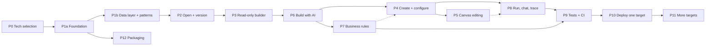

# Open Agent Kernel Studio (OAK Studio): phased implementation plan

Tracks [issue #950](https://github.com/yaalalabs/agent-kernel/issues/950). The scope comes from the team's
[Phase 1 PRD](../950-agent-kernel-studio-phase-1/PHASE-1-PRD.md), revised 25 November 2026, which supersedes
the issue where they differ. This file is the progress tracker: update the status table and the decision log
as work lands.

**The product.** OAK Studio is a desktop app (Electron) that builds, tests and
deploys an Open Agent Kernel (OAK) project from one folder on the user's computer. A visual canvas and a
coding agent sit on top of the real project files. It builds locally, runs on Windows, macOS and Linux, and
showcases the OAK feature set for whichever Agent Kernel version the project uses. Everything it produces is
ordinary framework code, pytest and Terraform in the user's own repository, so a project outlives the app.

**Name.** "OAK Studio" is a working name, from the PRD and the brand's
[name rule](../../../branding/README.md#name): the full name on first mention, "OAK" after that. Identifiers
keep their form: `ak-studio/`, `.akstudio/`, the `agentkernel` package, the `ak` CLI. The final name and app
identifier are [open decision 3](#open-decisions), settled by P12.

**Naming the work.** The PRD calls the whole local app "Phase 1" and splits it into six milestones. This plan
calls that **Release 1** and splits it into implementation phases **P0 to P12**, each covering one business
aspect.

## Progress

Status values: Not started, Design, In progress, In review, Done. Rows are in build order, which follows the
PRD's milestones.

| Phase | Business aspect | PRD milestone | Status | Design signed off | Doc |
|---|---|---|---|---|---|
| P0 | Technology selection | Before 1 | In review (spikes ran on Linux; record drafted; Windows and macOS deferred by the owner; spike S5 added; no turn has run on a subscription yet) | n/a | [P0](P0-technology-selection.md) |
| P1a | App foundation: workspace, shell, bridge, design system | Before 1 | Started 24 Nov 2026: Tasks 1–10 done on Linux; shell layout and component set await sign-off. The 25 Nov branding changes are decided; the code change lands separately in `ak-studio/` | Palette, fonts, density, theme only | [P1a](P1a-app-foundation.md), [plan](P1a-plan.md) |
| P1b | Data and feature layer, shared patterns, Studio skills | Before 1 | Not started | No | [P1b](P1b-data-layer-and-patterns.md) |
| P2 | Open a project and know its Agent Kernel version | 1 | Not started | No | [P2](P2-project-and-kernel-version.md) |
| P3 | See the project: read-only Canvas, Code, Config | 1 | Not started | No | [P3](P3-read-only-builder.md) |
| P6 | Build with AI | 2 | Not started | No | [outline](later-phases.md#p6--build-with-ai) |
| P7 | Business rules and `ak rules check` | 2 | Not started | No | [outline](later-phases.md#p7--business-rules) |
| P4 | Create and configure a project | 3 | Not started | No | [outline](later-phases.md#p4--create-and-configure-a-project) |
| P5 | Build on the canvas | 3 | Not started | No | [outline](later-phases.md#p5--build-on-the-canvas) |
| P8 | Run, chat and trace | 4 | Not started | No | [outline](later-phases.md#p8--run-chat-and-trace) |
| P9 | Tests, scenarios and CI | 4 | Not started | No | [outline](later-phases.md#p9--tests-scenarios-and-ci) |
| P10 | Deploy to one target | 5 | Not started | No | [outline](later-phases.md#p10--deploy-to-one-target) |
| P11 | The remaining targets | 6 | Not started | n/a | [outline](later-phases.md#p11--the-remaining-targets) |
| P12 | Packaging and release | None (installers are a PRD deliverable) | Not started | No | [outline](later-phases.md#p12--packaging-and-release) |

**Next action:** the owner signs off the P1a shell layout and base component set, after the 25 Nov branding
changes land in `ak-studio/` (rectangular controls at the 8 px radius, Archivo on primary call-to-action
labels, the logo mark; Tabler outline icons landed on 25 Nov in `4d7fcfec`). Owner review of the [P0 decision record](P0-technology-selection.md#decision-record)
is still open. The owner answers the [open decisions](#open-decisions) marked for 25 Nov. Anthropic's
confirmation of the coding-agent design is needed before P6. Windows and macOS are deferred until the
re-entry point under [Order and dependencies](#order-and-dependencies).

P0 to P3 (including P1a and P1b) are detailed and can be picked up as written. P4 to P12 are outlines; each is
detailed when the phase before it is close to done. After P3 comes P6, not P4.

## How a phase runs

1. **Detail it.** If the phase is still an outline, write its doc in the layout of P2 and P3.
2. **Design gate.** Every screen in the phase is finalised through [design-process.md](design-process.md)
   before its UI is built. The team's briefs and design canvas are input: use them as a starting sketch, and
   do not reopen the requirements in the PRD. A signed-off story supersedes its artboard.
3. **Build.** Work through the phase's work packages. Tick them in the phase doc.
4. **Verify.** Run the phase's verification list on all three operating systems (Windows and macOS deferred by
   the owner; Linux only until the re-entry point under [Order and dependencies](#order-and-dependencies)).
5. **Close.** Set the status here to Done, add decisions to the log below, and detail the next phase.

## Standing principles

Every phase keeps these. The first five are the PRD's requirements that apply everywhere (section 4); the
team's plan adds the sixth.

1. **Files are the source of truth.** The canvas and the Config tab are views of the files. The app re-reads a
   file that changes on disk.
2. **Every command is visible**, with its output and exit status.
3. **Apply and destroy need an explicit yes** after the plan, naming the cloud account. So does creating the
   Terraform state backend, which is real infrastructure.
4. **Credentials stay put.** Cloud keys are never stored. A secret is a key name plus the OAK secret provider
   that resolves it; `.env` is the local store of the `env` provider, and the UI shows names only. The app
   never reads, stores or proxies Claude Code's credentials.
5. **No telemetry without consent.** Usage data is off by default and opt-in. With it off, the app makes no
   network calls of its own, in the renderer or the main process; the tools it runs and the project's model
   providers make their own. No project data leaves the computer through the app.
6. **Nothing depends on the app.** Close it and the folder is still a complete, runnable project.

## Order and dependencies

A solid arrow means "needs"; a dotted arrow means "comes after, in the PRD order" only.

- **The PRD order** (decided 25 Nov 2026): open and read (P2, P3); coding agent and business rules (P6, P7);
  create and edit (P4, P5); run and test (P8, P9); deploy to one target (P10); the remaining four targets
  (P11). It replaces the issue's order, which put create and edit first. P6 needs only P3, so no built work
  changes.
- **What the order costs.** P6 installs the OAK skills itself and owns the "Coding agents" section of
  Settings. P7 runs the test file itself (`uv run pytest`) for its "Untested" state and generated tests,
  before P9 exists. P4's "Describe it with AI" entries work from the start. P10 takes P7's rule check and P9's
  test results as prerequisites. Detail: [later-phases.md](later-phases.md#order).
- **Windows and macOS.** Still deferred by the owner. Re-entry point: the three-system CI (`studio.yml`,
  written in P1a) runs green before the first build leaves the team, and before P6 starts at the latest. P6 is
  the first phase that depends on per-platform process trees and on finding the user's `claude`.
- After P3 the Studio already shows any OAK project visually. That is the first point worth showing to
  people.

## Cross-cutting: architecture and ground rules

| Document | Fixes | Built in |
|---|---|---|
| [architecture.md](architecture.md) | The data and feature layer: layers, who owns each kind of data, the contract's four shapes (query, command, job, session), safe file writes, jobs, errors, capability gating, feature folders and manifests, what the Studio writes into a project, and the kernel commands it should use instead of hacks | P1, followed by every phase |
| [conventions-and-skills.md](conventions-and-skills.md) | Ground rules for UI semantics, the UX pattern catalogue, development techniques, and the `ak-studio-*` skills that teach all of it to coding agents | P1, extended by every phase |

Both are proposals until approved at the start of [P1b](P1b-data-layer-and-patterns.md). Both were revised
after a review on 23 November 2026 (sessions, safe writes, domain-event invalidation, working copies, secret
handling, fewer skills written later, skills scoped to `ak-studio/`).

## Cross-cutting: Agent Kernel versions

Features are driven by the Agent Kernel version of the open project, because versions add features and make
breaking changes.

| Piece | What it does | Built in |
|---|---|---|
| Version detection | Reads the project's version from its environment, `uv.lock` or `pyproject.toml` | P2 |
| Capability catalog | One list of features with the version that adds each and the version that removes it. The whole app asks it "is F available here?" | P2 |
| Installed-version schema | Config forms are generated from the schema of the installed `agentkernel`, so fields, defaults and descriptions are always right for that version | P3 |
| Version-unavailable pattern | One UI pattern for "needs Agent Kernel ≥ X" | P2 design gate |
| Supported floor | The oldest version opened with full support; older projects open read-only | P2 |
| Version choice at creation | The new project wizard picks the version; templates follow it | P4 |
| Drift test | Fails when in-tree `ak-py` gains a feature the catalog does not list | P2 |

Detail: [P2](P2-project-and-kernel-version.md).

## Decision log

| Date | Decision | Where |
|---|---|---|
| 23 Nov 2026 | Plan lives in `docs/specs/950-agent-kernel-studio/`, separate from the unmerged brief pack | This file |
| 23 Nov 2026 | App source lives in this repository under `ak-studio/` | [P1a](P1a-app-foundation.md) |
| 23 Nov 2026 | Implementation phases are named P0 to P12 and mapped to the issue's milestones (remapped to the PRD's milestones on 25 Nov 2026; see below) | This file |
| 23 Nov 2026 | Phase order follows the issue (create and edit before coding agent). (Superseded 25 Nov 2026 by the PRD order; see below) | [later-phases.md](later-phases.md) |
| 23 Nov 2026 | Bundler: Vite, through electron-vite. Rspack is dropped. | [P0](P0-technology-selection.md) D3 |
| 23 Nov 2026 | Component library: shadcn/ui, styled with Tailwind CSS. React Spectrum is not used as a library. | [P0](P0-technology-selection.md) D1, D2 |
| 23 Nov 2026 | Style reference: the components' basic style resembles React Spectrum (Spectrum 2) in size, density, shape and states, with Agent Kernel's colours and fonts. (Shape amended 25 Nov 2026 for buttons, inputs and tags; see below) | [P0](P0-technology-selection.md) D1, [P1a](P1a-app-foundation.md) design gate |
| 23 Nov 2026 | Bridge: the in-house zod contract with the `Transport` interface, not oRPC. Same renderer code over IPC and WebSocket; sender checked on every IPC message, which oRPC's Electron path does not do. Approved by Dhananjaya Rajasinghe | [P0](P0-technology-selection.md) D5, [S3](research/spike-s3-bridge.md) |
| 23 Nov 2026 | Form validation is strict: Ajv `coerceTypes` off, so `"30"` for an integer `ttl` is rejected. Validators stay precompiled (CSP blocks runtime compile). Approved by Dhananjaya Rajasinghe | [P0](P0-technology-selection.md) D12, [S1](research/spike-s1-components.md) |
| 23 Nov 2026 | Floating layers are solid, as in Spectrum 2, not glass. Decided in P0. Approved by Dhananjaya Rajasinghe | [P0](P0-technology-selection.md) D1a, [conventions-and-skills.md](conventions-and-skills.md) |
| 23 Nov 2026 | Changed from provisional: shadcn/ui primitive base is React Aria, confirmed on Linux by S1 (two other libraries: splitter, toasts). Pending owner review | [P0](P0-technology-selection.md) D1, [S1](research/spike-s1-components.md) |
| 23 Nov 2026 | Changed from provisional: the architecture check is dependency-cruiser with the swc parser and a CI self-test, because without `@swc/core` it passes silently under TypeScript 7. Pending owner review | [P0](P0-technology-selection.md) D13, [S2](research/spike-s2-build.md) |
| 23 Nov 2026 | Changed from provisional: ESLint is dropped, Biome lints, because typescript-eslint cannot load under TypeScript 7.0. Pending owner review | [P0](P0-technology-selection.md) D10, [S2](research/spike-s2-build.md) |
| 23 Nov 2026 | Windows and macOS are deferred; Phase 0 evidence is from Linux. Decided by Dhananjaya Rajasinghe | [P0](P0-technology-selection.md#exit-criteria) |
| 23 Nov 2026 | New requirement: the Studio takes a key from the user and drives Claude with it to build agents. Spike S5 and decision D14 added to P0; the Claude Agent SDK runs in the main process and holds the key there. Replaces "the app never stores credentials". (Superseded 24 Nov 2026; see the next row) | [architecture](architecture.md#the-coding-agent-and-the-users-claude-code), [P6](later-phases.md#p6--build-with-ai) |
| 24 Nov 2026 | The coding agent uses the user's own Claude Code, already installed and signed in with a subscription. Decided by Dhananjaya Rajasinghe. Replaces the pasted-key design of 23 Nov. That the Studio itself never takes or stores the subscription token is our reading of Anthropic's rules, awaiting the owner's confirmation; under it, "the app never stores credentials" stands again. Mechanics ran on 24 Nov; no turn has run on a subscription; needs Anthropic's confirmation before P6 | [architecture](architecture.md#the-coding-agent-and-the-users-claude-code), [P0](P0-technology-selection.md) D14 |
| 24 Nov 2026 | P1a started at the owner's request. The P0 record is still in review (the choices of Vite and shadcn/ui were the owner's from the start; D1a, D5 and D12 were approved after the spikes; everything else is pending); P1a builds on the drafted rows and is Linux only, with the three-system CI written but not executed | [P1a-plan.md](P1a-plan.md) |
| 25 Nov 2026 | P1a design gate, palette, tokens, density and theme: Option A palette: Agent Kernel's current brand. Orange `#FF5E32` primary (dark text on fills), ice `#B1CDFF` / dusk `#3F598A` for the coding agent, navy ground; every role gets per-surface text variants tuned to 4.5:1. Fonts: Inter for UI, Archivo for headings, JetBrains Mono for code (Archivo also on primary call-to-action labels from 25 Nov 2026; see below). Density: one, Spectrum 2 medium (32 px controls, 40 px rows, 14 px text, 48 px top bar). Default theme: follow the system setting, dark when unknown. Approved by Dhananjaya Rajasinghe. Shell layout and the base component set are signed off after their stories (gate steps 4 to 6) | [P1a](P1a-app-foundation.md#design-gate), [options](research/p1a-design-gate-options.md) |
| 25 Nov 2026 | The P0 spike code (local branch `spike/950-studio-p0` and the `ak-studio-spikes/` working copy) is deleted at the owner's request; it was never pushed. The findings stay in `research/`. S5's live turn moves to P6 | [P0](P0-technology-selection.md#exit-criteria) |
| 25 Nov 2026 | Source of scope: the team's [PRD](../950-agent-kernel-studio-phase-1/PHASE-1-PRD.md) (revised 25 Nov 2026) supersedes issue #950 where they differ. The plan links to the team's folder as input. The team is asked to update the issue so the two agree. Ruled at the owner's request to align with the team branch | [Inputs](#inputs-and-what-was-checked), [design-process.md](design-process.md) |
| 25 Nov 2026 | Phase order follows the PRD's milestones: P2, P3; then P6, P7; then P4, P5; then P8, P9; P10; P11. Phase IDs are kept. P6 installs the OAK skills itself; P7 runs the test file itself before P9; P10 takes P7 and P9 as prerequisites. Replaces the 23 Nov order | [Order](#order-and-dependencies), [later-phases.md](later-phases.md#order) |
| 25 Nov 2026 | Working name "OAK Studio" ("Open Agent Kernel Studio" on first mention, per the brand's name rule). Identifiers `ak-studio/` and `.akstudio/` unchanged. The final name stays open decision 3, settled by P12 | This file, [branding](../../../branding/README.md#name) |
| 25 Nov 2026 | **Branding change.** Where the brand ([branding/README.md](../../../branding/README.md); the "Logo Extension V3, November 2026" PDF matches it) is explicit, it wins: Tabler outline icons replace lucide; buttons, inputs and tags are rectangular at the 8 px control radius, replacing the Spectrum 2 pill shape for those; Archivo for primary call-to-action labels, Inter for UI text; the logo mark is the app icon and sits in the top bar. Palette A stays: it is the brand. Spectrum 2 still sets size, density and states. Kept, owner-approved: 32 px controls, dark when the system gives no answer, solid floating layers. Ruled at the owner's request; the code change lands separately in `ak-studio/` | [P1a](P1a-app-foundation.md#design-gate), [conventions](conventions-and-skills.md#visual-rules), [P0](P0-technology-selection.md) C1, D1 |
| 25 Nov 2026 | Open decision 2 closed: the Studio's primary is orange `#FF5E32`. The P1a gate chose it, and the team moved its briefs and canvas to the OAK identity the same day | [P1a](P1a-app-foundation.md#design-gate) |
| 25 Nov 2026 | The coding-agent feature stays "Claude Agent" in our copy (Anthropic's naming rule for products built on its SDK); D14 stands. The team is asked to change its briefs' "Claude Code" labels | [conventions](conventions-and-skills.md#copy-rules), [P0](P0-technology-selection.md) D14 |
| 25 Nov 2026 | Our design gate stays. A signed-off story supersedes its artboard; artboard and component names stay code names where they fit; the team gets the differences after each gate. The PRD's redrawn canvas is a team deliverable (who owns it: open decision 11) | [design-process.md](design-process.md#ground-rules) |
| 25 Nov 2026 | Terraform state: remote by default, created through a confirm-by-name job (`deploy.backend.create`); local state only by choice, with a warning that state holds secrets | [P10](later-phases.md#p10--deploy-to-one-target), [architecture](architecture.md#jobs) |
| 25 Nov 2026 | Business-rule checks have one implementation, in Python (`ak rules check`), which the Studio calls. A helper shipped with the Studio runs the same module only on Agent Kernel versions without the command | [P7](later-phases.md#p7--business-rules), [architecture](architecture.md#get-data-from-the-kernel-not-around-it) |
| 25 Nov 2026 | Secrets are modelled as a key name plus the OAK secret provider; `.env` is the `env` provider's local store | [architecture](architecture.md#where-each-kind-of-data-lives) |
| 25 Nov 2026 | `.akstudio/` is committed with the project, except `.akstudio/runs/`, which git ignores (the team's rule). Closes P3's open question | [P3](P3-read-only-builder.md) |
| 25 Nov 2026 | Windows and macOS stay deferred, with a re-entry point: the three-system CI runs green before the first build leaves the team, and before P6 at the latest | [Order](#order-and-dependencies) |
| 25 Nov 2026 | The licence is decided before any build leaves the team, not at P12 (open decision 9) | [Open decisions](#open-decisions) |

## Open decisions

| # | Decision | Needed by | Notes |
|---|---|---|---|
| 1 | Owner review of the rest of the P0 decision record. D8 (state, data, routing) was not exercised by any spike; D11 (Electron policy) was not tested. Windows and macOS are deferred by the owner, until the re-entry point under [Order and dependencies](#order-and-dependencies) | End of P0 | [P0 decision record](P0-technology-selection.md#decision-record) |
| 1e | Coding agent (D14): the Studio uses the user's own signed-in Claude Code (decided 24 Nov 2026) and, on our reading of Anthropic's rules, holds no credential. Open: the owner's confirmation of that reading; Anthropic's confirmation that a third-party app may do this; a live turn on a working sign-in, moved to P6 (the spike machine's had expired; the mechanics ran; the spike code is deleted); what a user with only the Claude desktop app is told: the spike machine is one, and it reported "not installed" and "not signed in", so such a user may have to install and sign in to Claude Code separately. **Questions for Anthropic, from third-party reports that are not confirmed on an Anthropic page** ([research note 04](../950-agent-kernel-studio-phase-1/research/research_notes/AK%20Studio%20competitive%20landscape/04_ai_assisted_and_rules_driven_building.md)): that in May 2026 programmatic use, "whether via Anthropic's own Agent SDK, headless mode, or a third-party tool", moved into a separate usage pool; and that Anthropic advised businesses to use API keys for Agent SDK work. Whether an API-key route ships beside the subscription route is decided in P6 | Before P6 starts | [S5](research/spike-s5-coding-agent.md), [architecture](architecture.md#the-coding-agent-and-the-users-claude-code) |
| 1c | Canvas keyboard model: Tab reaches the first node only after all edges; `edgesFocusable={false}` fixes it but loses edge keyboard access | P3 design gate | [S4](research/spike-s4-canvas-code.md) |
| 1d | CodeMirror cold open missed 200 ms (360 to 382 ms); try preload on idle. Also needs a person: side-by-side look against Spectrum 2, screen-reader pass, canvas smoothness on a real GPU (nodes are solid by default; compare glass only if reconsidered) | P1a design gate | [P0 exit criteria](P0-technology-selection.md#exit-criteria) |
| 2 | Studio primary colour. **Closed 25 Nov 2026:** orange `#FF5E32`, chosen at the P1a gate; the team's briefs moved to the OAK identity the same day | Closed | [Decision log](#decision-log) |
| 3 | Product name and app identifier | P12 | Working name "OAK Studio" since 25 Nov 2026 (the PRD's working name). Identifiers `ak-studio/` and `.akstudio/` unchanged. The built app still says "Agent Kernel Studio" until the change lands in `ak-studio/` |
| 4 | Supported floor version | P2 | |
| 5 | Introspection by import or by static parsing | P3 | |
| 6 | Kernel-side commands (`ak inspect`, `ak config schema`, `ak config resolve`, `ak features`) in `ak-py` | Design in P3 | Proposed in [architecture.md](architecture.md); each goes through the repo's spec process |
| 6a | Approve the architecture and the ground rules | Start of P1b | [architecture.md](architecture.md), [conventions-and-skills.md](conventions-and-skills.md) |
| 6b | Mark secret fields in `AKConfig` (they are plain `str` today), so resolved config can be masked without a hand-kept list | Design in P3 | [architecture.md](architecture.md) |
| 6c | Move the project templates into `ak-py` as files that both the `ak-init` skill and the Studio read | Before P4 | Until then, reviewed reference projects |
| 7 | Anthropic's rules for the coding agent: no collecting or storing of Claude.ai credentials, no login screen of our own, the Claude Code executable unmodified, no routing of requests through plan credentials "on behalf of their users". Running Claude Code in a product "requires agreeing to our Commercial Terms of Service": an owner action. Running the user's own signed-in Claude Code is our reading of the rules, not a stated permission: confirm with Anthropic. The Studio's feature is "Claude Agent"; the Studio never calls itself "Claude Code": Anthropic's Agent SDK branding rule permits "Claude Agent" or "Powered by Claude" and not "Claude Code" (a primary source). Put in the same conversation with Anthropic: the two unconfirmed reports in 1e, and the model for the later hosted Studio (API keys or commercial terms), as the PRD asks | Before P6 | Checked against the documentation on 24 Nov 2026; see [architecture](architecture.md#the-coding-agent-and-the-users-claude-code) |
| 8 | First deploy target | P10 | |
| 9 | Studio licence | Before any build leaves the team | The PRD recommends free to use locally, ideally open source. The source sits in this repository, which is Apache 2.0 (`LICENSE`), so that licence would apply on merge unless the owner decides otherwise |
| 10 | The team's assumptions that differ from approved choices. Brief 00 assumes 40 px controls (ours: 32 px, approved 25 Nov), Archivo for all UI text (ours: Inter for UI text, Archivo for headings and primary call-to-action labels) and light when the system gives no answer (ours: dark). Owner: keep ours and ask the team to update brief 00 and the canvas, or adopt theirs | Before the P1a shell sign-off | [P1a](P1a-app-foundation.md#design-gate); team [brief 00](../950-agent-kernel-studio-phase-1/00-project-brief.md) |
| 11 | Who owns the PRD deliverable "the design canvas of 45 artboards, redrawn in the OAK identity", and who keeps it in step with signed-off stories. Our gate treats the canvas as input; the team lists it as a deliverable | Before the P1a shell sign-off | [design-process.md](design-process.md#ground-rules) |
| 12 | The PRD's items "to be agreed before issue": timeline, fees and team (owner items, outside this technical plan); where the app source lives (decided here on 23 Nov 2026 and built under `ak-studio/`; the PRD still lists it as open, so the owner tells the team, or reopens it before P1b) | Before the PRD is issued | [PRD](../950-agent-kernel-studio-phase-1/PHASE-1-PRD.md) section 7 |

## Inputs and what was checked

| Input | Where | State |
|---|---|---|
| Requirements | The team's [Phase 1 PRD](../950-agent-kernel-studio-phase-1/PHASE-1-PRD.md), revised 25 Nov 2026 | The source of scope. Supersedes issue #950 where they differ |
| Original request | [Issue #950](https://github.com/yaalalabs/agent-kernel/issues/950), last edited 13 Nov 2026 | Older than the PRD and lacks some of its items (simulated users, run history, the OTLP receiver, the CI workflow, remote state, adversarial rule tests, five targets). The team is asked to update it |
| Team plan and briefs: [plan](../950-agent-kernel-studio-phase-1/PHASE-1-PLAN.md), [README](../950-agent-kernel-studio-phase-1/README.md), briefs 00 to 09, parked later-phase briefs, competitive research | [`docs/specs/950-agent-kernel-studio-phase-1/`](../950-agent-kernel-studio-phase-1/README.md), from the team branch `feature/950-agent-kernel-studio-phase-1` at `013765ad` (25 Nov 2026), now in this branch | Input to the design gates, not a contract. For the 25 Nov alignment, read in full: the PRD, the plan, the README, briefs 00 to 09, the parked briefs' README and the research report. Read in part: the six research notes (takeaways, inferences and gaps) and each parked brief's header and notes. The comparison is in the alignment report of 25 Nov 2026 (working notes, not in the repository) |
| Design canvas (45 artboards) | <https://claude.ai/artifact/VSewdGFtfYAQe4zGFVt3po> | A team deliverable in the PRD, redrawn in the OAK identity on 25 Nov 2026 and not yet reviewed by the team. Input to our gates; a signed-off story supersedes its artboard. The rendered canvas was **not looked at** for this plan |
| Brand | [branding/README.md](../../../branding/README.md) | The source for the name rule, colours, Tabler outline icons, the 8 px control radius, rectangular buttons and the logos. The "Logo Extension V3, November 2026" PDF on the owner's Drive matches it |
| Technology research | [research/tech-stack-evaluation.md](research/tech-stack-evaluation.md) | Desk research, 23 November 2026. Not hands-on. |

Facts checked against the repository at `develop` `2d3375a1`:

- The `ak` CLI has only the `skill` subcommand (`ak-py/src/agentkernel/cli/ak.py`). `ak skill install` exists;
  `ak rules check`, which the PRD lists as a deliverable, does not and is new work in P7.
- Claude Code skills install to `.claude/commands` (`ak-py/src/agentkernel/skills/skills.py`).
- The package reports its version through `importlib.metadata` (`ak-py/src/agentkernel/__init__.py`); the
  current version is 0.10.2.
- `AKConfig` has no `SecretStr` fields; secrets such as `slack.bot_token` are plain `str`
  (`ak-py/src/agentkernel/core/config.py`).
- The bundled `ak-init` skill is a prose `SKILL.md` with code snippets and evals, not a generator.
- Eight framework adapters exist under `ak-py/src/agentkernel/framework/`.
- Azure Functions is being retired (`docs/specs/957-retire-azure-functions/design.md`), so the issue's "six
  Terraform targets" depends on the version. (The 25 Nov PRD names five targets.)
- The brand tokens in `docs/src/css/custom.css` use orange `#FF5E32` as primary on a navy ground, with Archivo
  as the body font. The design canvas's tokens use electric blue `#00DDFF` with magenta on a near-black ground,
  with Inter as the body font. The canvas predates the current brand. (On 25 Nov 2026 the team redrew the
  canvas in the OAK identity, at `013765ad`; not checked for this plan.)
- `AKConfig.model_json_schema()` works on in-tree `ak-py` with no `config.yaml` present: 28 top-level sections
  and 96 definitions. This is what P3's generated config forms rely on.
- The example apps and the `ak-init` templates start the server only under `if __name__ == "__main__":`
  (`examples/api/openai/app.py`, `ak-py/src/agentkernel/skills/ak-init/SKILL.md`), so importing a project
  module for introspection does not start it. Hand-written projects may differ.

## Files

| File | Holds |
|---|---|
| [README.md](README.md) | This tracker |
| [design-process.md](design-process.md) | The design gate every screen passes |
| [architecture.md](architecture.md) | The data and feature layer |
| [conventions-and-skills.md](conventions-and-skills.md) | Ground rules, UX patterns, development techniques, Studio skills |
| [P0-technology-selection.md](P0-technology-selection.md) | Stack decisions and spikes |
| [P0-plan.md](P0-plan.md) | Task-by-task execution plan for the P0 spikes |
| [P1a-plan.md](P1a-plan.md) | Task-by-task execution plan for P1a, with its pre-flight rulings |
| [research/p1a-design-gate-options.md](research/p1a-design-gate-options.md) | P1a design gate: palette, fonts, density and theme options, with measured contrast |
| [P1a-app-foundation.md](P1a-app-foundation.md) | Workspace, Electron shell, bridge transport, design system |
| [P1b-data-layer-and-patterns.md](P1b-data-layer-and-patterns.md) | Contract shapes, jobs and sessions, shared patterns, generators, enforcement, first skills |
| [P2-project-and-kernel-version.md](P2-project-and-kernel-version.md) | Welcome, toolchain, command runner, versions and the capability catalog |
| [P3-read-only-builder.md](P3-read-only-builder.md) | Introspection, read-only Canvas, Code and Config |
| [later-phases.md](later-phases.md) | Outlines of P4 to P12 in the PRD order (P6 and P7 first), and what comes after Release 1 |
| [research/tech-stack-evaluation.md](research/tech-stack-evaluation.md) | Evidence for P0 |

This plan uses its own layout instead of the repository's `design.md`, `spec.md`, `plan.md` set, because it
plans a multi-phase product, not one change to `ak-py`. Work that changes `ak-py` (for example
`ak rules check` in P7) follows the repository's normal spec process.
