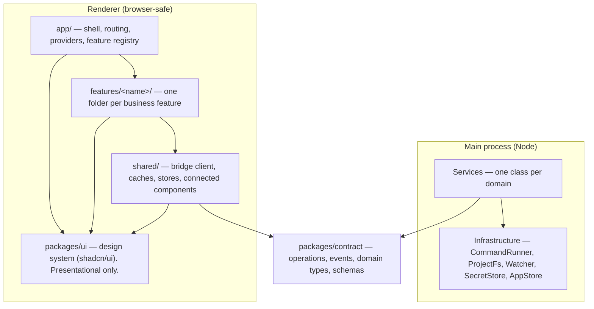

# Studio architecture: the data and feature layer

**Status:** proposed, revised after review on 23 November 2026. Approved and built in
[P1b](P1b-data-layer-and-patterns.md), followed by every later phase. After approval the
`ak-studio-architecture` skill is the maintained source and this file is the frozen design record.

Every screen in the Studio reads project files, runs commands, follows streams and waits on long jobs. If each
feature solves those problems its own way, the code drifts, and code written by a coding agent drifts
fastest. This document fixes **one way** to do each of them, so that features look the same whoever writes
them, and so that the Studio never needs a hack to get data out of Agent Kernel.

The rules are enforced by lint and tests where they can be (see "Enforcement"), and taught to coding agents
through the Studio skills ([conventions-and-skills.md](conventions-and-skills.md)).

## Layers

Arrows mean "may import".



At run time the renderer calls services only through the bridge, and infrastructure is the only thing that
touches the project's files, processes and Agent Kernel environment.

| Layer | May import | Must not import |
|---|---|---|
| `packages/ui` | React, shadcn/ui primitives, Tailwind | `contract`, `shared`, `features`, anything that fetches data |
| `packages/contract` | zod | Anything with side effects; Node or Electron APIs |
| `renderer/shared` | `contract`, `ui` | `features` |
| `renderer/features/<a>` | `shared`, `ui`, `contract` | **Any other feature**; `electron`; Node built-ins |
| `renderer/app` | Everything in the renderer | `electron`; Node built-ins |
| `desktop/services` | `contract`, `desktop/infra` | The renderer; another service's internals (services talk through injected interfaces) |
| `desktop/infra` | Node, Electron | Services; the renderer |

**Presentational and connected components.** A component with no data access lives in `packages/ui`
(`JobProgressView`, `ErrorMessage`, `VersionNotice`). Its connected wrapper, which reads a store or the
catalog, lives in `renderer/shared` (`JobProgress`, `ErrorView`, `CapabilityGate`). Features use the wrapper.

## One project per window

- A window has at most one open project. `projectId` identifies it in every operation.
- Opening a project creates a **project scope** in the main process: its watcher, its services' state, its
  jobs and sessions. Closing the project or the window disposes the scope: watchers stop, sessions stop, and
  running jobs follow the quit rule under "Jobs".
- App-level services (`AppService`, `ToolchainService`) live outside any scope.

## Where each kind of data lives

The most important rule of the Studio: **every piece of data has exactly one owner**, and the renderer never
keeps a second copy that can silently disagree with it.

| Kind of data | Examples | Owner (source of truth) | How the renderer holds it |
|---|---|---|---|
| Project state | `config.yaml`, the project graph, the file tree, rules, deploy history | Files on disk, read and derived by main-process services | **Query cache** (TanStack Query), invalidated by domain events |
| Machine state | Toolchain, Agent Kernel version, recent projects | Main-process services | Query cache |
| Streams | Command output, run log, coding-agent events, trace spans | Main-process services | **Stream store**: one bounded buffer per stream |
| Jobs and sessions | A test run, `terraform plan`; the local server, a coding-agent session | `JobService` and `SessionService` | **Job and session stores**, mirrored from events |
| UI state | Selected node, open panel, active tab, canvas zoom | The renderer | **Feature store** (Zustand), one per feature |
| Working copies | Canvas node positions while dragging; a config form being edited; an unsent chat message | The renderer, briefly | Feature store or form state, under the working-copy rule below |
| Preferences | Theme, panel sizes, density | `AppService` (the app's data folder) | Query cache; written through a command |
| Secrets | Model keys in `.env` | `SecretStore` in the main process only | Names and resolve state only |

Rules:

1. **No optimistic writes to project files.** A save shows a pending state until the main process confirms the
   file is written and re-read.
2. **A feature store holds UI state, not server data.** The one exception is a working copy.
3. **Working-copy rule.** A feature may hold an editable copy of server data only while the user is editing it.
   The copy records the version it was taken from, is written back by one command at a defined moment (drag
   end, form save), and is dropped once the write is confirmed. If the source changes underneath it, the copy
   is flagged as conflicting and the user chooses. Nothing else reads from a working copy.
4. **Every query key is built by the feature's key factory**, shaped `[domain, projectId, ...detail]`.
5. **Invalidation is by domain event, decided in the main process.** The watcher reports changed paths to the
   services. Each service decides what that means for its domain, recomputes what it derives (the graph
   service reruns introspection once, debounced, and keeps the last good graph meanwhile), and emits a domain
   event: `config.changed`, `graph.changed`, `files.changed`, `rules.changed`. The renderer maps each event to
   the query-key prefix of the same domain. The renderer never reasons about file paths.
6. **Secret values never travel from the main process to the renderer.** A value the user types travels once,
   renderer to main, in a command that is never logged or recorded. Raw process output and error detail are
   masked for known secret values before they cross the bridge.

## Writing files safely

- Every read of a file-backed resource returns a `revision` (a content hash).
- Every command that writes a file carries the `baseRevision` it was edited from.
- If the file's current revision differs, the command fails with `file.changedOnDisk` and the new content.
  The UI shows the changed-on-disk pattern and keeps the user's working copy.
- Writes are atomic (write a temporary file, then rename), keep line endings, and go through `ProjectFs`.

## The contract

`packages/contract` declares every operation once. There are four shapes, and only four:

| Shape | Use for | Renderer side | Example |
|---|---|---|---|
| `query` | Reading state; no side effects | `useQuery` via the feature's hook | `config.readSection`, `toolchain.detect` |
| `command` | One write that normally finishes in under a second | `useMutation` via the feature's hook | `config.writeSection`, `secrets.set` |
| `job` | Finite work that is slow, cancellable or has steps. It ends. | `useJob` | `project.create`, `tests.run`, `deploy.plan`, `agent.turn` |
| `session` | Something long-lived that runs until stopped. It has no result. | `useSession` | `run.server`, `agent.session`, `trace.receiver` |

Plus one-way **events** from the main process: the domain events above, `job.updated`, `session.updated`,
`stream.chunk`, `command.recorded`.

```ts
// packages/contract/src/config.ts — the shape every operation follows
export const configWriteSection = command({
  id: "config.writeSection",
  input: z.object({ projectId: ProjectId, section: z.string(), value: z.unknown(), baseRevision: Revision }),
  output: z.object({ revision: Revision }),
  errors: ["project.notOpen", "config.invalid", "file.changedOnDisk"],
  capability: undefined, // or a catalog id that must be available
});
```

- Inputs are validated with zod in the main process. Stream chunks are typed but not validated one by one.
- Every operation names the error codes it can return, so the UI can handle each one.
- An operation that needs a kernel feature names its capability id; the main process refuses it with
  `kernel.capabilityUnavailable` when the project's version lacks it.
- A command that runs past 300 ms shows a pending state automatically. A command that regularly runs past a
  second is redeclared as a job.

## Streams

- A stream belongs to a job, a session or a recorded command, and is addressed by `streamId`.
- The main process batches chunks (one message per stream per animation frame at most) and keeps a bounded
  backlog, so a burst of output cannot flood the bridge.
- The renderer's stream store keeps a bounded buffer per stream. A late subscriber first receives the backlog.
- Subscriptions are cancelled when the last view of a stream unmounts.

## Jobs

Every slow, finite thing is a job, with one model and one UI pattern.

```ts
type Job = {
  id: string;
  kind: string;                 // "project.create", "deploy.apply", ...
  title: string;                // sentence case, shown in the UI
  state: "queued" | "running" | "waiting-for-user" | "succeeded" | "failed" | "cancelled";
  progress?: { step: number; steps: number; label: string };
  request?: UserRequest;        // present while waiting-for-user
  commandIds: string[];         // the CommandRunner records behind it
  streamId?: string;
  result?: unknown;             // typed per kind in the contract
  error?: StudioError;
  cancellable: boolean;
  survivesQuit: boolean;        // see the quit rule
};

type UserRequest = {
  id: string;
  kind: "confirm" | "confirm-by-name" | "permission" | "choice";
  title: string;
  summary: string;              // what will happen
  affects: string[];            // cloud account, files, resources
  expectedName?: string;        // for confirm-by-name
  options?: { id: string; label: string; destructive?: boolean }[];
};
```

- **Answering.** `job.respond({ jobId, requestId, answer })` is the only way to answer. `waiting-for-user`
  covers a Terraform plan to confirm, a coding-agent permission request and a paused human-in-the-loop tool
  call; they all render with the approval pattern. A job has one open request at a time.
- **Serialising.** Jobs of the same kind on the same project do not overlap.
- **Reload.** `JobService` lives in the main process. A reloaded window calls `jobs.list` and reattaches to
  running jobs and their streams.
- **Quit rule.** On quit or project close with running jobs, the app asks. Jobs marked `survivesQuit: false`
  are cancelled and their process trees killed. Jobs marked `survivesQuit: true` (`terraform apply` and
  `destroy`, where killing the process risks the state file) block the quit until they finish, with an
  explicit, warned override.
- **Crash recovery.** Each job writes a small record in the app's data folder when it starts and when it
  ends. A record with no end is shown on the next launch as "interrupted", with the command that was running
  and what to check.

## Sessions

```ts
type Session = {
  id: string;
  kind: string;                 // "run.server", "agent.session"
  state: "starting" | "running" | "stopping" | "stopped" | "failed";
  info?: unknown;               // typed per kind: port, URL, model
  streamId?: string;
  commandIds: string[];
  error?: StudioError;
};
```

- Started with `session.start`, stopped with `session.stop`, one per kind per project.
- A session can spawn jobs (an agent turn inside an agent session; a chat exchange against the local server).
- All sessions stop when the project scope is disposed.

## Errors

```ts
type StudioError = {
  code: string;            // from the error catalog, e.g. "toolchain.missing", "config.invalid"
  message: string;         // sentence case, says what happened
  detail?: string;         // raw output, masked, collapsed by default
  file?: string; line?: number;
  action?: { label: string; commandId: string; args?: unknown }; // an app command the user can run next
};
```

- Codes live in one catalog in `packages/contract`. A code with no presentation fails a test.
- `ErrorView` renders any error inline, in a banner or in a toast, by the placement rules in
  [conventions-and-skills.md](conventions-and-skills.md).
- Thrown exceptions never cross the bridge; the service boundary converts them.

## Agent Kernel versions in the code

- `useCapability(id)` returns `available`, `needs-upgrade` or `removed` from the P2 catalog.
- `<CapabilityGate id="...">` wraps any control or section that needs a capability and renders the
  version-unavailable pattern when it is missing. No feature writes its own version check.
- Each feature's manifest lists the capabilities it uses, so a test can confirm every one exists.

## Features

A feature is one business slice: Welcome, Canvas, Code, Config, Commands, Run, Tests, Deploy, Build with AI,
Rules, Settings. Every feature has the same folder:

```
features/config/
  manifest.ts       id, tab or route, app commands, shortcuts, capabilities. The only file app/ imports.
  api/              query keys and hooks over the contract (useConfigSection, useWriteConfigSection)
  model/            the feature store (UI state and working copies) and selectors
  components/       components used only by this feature
  screens/          the screens the router mounts
  *.stories.tsx     beside each component and screen, with fixture data
  *.test.ts(x)      beside what they test
```

- **The manifest is how a feature joins the app.** The app registry reads every manifest to build the tabs,
  routes, command palette, menu and shortcuts. Adding a feature never edits the shell.
- **Features never import each other.** Cross-feature actions go through **app commands**: a feature declares
  commands in its manifest (`code.revealFile`, `ai.fixProblem`, `canvas.selectNode`), each with a typed
  argument, and any feature runs one with `runCommand(id, args)`. The same commands feed the palette, menus,
  shortcuts and error actions. Shared data goes through the query cache.
- **A generator creates the folder** (`pnpm new:feature <name>`), so the skeleton is never hand-written.

## Forms

- Config forms are generated from the installed version's JSON schema by one `SchemaForm`, with React Hook
  Form holding the working copy.
- Field-level checks (required, type, enum, range) run in the renderer from the same JSON schema, for
  immediate feedback.
- **The kernel is the authority.** Before a save, the main process validates the whole section with the
  installed Agent Kernel. A value the renderer accepted and the kernel rejects is shown as a `config.invalid`
  error on its field.

## Main-process services

- One class per domain: `ProjectService`, `ToolchainService`, `KernelService`, `GraphService`,
  `ConfigService`, `RunService`, `TestService`, `DeployService`, `AgentService`, `RulesService`,
  `SecretService`, `JobService`, `SessionService`, `AppService`.
- Dependencies are passed to the constructor (`CommandRunner`, `ProjectFs`, `Watcher`, `SecretStore`), so
  services are tested with fakes and no real process.
- A service registers its handlers against the contract; the registry fails start-up if any operation has no
  handler.
- Only `CommandRunner` starts processes. Only `ProjectFs` touches the working directory, and it refuses paths
  outside it. Only `SecretStore` reads `.env` values.

## What the Studio writes into a project

Code the Studio generates must look exactly like code a person would write with Agent Kernel, so a project
never shows it was made by the Studio.

1. **One source for templates.** The bundled skills (`ak-init`, `ak-cloud-deploy`) are prose instructions with
   code snippets, not generators, so there is nothing to compare output against mechanically. The Studio's
   templates are therefore checked two ways: each template's output is stored as a **reference project** in
   `ak-studio/fixtures/templates/`, reviewed by a person against the skill's snippets when it is added or
   changed; and a test regenerates every reference and fails on any difference. Longer term, the snippets
   move into template files inside `ak-py` that both the skill and the Studio read (an open decision).
2. **No Studio markers in code.** No generated-code banners, region comments or IDs in `app.py`, `tool.py` or
   `config.yaml`. Anything the Studio needs to remember goes in `.akstudio/`.
3. **Minimal diffs.** Writing a config section changes only that section and keeps comments and key order.
   Writing Python only adds or replaces whole template blocks.
4. **Formatted, but only what was written.** The project's formatter, if it has one, is applied to the
   generated block only. The Studio never reformats code it did not write.
5. **The project passes its own checks** (tests, lint, `ak` validation) after every Studio write; a template
   whose output fails them is a bug.

## Get data from the kernel, not around it

When the Studio needs information Agent Kernel already has, the kernel should **expose it**, not have the
Studio parse or guess it. Proposed additions to `ak-py`, each specified through the repository's normal
`design.md`, `spec.md`, `plan.md` process:

| Addition | Gives | Replaces in the Studio | Needed by |
|---|---|---|---|
| `ak inspect --json` | Agents, framework, tools, handoffs, hooks and registered surfaces of the project | The Studio-owned introspection helper | P3 |
| `ak config schema --json` | `AKConfig` JSON schema of the installed version | Calling `model_json_schema()` from a Studio script | P3 |
| **Secret fields marked in `AKConfig`** | A machine-readable mark on every field that holds a secret | A hand-kept list of secret field names | P3 |
| `ak config resolve --json` | The resolved configuration with secret values replaced by key names | Merging YAML and `AK_*` variables in the Studio | P3; depends on the row above |
| `ak features --json` | The capabilities this version has | Part of the Studio-side catalog, for new versions | After P3 |
| `ak rules check` | Rule check results | (already planned) | P7 |

- **Secrets today.** `AKConfig` holds tokens as plain `str` fields (for example `slack.bot_token` in
  `ak-py/src/agentkernel/core/config.py`); nothing marks them as secret. Until the kernel marks them, the
  Studio keeps its own list of secret field paths, has a test that fails when a new field's name or
  description looks like a secret and is not listed, and treats any unknown string under a listed section as
  hidden by default.
- Output formats carry a `schemaVersion` and are documented, so other tools can use them too.
- The Studio uses a kernel command when the project's version has it (a catalog entry), and its own helper as
  the fallback for older versions. The fallback shrinks as old versions fall below the supported floor.
- This is how the framework improves alongside the Studio: every hack the Studio would need becomes a small,
  documented kernel feature instead.

## Enforcement

| Rule | Enforced by |
|---|---|
| Layer boundaries; no feature imports another feature | dependency-cruiser rules in CI |
| No `electron` or Node import in the renderer or `ui` | dependency-cruiser, plus Biome's restricted-imports rule |
| Only design-system colours | Tailwind's default palette is removed in `@theme`, so a class like `text-blue-500` does not exist and fails the build |
| No arbitrary values (`p-[13px]`) or inline colour styles | A small custom check over class names (a Biome plugin or a script), written in P1b |
| Every operation has a handler | Registry check at start-up and a contract test |
| Every error code has a presentation | Contract test |
| Every capability and app command a manifest names exists | Unit test |
| Templates reproduce their reference projects | Regeneration test |
| Every secret-looking config field is in the secret list | Unit test against the in-tree `AKConfig` |
| Every component and screen has stories for its required states | A script that reads the story index, written in P1b |
| Accessibility | axe on every story; a scripted keyboard test for the canvas and other composite widgets |
