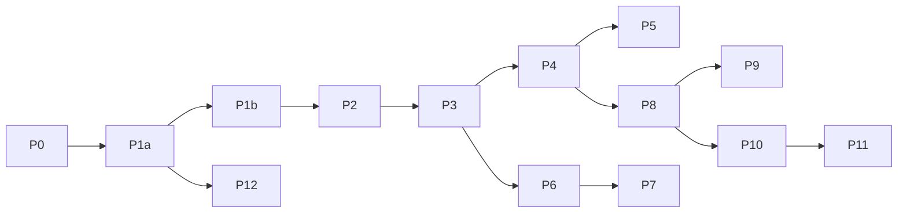

# P4 to P12 · Outlines

These phases are outlined, not detailed. Each gets its own detailed doc (same layout as
[P2](P2-project-and-kernel-version.md) and [P3](P3-read-only-builder.md)) when the phase before it is close to
done, so the detail is written against what was actually built. Every phase with screens passes the
[design gate](design-process.md) first.

Existing design input for each phase is the matching brief on `feature/950-agent-kernel-studio-phase-1`. It is
unapproved and is used as a starting sketch.

Every phase is built as feature slices on the [architecture](architecture.md), follows the ground rules and
pattern catalogue in [conventions-and-skills.md](conventions-and-skills.md), and adds to the pattern catalogue
and skills when it introduces something new. Its detailed doc names the features, services, operations and
jobs it adds.

## Order

The issue orders "create and edit" before "coding agent". The plan on the feature branch puts the coding agent
first, arguing that it is what sets the app apart. This plan follows the issue. P6 depends only on P3, so it
can be pulled ahead of P4 and P5 without rework if priorities change.

---

## P4 · Create and configure a project

| | |
|---|---|
| Business aspect | Starting a project and changing its configuration without hand-editing YAML |
| Issue milestone | 2 (Create and edit), first half |
| Depends on | P3 |
| Screens | New project wizard; Config tab in edit mode; Settings (toolchain, secrets, general) |
| Design input | Briefs 03, 04 (Config), 09 |

**Outcome.** From an empty folder, a person picks an Agent Kernel version, a framework, a model provider and a
template, and gets a project that opens on the canvas. They edit any `config.yaml` section as a form and add
secret names.

**Work, in outline**

- New project wizard: folder, **Agent Kernel version** (latest by default, older ones selectable), framework,
  model provider, template; then `uv` environment creation and `ak skill install --assistant claude`, all
  through the command runner.
- Scaffold templates, selected by version range from the catalog. Decide whether templates are Studio-owned or
  reuse what the bundled `ak-init` skill describes.
- Config editing: write `config.yaml` keeping comments and key order. Validate with the installed version
  before saving.
- Secrets: read and write `.env` in the main process only; the renderer sees key names and whether each
  resolves.
- Settings: toolchain, secrets, general preferences, usage data (off by default).

**Design questions.** How many wizard steps. What the wizard shows while the environment is created (it can
take minutes). How the version choice explains what a newer version adds. How a form shows an invalid value
before save.

**Skill.** `ak-studio-scaffold-template`. The bundled `ak-init` skill is prose, not a generator, so each
template has a reviewed reference project and a test that regenerates it (see "What the Studio writes into
a project" in [architecture.md](architecture.md)). Decide before this phase whether the templates move into
`ak-py` as files that both the skill and the Studio read.

**Config writes** carry the base revision and fail with `file.changedOnDisk` on a conflict; secret values
travel renderer to main only, in a command that is never recorded.

**Key risk.** Round-trip YAML editing that keeps comments. Pick and test the library in this phase's first
task.

---

## P5 · Build on the canvas

| | |
|---|---|
| Business aspect | Building the agent system visually |
| Issue milestone | 2 (Create and edit), second half |
| Depends on | P4 |
| Screens | Canvas in edit mode: palette, drag and drop, editable inspector, context menu |
| Design input | Brief 04 |

**Outcome.** A person adds agents, tools, handoffs, channels, guardrails and stores on the canvas, and the
project files change accordingly.

**Work, in outline**

- Palette, gated by the catalog and by installed frameworks.
- Config-backed nodes (channels, protocols, stores, guardrails, sandbox, tracing, execution mode) write
  `config.yaml` deterministically, reusing P4's writer.
- Python-backed nodes (agent, tool, handoff, hook) are written only through scaffold templates. No
  general-purpose Python rewriting. Anything a template cannot express is handed to the coding agent (P6) or
  to the user's editor.
- A "writing `app.py`" state on the node, and the write shown in the Commands panel.

**Patterns first used here.** Undo and redo (an undo is a new write), and working copies for edits in
progress.

**Design questions.** What happens when a canvas edit cannot be expressed by a template. How an edit
made here and an edit made on disk at the same moment are reconciled.

**Key risk.** This is the issue's named hardest part: correct Python across eight frameworks. Start with one
framework end to end, then add the rest one at a time. The phase can ship with a subset of frameworks editable
and the others read-only.

---

## P6 · Build with AI

| | |
|---|---|
| Business aspect | Asking a coding agent to make changes, and staying in control of them |
| Issue milestone | 3 (Coding agent), first half |
| Depends on | P3 (can run before P4 and P5) |
| Screens | Build with AI drawer: Chat and Code views, approval cards, pending changes |
| Design input | Brief 05 |

**Outcome.** A person who has Claude Code installed and signed in asks Claude, running locally in the
folder, for a change; approves its permission
requests as cards; sees what changed on the canvas and in a diff; accepts or reverts each turn.

**Work, in outline**

- One agent-neutral coding-agent interface: start a session, send a prompt, stream events, relay permission
  requests, report changed files. The Claude Agent SDK, driving the user's own Claude Code, is its only
  adapter ([architecture](architecture.md#the-coding-agent-and-the-users-claude-code), decided in P0 as D14).
- Checkpoint before each turn: git when the folder is a repository, the app's own snapshot otherwise. Accept
  and revert belong to the app, not to the adapter.
- The agent's commands appear in the Commands panel, marked as the agent's.
- The agent never applies or destroys Terraform.
- The Studio uses the Claude Code already installed and signed in on the user's machine (owner's decision,
  24 November 2026). On our reading of Anthropic's rules, awaiting the owner's confirmation, it never
  stores, reads or asks for a credential, and shows no login of its own.
- A status view: not installed, not signed in, or ready, with the version and which credential Claude Code
  is using. When not signed in, it tells the user to sign in from a terminal.
- The opened folder's agent hooks and permission rules are listed and confirmed before they are loaded.
- Run the second half of spike S5 if P0 did not: the SDK against the user's installation, status detection
  and a live turn.

**Skill.** `ak-studio-coding-agent-adapter`. The coding agent is a session; an agent turn is a job; each permission request puts it in
`waiting-for-user` and renders with the approval pattern.

**Design questions.** Drawer docking with the layout fixed in P3. How a long agent turn shows progress. How a
partly accepted turn looks. What the drawer shows when Claude Code is missing or not signed in. The wording:
the feature is "Claude Agent"; "Claude Code" names only the user's installed program.

**Open before starting.** Agreement to Anthropic's Commercial Terms, and Anthropic's confirmation that a third-party app may drive the user's signed-in
Claude Code (its pages do not say so; see the architecture). Whether an API key is offered later as a second
route for users without a subscription. The lowest Claude Code version supported.

---

## P7 · Business rules

| | |
|---|---|
| Business aspect | Linking plain-language rules to the code, config and tests that enforce them |
| Issue milestone | 3 (Coding agent), second half |
| Depends on | P6 |
| Screens | Rules view in the drawer; agentic development workspace |
| Design input | Brief 06 |

**Outcome.** A person writes a rule in plain language; the coding agent implements and links it; the app shows
whether each rule is enforced, untested, drafted or out of sync.

**Work, in outline**

- The rule file format in `.akstudio/`: documented and versioned.
- `ak rules check`, a **new** `ak` subcommand in `ak-py` (today the CLI has only `ak skill`,
  `ak-py/src/agentkernel/cli/ak.py`). It is core package work, so it follows the repository's own
  `design.md`, `spec.md`, `plan.md` process and ships in an Agent Kernel release. The catalog records the
  version that adds it; on older versions the Studio runs the same checks itself.
- Rule states recomputed when a linked file changes.
- "Generate tests" and "Fix with AI" through the P6 interface.

**Design questions.** The rule states' order of severity. How a rule's links are shown and followed. The
workspace layout next to the canvas.

**Open details carried from the brief.** The rule file format. Which line-range changes count as out of sync.

---

## P8 · Run, chat and trace

| | |
|---|---|
| Business aspect | Trying the project locally and seeing what it did |
| Issue milestone | 4 (Run and test), first half |
| Depends on | P4 |
| Screens | Run control in the top bar; Test & Trace tab: chat, trace; Run log |
| Design input | Brief 07 |

**Outcome.** A person starts the project locally, chats with it, approves a paused tool call, and reads the
trace of the run with timing, tokens and estimated cost.

**Work, in outline**

- The local server is a **session**, not a job; a chat exchange and an environment sync are jobs.
- Run service: environment sync, start and stop the local server, stream its log, free the port on exit.
- Chat over the same REST and streaming interface a deployed project exposes.
- Live view from stream events; span detail from a local OpenTelemetry receiver, switched on for the run
  through environment variables without editing `config.yaml`.
- Human-in-the-loop approvals in the chat.

**Version awareness.** Stream event types, tracing options and human-in-the-loop support differ by version and
by framework; the catalog gates them.

**Design questions.** Chat and trace side by side or stacked. What the trace shows for a framework with no
span detail. Where the cost estimate's price table comes from.

---

## P9 · Tests, scenarios and CI

| | |
|---|---|
| Business aspect | Proving the project works, and keeping it proven |
| Issue milestone | 4 (Run and test), second half |
| Depends on | P8 |
| Screens | Test & Trace tab: test results, run history and comparison, scenarios, simulated user |
| Design input | Brief 07 |

**Outcome.** A person runs the test file, reads why a case failed, compares two runs, saves a chat as a test
case, runs a simulated user, and adds a CI workflow file.

**Work, in outline**

- `uv run pytest` through the command runner; results with judge score and reason.
- Run history in `.akstudio/runs/` (ignored by git); comparison of two runs.
- Saved scenarios and simulated-user scenarios in `.akstudio/`.
- "Add CI workflow" writes the file only.

---

## P10 · Deploy to one target

| | |
|---|---|
| Business aspect | Shipping the project to the cloud from this computer, safely |
| Issue milestone | 5 (Deploy) |
| Depends on | P8 |
| Screens | Deploy tab: target, prerequisites, variables, state backend, plan, confirm, apply, outputs, destroy |
| Design input | Brief 08 |

**Outcome.** A person deploys to one cloud target, calls the endpoint, and destroys the deployment.

**Work, in outline**

- `deploy.apply` and `deploy.destroy` are jobs marked to survive quit: the app will not kill Terraform
  mid-apply, and an interrupted run is reported on the next launch.
- Deploy service: generate `deploy/`, package, `terraform init`, `plan`, `apply`, `output`, `destroy`, called
  directly with argument lists.
- Variables form rendered from `deploy/variables.tf`.
- Plan parsed into counts and a grouped resource list.
- Confirmation that names the cloud account. Secrets passed at run time, never written to
  `terraform.tfvars`.
- "Configuration fits the target" checks before anything is applied.
- State backend choice; deploy history in `.akstudio/`.

**Version awareness.** The target list and the Terraform module version come from the project's Agent Kernel
version. The first target is chosen at the start of this phase; AWS containerized is the brief's fixture.

**Design questions.** The confirmation step is the most safety-critical screen in the app; it gets its own
options exploration.

---

## P11 · The remaining targets

| | |
|---|---|
| Business aspect | Any cloud |
| Issue milestone | 6 (More targets) |
| Depends on | P10 |
| Screens | No new screens; per-target prerequisites and variables |

**Outcome.** Every Terraform target the project's Agent Kernel version supports can be deployed and destroyed.

**Note.** The issue says six targets. Azure Functions is being retired
(`docs/specs/957-retire-azure-functions/design.md`), so the count depends on the version. The catalog decides
what is offered.

---

## P12 · Packaging and release

| | |
|---|---|
| Business aspect | Getting the app onto people's computers |
| Issue milestone | 7 (Packaging) |
| Depends on | P1a for the build pipeline; runs last for signing and release |
| Screens | About, update notice |

**Outcome.** Signed installers for Windows, macOS and Linux, built in CI, with the acceptance run from the
issue passed on each.

**Work, in outline**

- Code signing and notarisation; installer formats per platform.
- Auto-update, or a manual "update available" notice. Decide in this phase.
- The release process and how Studio versions relate to Agent Kernel versions.
- The full acceptance run from the issue on all three platforms.

**Note.** A local, unsigned build works from P1a onward (`ak-studio/` builds and runs on a developer's
computer). P12 is about distribution only.
